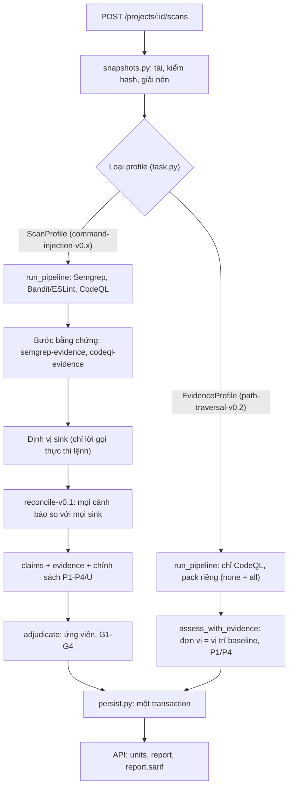
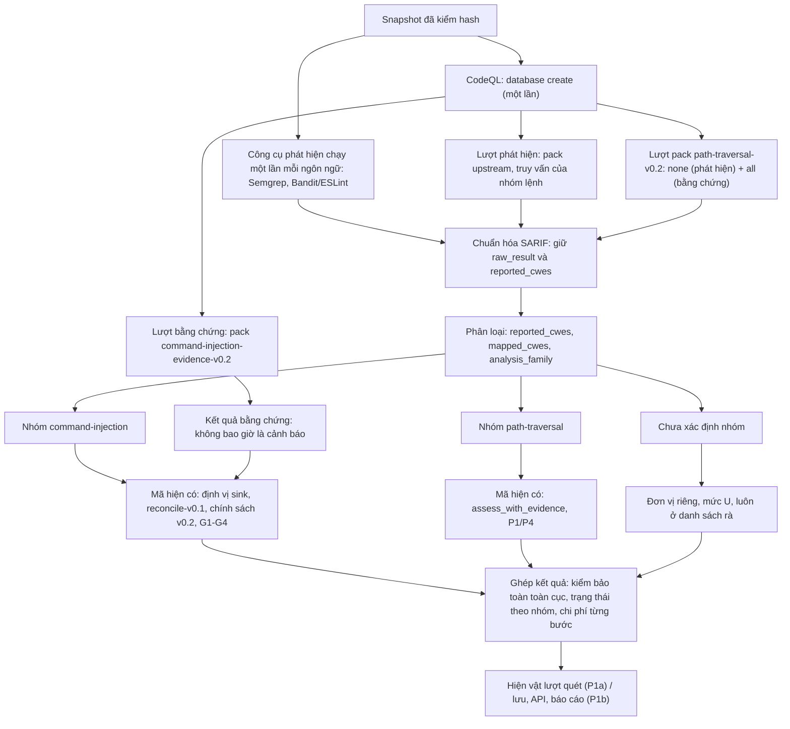

# Kiến trúc đa CWE — thiết kế P0 và kế hoạch P1

Tài liệu thiết kế, viết ngày 2026-11-15 trên nhánh `feat/cwe22-triage`. Đây là **kế hoạch**, chưa có
dòng mã ứng dụng nào được sửa. Trạng thái ứng dụng như đã cài đặt vẫn nằm ở
[architecture.md](../architecture.md); trạng thái nghiên cứu ở [research.md](../research.md).

- **Mục tiêu dài hạn:** một kiến trúc phân tích tĩnh đa CWE (CWE-22, 78, 89, 79, 918) cho Python và
  JavaScript/TypeScript, thay cho hai đường xử lý chuyên biệt hiện nay.
- **Phạm vi của tài liệu này (P0):** truy vết hiện trạng, chọn kiến trúc, đặc tả các bất biến và chia
  P1 thành đầu việc. Không sửa backend/frontend, không quét dữ liệu mới, không thêm CWE, không sửa
  hiện vật nghiên cứu đã khóa.
- **Bản này là bản đã chỉnh** sau khi chủ đề án rà bản kế hoạch đầu; các điểm thay đổi và lý do nằm ở
  [mục 7](#7-quyết-định-và-lý-do).
- **Cập nhật cùng ngày:** P1a đã được triển khai trên nhánh `feat/multi-cwe-core`; mã, kiểm thử và
  kết quả lượt quét thật nằm ở [mục 16](#16-trạng-thái-p1a-2026-11-15). P1b (tích hợp vào ứng dụng
  web) nằm ở [mục 17](#17-trạng-thái-p1b-2026-11-15). Các mục 1–15 giữ nguyên là bản thiết kế; chỗ
  nào thực tế khác kế hoạch thì được ghi ngay tại chỗ và ở mục 16, 17. Lần rà nghiệm thu kỹ thuật
  P1 nằm ở [mục 18](#18-nghiệm-thu-kỹ-thuật-p1-2026-11-15); thẩm định và thiết kế tối thiểu cho
  CWE-89 ở [mục 19](#19-p2--thẩm-định-và-thiết-kế-tối-thiểu-cho-cwe-89-2026-11-15); P2a (profile
  `multi-cwe-v0.2`, CWE-89 chỉ phát hiện và giữ) ở [mục 20](#20-trạng-thái-p2a-2026-11-15); P2b
  (profile `multi-cwe-v0.3`, CWE-89 bằng Semgrep, Bandit và CodeQL, có số đo trên dữ liệu phát triển
  có nhãn) ở [mục 21](#21-trạng-thái-p2b-2026-11-16).

## 1. Kết luận ngắn

1. Kiến trúc được chọn là **lượt quét ghép**: một snapshot, một cơ sở dữ liệu CodeQL cho mỗi ngôn
   ngữ, nhiều **nhóm phân tích** (analysis family). Mỗi cảnh báo được định tuyến tới đúng một nhóm
   hoặc ở trạng thái "chưa xác định nhóm"; mỗi nhóm được xử lý bằng **chính mã và profile đã ghim
   hiện có** của nó.
2. Thứ phải trừu tượng hóa ngay rất ít: mô hình phân loại ba trường, khả năng chạy nhiều lượt
   phân tích CodeQL trên một database, và một lớp ghép kết quả theo nhóm. Mọi thứ khác (bộ gộp,
   bằng chứng, chính sách, bước gạn, đường CWE-22) **giữ nguyên**.
3. Chống gộp nhầm CWE bằng **định tuyến trước khi gộp**, không bằng cách đổi khóa đơn vị. Vì vậy
   `unit_id` của các profile cũ không đổi.
4. Không có quy tắc gạn chung cho mọi CWE. Nhóm mới mặc định **chỉ phát hiện và giữ cảnh báo**.
5. P1 chia hai chặng: **P1a** chỉ thêm mã mới và chứng minh bằng một lượt quét ghép thật trên dữ liệu
   phát triển; **P1b** (profile schema, lưu trữ, API, giao diện, hiệu năng) chỉ mở khi P1a đạt.

## 2. Trạng thái Git khi viết (đã kiểm tra, không thay đổi gì)

| Mục | Kết quả |
|---|---|
| Nhánh, HEAD | `feat/cwe22-triage`, `837c53d700dae0ab0686598c49ad444f61b10c76` |
| Nhánh trên origin (`git ls-remote`, đọc trực tiếp từ remote) | `feat/cwe22-triage` ở `ac014a2` |
| Chênh lệch | Local đi trước **1 commit**, origin không có commit nào local thiếu (`ac014a2` là tổ tiên của HEAD) |
| Commit chưa push | `837c53d docs: align the conclusion and chapter 3 wording with the measured results` (2 file dưới `docs/thesis/`) |
| Working tree | Sạch, trừ PDF đề cương chưa theo dõi (không được stage) |
| Khác | Không có nhánh `main` cục bộ (`origin/main` ở `b35413d`); có một worktree khác ở `.kilo/worktrees/cloud-argon` (HEAD tách rời `9299543`) — không đụng tới |

Hệ quả: mọi tham chiếu "HEAD `837c53d`" trong tài liệu này là **commit chỉ có ở máy cục bộ**. Việc
push là quyết định của chủ đề án; không reset, không ghi đè.

## 3. Hiện trạng đã truy vết

Truy vết trên mã nguồn, không theo README. Đường dẫn tương đối tính từ `backend/app/` trừ khi ghi khác.

### 3.1 Luồng hiện tại

### 3.2 Từng bước và file

| Bước | File và hàm | Phụ thuộc CWE |
|---|---|---|
| Thu nhận nguồn | `workflows/scans/snapshots.py`, `scanners/sources.py`, `scanners/acquisition.py` | Không. Ngôn ngữ theo `SOURCE_EXTENSIONS` (python; javascript gồm cả TS) |
| Chạy công cụ | `scanners/pipeline.py::run_pipeline`; `semgrep.py`, `codeql.py`, `bandit.py`, `eslint.py` | Không: rule và truy vấn đến từ profile. Giới hạn cấu trúc: một pack CodeQL chính (`query_pack_for_language`), **một** bước `codeql-evidence`, **một** file luật `semgrep-evidence` |
| Chuẩn hóa SARIF | `scanners/sarif.py::sarif_findings` | Không. Giữ nguyên `raw_result`; `reported_cwes` lấy bằng regex từ metadata rule |
| Định vị sink | `triage/sinks_python.py`, `triage/sinks_javascript.py`, `scanners/semgrep.py::run_sink_locator`, `experiments/locators/sink-locator-v{0,1}-javascript.yaml` | Chỉ CWE-78 |
| Đối chiếu | `triage/reconcile.py::reconcile_findings` | Lẫn lộn (mục 3.3, 3.5) |
| Phân loại rule | `triage/claims.py::classify_claims`, `triage/assess.py::verified_definitions` | Cơ chế chung, có hai chỗ viết cứng |
| Bằng chứng theo đơn vị | `triage/evidence.py::EvidenceIndex` | Lẫn lộn |
| Chính sách ưu tiên | `triage/policy.py` | Bộ máy chung, bộ vị từ cố định |
| Gạn | `triage/adjudicate.py::adjudicate` | Lẫn lộn |
| Đường CWE-22 | `triage/safety_evidence.py::assess_with_evidence`, `workflows/scans/analysis.py::scan_language_evidence`, `scanners/profile.py::load_evidence_profile` | Riêng CWE-22 |
| Điều phối | `workflows/scans/analysis.py::scan_language`, `workflows/scans/task.py::scan_snapshot` | Rẽ nhánh `isinstance(profile, EvidenceProfile)` |
| Lưu | `workflows/scans/persist.py`, `features/triage/models.py`, `features/findings/models.py` | Chung, có ràng buộc mang từ vựng CWE-78 |
| Báo cáo, API | `workflows/scans/report.py`, `service.py`, `schemas.py` | Chung, không có chiều CWE |
| CLI nghiên cứu | `experiments/run_pilot.py` | Dùng chung `app.scanners` và `app.triage`; gắn với chính sách v0.1 |

### 3.3 Thành phần viết cứng cho CWE-78

| File | Ký hiệu | Nội dung |
|---|---|---|
| `triage/assess.py` | `_CODEQL_RULES`, `codeql_rule_id` | Chỉ biết hai truy vấn `Security/CWE-078/*.ql`; truy vấn khác ném `ValueError` |
| `triage/claims.py` | `classify_claims` | `candidate_status: "cwe78_candidate"` |
| `triage/reconcile.py` | `SHELL_COMMAND_KINDS`, `_JS_PROCESS_KINDS`, `shell_state`, `argument_role`, `_related_shell_location` | Vai trò đối số `shell_command` / `executable` / `argument_list`; liên kết `[shell command](n)` trong thông điệp CodeQL. `argument_role` nằm trong khóa đơn vị |
| `triage/evidence.py` | `_argument_span`, `_literal_proof`, `_safe_command`, `_INTERPRETERS`, `_SUBPROCESS`, `_JS_SPAWN`; trong `_trace` và `EvidenceIndex.build` | Điểm cuối hợp lệ của vết luồng là vai trò lệnh; chứng minh "toàn bộ lệnh là hằng"; vị từ `shell_semantics`; các trường `shell_state`, `command_literal` |
| `triage/policy.py` | `PREDICATES`, `apply_policy` | Đúng mười vị từ, kiểm "exactly ten" |
| `triage/adjudicate.py` | `_BANDIT_LITERAL_TESTS`, `_SHELL_STRING_SINKS`, `_literal_rule` (G2), `_constant_rule` (G4), `_REASONS`; chữ ký `adjudicate` | G2 và G4 là ngữ nghĩa lệnh; ba tham số bằng chứng cố định (`codeql_evidence`, `semgrep_evidence`, `constant_evidence`) |
| `triage/sinks_python.py` | `_SUPPORTED_MODULES`, `_canonical_supported` | `os`, `subprocess`, `asyncio`, `pty` |
| `triage/sinks_javascript.py` | `_CHILD_METHODS`, `_direct_child_aliases`, `_canonical_kind` | `child_process`, `shelljs` |
| `workflows/scans/analysis.py` | `_locate_sinks`, `_codeql_evidence`, `_semgrep_evidence`, `_constant_evidence` | Một khối `adjudication` cho mỗi ngôn ngữ |
| `features/triage/models.py` | `ck_location_unit_argument_role` | CHECK chỉ cho ba vai trò lệnh |
| `workflows/scans/schemas.py` | `ScanCreate.profile`, `UnitDetail.shell_state`, `UnitDetail.blocker_proof` | Danh sách profile là `Literal`; trường chi tiết mang ngữ nghĩa lệnh |
| `frontend/src/features/scans/` | `api/create-scan.ts`, `components/units-table.tsx`, `components/unit-detail-sheet.tsx` | Nhãn profile; cột `argument_role`; khối `shell_state`, `blocker_proof` |
| `experiments/run_pilot.py` | `LOCATOR_RULE`, `POLICY_FILE`, `CLAIMS_FILE` | Gắn với locator v0, chính sách v0.1, rule-claims-v2; chỉ nhận Semgrep và CodeQL |

### 3.4 Thành phần riêng của CWE-22

- `scanners/profile.py`: `EvidenceProfile`, `load_evidence_profile` (bắt buộc `scanners == ["codeql"]`,
  không có luật Semgrep, mọi truy vấn nằm trong pack của profile).
- `workflows/scans/analysis.py::scan_language_evidence`: dùng pack của profile làm pack chính, chỉ đánh
  giá khi lượt quét `completed`.
- `triage/safety_evidence.py::assess_with_evidence`: mỗi vị trí cảnh báo của truy vấn baseline
  (`st/cwe-22/none`) là một đơn vị; khóa đơn vị gồm `baseline_rule`; còn bị truy vấn bằng chứng
  (`st/cwe-22/all`) báo thì P1, không còn thì P4 và `filtered`; rule lạ hoặc cảnh báo bằng chứng nằm
  ngoài baseline ném `ValueError`. Không có bộ định vị sink, không rule-claims, không file chính sách.
- Khác với CWE-78: kết quả của truy vấn bằng chứng **được lưu như cảnh báo** và gắn vào đơn vị;
  ở CWE-78 kết quả bước bằng chứng không bao giờ là cảnh báo.
- Pack [rules/codeql/path-traversal-v0.2/](../../rules/codeql/path-traversal-v0.2/README.md), trùng
  từng byte với bản nghiên cứu đã đóng băng.

### 3.5 Thành phần tái sử dụng được nguyên trạng

- Toàn bộ thu nhận nguồn; `run_pipeline` (chạy song song, lỗi độc lập từng công cụ, trạng thái
  `completed/partial/failed`); `process.invoke`; `provenance`; kiểm hash profile (`_verified`, `_pinned`).
- `sarif_findings`; `assert_finding_conservation`; cơ chế phân loại rule theo hash định nghĩa.
- Kỹ thuật **thu thập và đối chiếu bằng chứng**: `codeql.py::run_codeql_evidence` (chạy truy vấn đã
  ghim trên chính database của lượt quét, có `--rerun`), `adjudicate.py::codeql_evidence_index`,
  `semgrep_evidence_index`, `_trace_lines`.
- Bộ máy chính sách (`matches`, `validate_policy`, `apply_policy`), cách nhóm ứng viên, bộ mã lý do giữ.
- `persist.py`, `report.py`, xuất SARIF hợp nhất.
- Thư viện `SafetyEvidence.qll` của nghiên cứu đã được tham số hóa theo CWE cho Python
  (`experiments/owasp-bp-pilot/ql_v02/gen.py` sinh truy vấn cho 22, 78, 79, 643). Đây là hiện vật đã
  khóa; chỉ là điểm xuất phát cho các nhóm sau này, không dùng trong P1.

### 3.6 Quan sát phụ khi truy vết

Ghi lại để không bị quên; **không** sửa trong P1a.

1. `reported_cwes` không được chuẩn hóa: cùng một CWE có thể xuất hiện là `cwe-78`, `cwe-078` hay
   `CWE-78` tùy công cụ (`backend/tests/scanners/test_sarif.py` khẳng định dạng `cwe-78`). Hiện không
   quyết định nào dùng trường này; nó chỉ được lưu vào `findings.cwe_ids`.
2. `workflows/scans/results.py::LOCATOR_VERSION = "sink-locator-v0"` là giá trị mặc định mà
   `scan_language` không ghi đè, nên lượt quét bằng `command-injection-v0.3` (dùng locator v1) vẫn lưu
   `locator_version = "sink-locator-v0"`.
3. `workflows/scans/task.py::SCANNER_STEPS = 5` đếm Semgrep, Bandit/ESLint, CodeQL create, CodeQL
   analyze và sink locator; hai bước `semgrep-evidence` và `codeql-evidence` không nằm trong ngân sách
   thời gian của Celery.
4. Hai gói bằng chứng CodeQL hiện có khai **cùng tên pack** `security-triage/python-safety-evidence`
   (cùng hash `qlpack.yml`), nên không được giả định là có thể đưa chung vào một lệnh `analyze`.

### 3.7 Ràng buộc khóa đã xác minh

- Bốn manifest `profiles/*/profile.json` và mọi file chúng ghim là tài liệu khóa.
- Các `PREREGISTRATION.json` của `experiments/evaluation/independent*` ghim hash của
  `triage/reconcile.py`, `triage/adjudicate.py`, `scanners/acquisition.py` và
  `workflows/scans/analysis.py`. `FROZEN_CONFIGURATION*.json` của `pairs-v1` ghim thêm toàn bộ
  `triage/*.py` và `scanners/semgrep.py`.
- `experiments/tests/test_evaluation.py::_assert_registered` đọc từng file theo đường dẫn: file phải
  còn ở chỗ cũ, và nếu byte khác thì phải có bản ghi trong
  [PIPELINE_CHANGES.json](../../experiments/evaluation/PIPELINE_CHANGES.json). Hiện có hai bản ghi
  (`adjudicate.py`, `analysis.py`).
- `experiments/run_pilot.py::runner_files_sha256` và `pairs-v1/freeze.py` liệt kê `triage/*.py` bằng
  glob không đệ quy: file mới trong `app/triage/` sẽ làm đổi tập file mà các bản ghi đó mô tả.
- Không file nào trong `scanners/codeql.py`, `scanners/pipeline.py`, `scanners/sarif.py`,
  `scanners/profile.py` bị ghim bởi một bản đăng ký nào.

## 4. Đánh giá lại: trừu tượng hóa gì ngay, giữ nguyên gì

Câu hỏi kiểm tra cho mỗi thành phần: *để một snapshot được quét cho hai nhóm CWE sẵn có và cho kết
quả đúng, có bắt buộc phải sửa nó không?*

| Thành phần | Quyết định | Lý do |
|---|---|---|
| Mô hình phân loại cảnh báo (nhãn gốc, ánh xạ, nhóm xử lý) | **Làm ngay**, module mới | Hiện không có khái niệm "cảnh báo này thuộc nhóm nào"; đây là điều kiện để không gộp nhầm |
| Nhiều lượt phân tích CodeQL trên một database, mỗi lượt có tên riêng | **Làm ngay**, một tham số bổ sung | Hai nhóm dùng hai pack khác nhau; không thì phải trích xuất hai lần |
| Lớp ghép: chạy công cụ một lần, định tuyến, gọi bộ xử lý từng nhóm, kiểm bảo toàn toàn cục | **Làm ngay**, module mới | Thay cho rẽ nhánh theo loại profile, nhưng ở P1a chỉ là đường mới chạy song song |
| Bộ xử lý nhóm CWE-78 và CWE-22 | **Làm ngay**, dạng vỏ mỏng | Gọi lại đúng `_assess_pipeline` và `assess_with_evidence` hiện có |
| `reconcile.py`, `evidence.py`, `policy.py`, `adjudicate.py`, `claims.py`, `assess.py`, `sinks_*.py` | **Giữ nguyên** | Chỉ nhận cảnh báo của nhóm lệnh nên phần viết cứng CWE-78 vẫn đúng chỗ. Tách chúng ra chỉ cần khi có nhóm thứ hai đi qua bộ gộp |
| `safety_evidence.py` | **Giữ nguyên** | Là điều kiện gạn đã đo của CWE-22; viết lại sẽ làm mất liên hệ với kết quả đã đánh giá |
| Khóa đơn vị, khóa ứng viên, `RECONCILIATION_VERSION` | **Giữ nguyên** | Định tuyến trước khi gộp đã đủ ngăn gộp nhầm (mục 5.3); hai nhóm có khóa khác cấu trúc nên không trùng |
| Bộ vị từ chính sách | **Giữ nguyên** | Mỗi nhóm vẫn dùng chính sách riêng đã ghim của nó |
| Loader profile, manifest | **Giữ nguyên ở P1a** | Lượt quét ghép được dựng từ hai profile đã ghim; schema mới để P1b |
| Bảng dữ liệu, API, giao diện | **Giữ nguyên ở P1a** | P1a chứng minh ở mức hiện vật của lượt quét (JSON), không qua cơ sở dữ liệu |
| `run_pilot.py`, mọi thứ dưới `experiments/` | **Giữ nguyên** | Thực nghiệm lịch sử không phụ thuộc đường mới |

Kết quả: P1a sửa đúng **một** file ứng dụng hiện có (`scanners/codeql.py`, thêm một tham số có giá
trị mặc định), còn lại là file mới và kiểm thử.

## 5. Kiến trúc đích

### 5.1 Nguyên tắc tương đương

> Với cùng snapshot và cùng công cụ đã ghim, kết quả của mỗi nhóm trong lượt quét ghép phải bằng kết
> quả của việc quét riêng nhóm đó bằng profile hiện có của nó, trừ các khác biệt được liệt kê tường
> minh.

Nguyên tắc này vừa là tiêu chí nghiệm thu, vừa là lý do dùng lại mã cũ: nhóm lệnh và nhóm đường dẫn
trong lượt quét ghép chạy đúng các hàm mà hai profile hiện tại đang chạy.

Khác biệt được phép (và phải có kiểm thử khẳng định đúng danh sách này):

| Khác biệt | Lý do |
|---|---|
| `raw_id` của cảnh báo từ lượt phân tích pack CWE-22 mang tiền tố tên lượt (`codeql-path-traversal:…` thay cho `codeql:…`), kéo theo `raw_finding_ids`, `mappings[].raw_id`, `refuted_raw_ids` | Hai lượt phân tích CodeQL trong cùng một ngôn ngữ sẽ trùng `codeql:0:n` nếu không tách; `raw_id` phải duy nhất để kiểm bảo toàn |
| Tên bước: lượt pack CWE-22 là `codeql-path-traversal`, dùng chung `codeql-create` | Một database cho cả hai nhóm |
| Tiền tố trong mã rule của Semgrep (`out.run-01.composite.python.subprocess-shell-true`) | Semgrep ghép đường dẫn thư mục chứa file luật đã stage vào mã rule; hai lượt quét ghi ra hai thư mục. Không phải khác biệt của lượt ghép: hai lượt quét riêng bất kỳ cũng khác nhau ở đây. Phát hiện ở lượt quét thật (mục 16) |
| `index` của artifact trong `raw_result` của CodeQL | Là vị trí trong bảng artifact của riêng một lượt chạy; đường dẫn artifact không đổi. Phát hiện ở lượt quét thật (mục 16) |

Cảnh báo của nhóm lệnh đến từ cùng một lời gọi `run_pipeline` như khi quét riêng nên `raw_id` của
chúng không đổi; khóa đơn vị của nhóm đường dẫn không chứa `raw_id`. Vì vậy `unit_id`, khóa ứng viên, mức ưu tiên, `decision_id`, lý do, `disposition`, hash chính sách và phiên
bản (`reconcile-v0.1`, `adjudicate-v0.3`, `safety-evidence-units-v1`) không được khác.

### 5.2 Luồng đa CWE

### 5.3 Mô hình phân loại

Ba trường tách biệt, không trường nào thay thế trường nào:

| Trường | Ý nghĩa | Nguồn | Được sửa bởi hệ thống? |
|---|---|---|---|
| `reported_cwes` | Nhãn nguyên bản công cụ gắn cho rule | SARIF, như `sarif_findings` đọc hôm nay | Không bao giờ; kể cả không chuẩn hóa tại chỗ |
| `mapped_cwes` | Danh sách CWE có căn cứ của rule; một rule **có thể có nhiều** CWE (ví dụ `py/command-line-injection` → CWE-78, CWE-88) | Trường `mapped_cwes` của rule-claims đã ghim, chỉ khi định nghĩa rule khớp hash; với pack CWE-22 là id truy vấn đã ghim trong manifest và README của pack | Không; rỗng nếu không có căn cứ, kèm `mapped_cwes_basis` |
| `analysis_family` | Nhóm ngữ nghĩa dùng để xử lý: `command-injection`, `path-traversal`, hoặc `null` | Quy tắc định tuyến bên dưới | Không; kèm `family_status`, `family_basis`, `unresolved_reason` |

Quy tắc định tuyến, theo thứ tự:

1. **Theo lượt chạy.** Nếu lượt chạy công cụ sinh ra cảnh báo chỉ phục vụ một thành viên (chỉ chạy
   rule/truy vấn đã ghim của profile đó) thì nhóm là nhóm của thành viên đó
   (`family_basis: "pass_provenance"`). Ở P1a mọi lượt chạy đều thuộc loại này.
2. **Theo rule đã ghim.** Nếu một lượt chạy phục vụ nhiều thành viên, nhóm là thành viên duy nhất
   khai rule đó với định nghĩa khớp hash (`family_basis: "pinned_rule_set"`).
3. **Chưa xác định.** Không thành viên nào khai rule (`rule_not_claimed`), định nghĩa không khớp hash
   (`definition_unverified`) hoặc nhiều hơn một thành viên khai (`ambiguous_family`) thì
   `analysis_family = null`, `family_status = "unresolved"`.

Cảnh báo chưa xác định nhóm: giữ nguyên mọi nhãn, thành một đơn vị riêng theo vị trí báo, mức `U`,
`disposition = review`, không quy tắc gạn nào được áp dụng, không gộp với đơn vị của nhóm nào.

Hai trạng thái không được nhập làm một: *chưa xác định nhóm* (ở tầng định tuyến) và
`classification_unresolved` (rule không khớp rule-claims, đã có sẵn trong nhóm lệnh và được chính
sách của nhóm đó đưa về `U`).

Vì sao định tuyến đủ để chống gộp nhầm: bộ gộp `reconcile-v0.1` so mọi cảnh báo nó nhận với mọi sink
lệnh và chọn sink trong cùng chứa vùng báo. Nếu cảnh báo CWE-22 ở đối số `open(p)` nằm trong
`os.system("cat " + open(p).read())` được đưa vào bộ gộp này, nó sẽ bị nhập vào đơn vị của lời gọi
`os.system`. Khi cảnh báo đó không bao giờ tới bộ gộp của nhóm lệnh, lỗi này không thể xảy ra, và
không cần đổi khóa đơn vị.

### 5.4 Bộ xử lý nhóm

Một bộ xử lý là một hàm có cùng chữ ký: nhận cảnh báo đã định tuyến của nhóm, kết quả các lượt chạy
mà nhóm phụ thuộc và profile đã ghim của nhóm; trả về đơn vị, đánh giá, phiên bản và trạng thái.
Đăng ký bằng một `dict`; không có lớp cơ sở, không plugin.

| Nhóm | Thành viên (profile đã ghim) | Bộ xử lý gọi | Chính sách | Điều kiện gạn |
|---|---|---|---|---|
| `command-injection` | `command-injection-v0.3` (hoặc v0.1, v0.2) | `analysis._assess_pipeline` hiện có | `priority-v0.2` đã ghim | G1–G4 như hiện có |
| `path-traversal` | `path-traversal-v0.2` | `safety_evidence.assess_with_evidence` hiện có | P1/P4 của profile | Truy vấn `st/cwe-22/all` không còn báo vị trí baseline |
| (chưa xác định) | — | Đơn vị dự phòng qua `reconcile_findings` với danh sách sink rỗng | `U` cố định | Không có |

Phần ngữ nghĩa CWE-78 trong `reconcile.py`, `evidence.py`, `adjudicate.py` **không** được tách thành
giao diện nhiều hàm ở P1. Hợp đồng chi tiết hơn (định vị sink, vai trò đối số, điểm cuối vết luồng,
vị từ riêng) chỉ được thiết kế khi có nhóm thứ hai cần đi qua bộ gộp; xem [mục 12](#12-chưa-nên-triển-khai).

### 5.5 Quản lý CodeQL

- **Một database cho mỗi ngôn ngữ.** `run_codeql` tạo database như hôm nay; các lượt sau dùng lại nó,
  đúng kỹ thuật mà bước `codeql-evidence` đang dùng.
- **Không ép gộp pack.** Mỗi pack là một lượt `database analyze` riêng, có tên bước, file SARIF, log,
  thời gian và số kết quả riêng. Hai pack tự viết trùng tên pack nên càng không được đưa chung một lệnh.
- **Phân biệt phát hiện với bằng chứng** ở mức kết quả:

  | Lượt | Pack | Vai trò kết quả |
  |---|---|---|
  | `codeql` | `codeql/python-queries` đã ghim | Phát hiện (cảnh báo của nhóm lệnh) |
  | `codeql-path-traversal` | `rules/codeql/path-traversal-v0.2` | `cwe22_none`: phát hiện; `cwe22_all`: bằng chứng, nhưng được lưu như cảnh báo gắn vào đơn vị, đúng hành vi của profile hiện tại |
  | `codeql-evidence` | `rules/codeql/command-injection-evidence-v0.2` | Bằng chứng; không bao giờ là cảnh báo |

- **Ghi chi phí thực tế.** Mỗi bước giữ `seconds` (đã có trong `ProcessRecord`); `run.json` của lượt
  quét ghép ghi thêm bước đó phục vụ nhóm nào và thuộc loại nào. Lượt `codeql-path-traversal` chạy hai
  truy vấn trong một lệnh như profile hiện tại, nên chi phí phát hiện và chi phí bằng chứng của nó
  không tách được nếu không đổi cách chạy pack; tài liệu kết quả phải nói rõ điều này.
- **Điều kiện ghép.** Các thành viên phải cùng phiên bản CodeQL và cùng ngôn ngữ; nếu không, lượt quét
  ghép từ chối chạy thay vì âm thầm chọn một phiên bản.
- **Không tối ưu ở P1a.** Các lượt chạy tuần tự; song song hóa và giới hạn thời gian của Celery thuộc P1b.

### 5.6 Thẩm định và gạn theo nhóm

Lõi chung chỉ cung cấp **kỹ thuật**: chạy truy vấn/luật bằng chứng đã ghim, lập chỉ mục vị trí của
truy vấn đối chứng và truy vấn bằng chứng, đối chiếu vết luồng với các dòng mã. Lõi **không** chứa
điều kiện gạn nào áp dụng cho mọi nhóm. Mỗi điều kiện gạn thuộc về một nhóm, gắn với một gói bằng
chứng cụ thể và với kết quả kiểm chứng của chính nó:

| Điều kiện | Nhóm | Bằng chứng đã có (nguồn: [research.md](../research.md), [thesis/commitments.md](../thesis/commitments.md)) |
|---|---|---|
| G1 — truy vấn bằng chứng CodeQL không còn báo luồng | `command-injection`, Python | OWASP BenchmarkPython (dữ liệu phát triển): gạn 2/7 cảnh báo sai, 0/13 cảnh báo đúng |
| G2 — lệnh là hằng, Bandit xác nhận | `command-injection`, Python | Đợt độc lập 5 (không có nhãn): gạn 19/145 ứng viên; phép kiểm đã đăng ký chấp nhận 17, hai ca còn lại khi đọc lại là lệnh hằng bọc trong lời gọi khác |
| G3 — luồng chỉ qua nhánh không bao giờ chạy | `command-injection`, Python | OWASP (phát triển): 1/7 cảnh báo sai |
| G4 — chuỗi lệnh `exec`/`execSync` là hằng | `command-injection`, JS/TS | 84 package (phát triển): 1/11 cảnh báo sai, 0/122 cảnh báo đúng |
| Pack v0.2 loại mọi luồng tới vị trí baseline | `path-traversal`, Python | Benchmark: 49/53 cảnh báo sai ở nửa kiểm tra; mã thật: 4/43 cảnh báo sai, 0/7 cảnh báo đúng (một người rà, không mù) |

Quy tắc cho nhóm mới: **mặc định không có điều kiện gạn** — phát hiện, gộp nếu có căn cứ, xếp ưu
tiên, giữ mọi ứng viên ở danh sách rà. Một điều kiện gạn chỉ được bật cho một nhóm sau khi có gói
bằng chứng ghim hash, bộ phản ví dụ, và một lượt đo theo giao thức được ghi trước khi quét. Tên G1
hay G3 không tự chuyển sang nhóm khác: cùng kỹ thuật trên nhóm khác là một điều kiện mới, có mã
riêng và phải được đo riêng.

### 5.7 Trạng thái và lỗi công cụ

- Mức độ hoàn tất được tính **theo nhóm**, trên các lượt chạy mà nhóm đó phụ thuộc. Lỗi của lượt chỉ
  phục vụ nhóm B không làm đổi kết quả của nhóm A so với khi quét riêng A.
- Lỗi của bước dùng chung (ví dụ `codeql-create`) ảnh hưởng mọi nhóm phụ thuộc, đúng như khi quét riêng:
  nhóm lệnh vẫn được đánh giá bằng cảnh báo của công cụ sàng lọc nhưng không gạn gì; nhóm đường dẫn
  không xếp hạng gì.
- Một nhóm có bộ xử lý ném lỗi (ví dụ rule lạ trong lượt pack CWE-22) được ghi là thất bại kèm lỗi;
  cảnh báo thô của nó vẫn nằm trong `findings.json`; các nhóm khác tiếp tục.
- Trạng thái lượt quét theo đúng quy tắc hiện có của `task._overall`, áp dụng trên trạng thái các nhóm.

## 6. Đặc tả bất biến

### 6.1 Bảo toàn cảnh báo gốc

| # | Bất biến | Kiểm bằng |
|---|---|---|
| B1 | Mỗi kết quả SARIF của lượt phát hiện xuất hiện đúng một lần trong `findings.json`, với `raw_result` và `reported_cwes` y nguyên | So số kết quả từng file SARIF với số cảnh báo theo lượt |
| B2 | Mỗi cảnh báo thuộc đúng một đơn vị của đúng một nhóm, hoặc đúng một đơn vị "chưa xác định nhóm" | Mở rộng `assert_finding_conservation` trên hợp các nhóm |
| B3 | `raw_id` duy nhất trong một ngôn ngữ của lượt quét | Kiểm khi ghép; trùng là lỗi, không tự đổi tên |
| B4 | Kết quả của bước bằng chứng thuần túy không bao giờ thành cảnh báo hay đơn vị | Như hiện nay (`evidence_findings` tách riêng) |
| B5 | Phân loại là bản ghi bổ sung theo `raw_id`; không ghi đè trường nào của cảnh báo | So `findings.json` trước và sau phân loại |
| B6 | Gạn chỉ đổi `disposition`; đơn vị, cảnh báo, bằng chứng và lý do vẫn còn | Như hiện nay |
| B7 | Nhóm thất bại không làm mất cảnh báo thô của nó | Kiểm thử lỗi công cụ |

### 6.2 Chống gộp nhầm CWE

- Bộ gộp và bộ đánh giá của một nhóm chỉ nhận cảnh báo đã định tuyến cho nhóm đó.
- Không đơn vị nào chứa cảnh báo của hai nhóm; không ứng viên nào chứa đơn vị của hai nhóm.
- Điều kiện gạn của nhóm W chỉ đọc cảnh báo và bằng chứng của W. Cảnh báo của nhóm khác ở cùng vị
  trí không chặn, cũng không kích hoạt việc gạn.
- Cảnh báo chưa xác định nhóm không được dùng làm "xác nhận độc lập" cho nhóm nào.

### 6.3 Thiếu bằng chứng

Nguyên tắc chung giữ nguyên: thiếu bằng chứng thì giữ; **vắng cảnh báo không phải là bằng chứng**.

| Tình huống | Hành động | Mã lý do |
|---|---|---|
| Lượt chạy mà nhóm phụ thuộc bị `partial` hoặc `failed` | Nhóm lệnh: không gạn gì. Nhóm đường dẫn: không xếp hạng gì (như profile hiện tại) | `run_incomplete` (đã có) |
| Bước bằng chứng thất bại | Điều kiện dùng bước đó không gạn | `evidence_step_failed` (đã có) |
| Truy vấn đối chứng không báo đúng cảnh báo này | Giữ | `evidence_baseline_does_not_report_this_alert` (đã có) |
| Công cụ khác khẳng định luồng mà không có vết | Giữ | `flow_claim_without_a_trace_to_check` (đã có) |
| Nhóm không có gói bằng chứng | Giữ mọi ứng viên | `no_refuting_evidence` (đã có) |
| Rule không khớp rule-claims | Mức `U` theo chính sách của nhóm | `classification_unresolved` (đã có) |
| Không định vị được sink | Đơn vị dự phòng, mức `U` | `unmapped` (đã có) |
| Không xác định được nhóm | Đơn vị riêng, mức `U`, luôn ở danh sách rà | `rule_not_claimed`, `definition_unverified`, `ambiguous_family` (mới, chỉ ở đường mới) |
| Truy vấn bằng chứng báo vị trí ngoài baseline | Nhóm thất bại, không xếp hạng | Lỗi của `assess_with_evidence` (đã có) |

### 6.4 Hành vi của bốn profile hiện tại

- Bốn manifest và mọi file chúng ghim không đổi một byte.
- Ở P1a, đường thực thi của bốn profile (`scan_language`, `scan_language_evidence`, `task.scan_snapshot`)
  không bị sửa; thay đổi duy nhất chạm tới mã chúng gọi là tham số bổ sung có giá trị mặc định ở
  `run_codeql_evidence`.
- Kiểm thử hồi quy "golden" ([mục 11](#11-kiểm-thử-bảo-đảm-không-phá-hành-vi-cũ)) phát hiện mọi thay
  đổi ngoài ý muốn ở đơn vị, đánh giá và bản ghi cảnh báo.
- Job CI `scan-parity` (CLI và API cho cùng kết quả trên `curling@0.2.0`) phải tiếp tục qua mà không
  sửa `experiments/run_pilot.py`.

## 7. Quyết định và lý do

| # | Quyết định | Lý do | Phương án bị loại |
|---|---|---|---|
| D1 | Phân loại bằng ba trường `reported_cwes`, `mapped_cwes`, `analysis_family`; có trạng thái chưa xác định nhóm | Một rule có thể mang nhiều CWE; nhãn của công cụ không đủ tin để định tuyến nhưng không được mất | Buộc mỗi rule đúng một CWE; lấy CWE từ `reported_cwes` |
| D2 | Chống gộp nhầm bằng định tuyến trước khi gộp; không đổi khóa đơn vị | Giữ nguyên `unit_id` đã dùng trong các đánh giá; không cần sửa `reconcile.py` (bị ghim) | `reconcile-v0.2` có nhóm trong khóa |
| D3 | Lượt quét ghép dựng từ các **profile đã ghim hiện có** | Mỗi nhóm chạy đúng cấu hình đã được đánh giá; không cần schema mới để chứng minh | Profile schema 2 ngay từ đầu |
| D4 | Bộ xử lý nhóm là vỏ mỏng gọi mã hiện có | Thay đổi ít nhất; nguyên tắc tương đương kiểm được | Giao diện nhiều hàm và di chuyển mã CWE-78 |
| D5 | Không có điều kiện gạn chung; nhóm mới mặc định chỉ phát hiện và giữ | Mỗi điều kiện gạn chỉ có căn cứ trên nhóm và dữ liệu nó đã được đo | G1/G3 thành quy tắc lõi cho mọi CWE |
| D6 | Một database CodeQL, mỗi pack một lượt phân tích có tên; phân biệt phát hiện và bằng chứng; ghi chi phí | Hai pack hiện có trùng tên; chi phí trích xuất là phần dùng chung được | Gộp mọi truy vấn vào một lệnh `analyze` |
| D7 | P1a chỉ thêm mã; không sửa file bị ghim bởi một bản đăng ký | Thực nghiệm lịch sử và bốn profile không bị ảnh hưởng theo cấu trúc, không cần "hợp thức hóa" | Tái cấu trúc `triage/*.py` và ghi vào `PIPELINE_CHANGES.json` |
| D8 | Mã mới đặt ở `app/workflows/scans/`, không ở `app/triage/` | Tập file `triage/*.py` mà `freeze.py` và `run_pilot.py` liệt kê không đổi | Gói con `app/triage/weaknesses/` |

**Thay đổi so với bản kế hoạch đầu** (đã bị rà và không được duyệt nguyên trạng):

| Bản đầu | Bản này | Vì sao |
|---|---|---|
| Mỗi rule khai đúng một `weakness` | Ba trường, nhiều CWE cho một rule, có trạng thái chưa xác định | Yêu cầu 1 của lượt rà |
| G1 và G3 là quy tắc gạn của lõi chung | Lõi chỉ có kỹ thuật thu thập/đối chiếu; điều kiện gạn theo nhóm | Yêu cầu 2 |
| P1 gồm 11 đầu việc liền mạch, có schema, DB, API, UI | P1a (chứng minh) rồi mới P1b (mở rộng) | Yêu cầu 3 |
| Tách ngữ nghĩa CWE-78 thành bộ xử lý nhiều hàm, đổi khóa đơn vị, vị từ mở rộng | Hoãn; bộ xử lý là vỏ mỏng | Đánh giá lại ở mục 4: không cần để chứng minh |
| Sửa `triage/*.py` tại chỗ và ghi `PIPELINE_CHANGES.json` | Không sửa file bị ghim ở P1a; không ghi tự động | Yêu cầu 5 |
| Bước bằng chứng thành danh sách trong `run_pipeline` | Một tham số tên lượt ở `run_codeql_evidence` | Đủ cho hai nhóm; không sửa `pipeline.py` |

## 8. Nghiên cứu đã đóng băng và quản lý phiên bản

1. **P1a không chạm** file nào bị ghim: không sửa `triage/*.py`, `scanners/semgrep.py`,
   `scanners/acquisition.py`, `workflows/scans/analysis.py`, không sửa gì dưới `experiments/`,
   `profiles/`, `rules/`, `tools/`. Do đó `experiments/tests/test_evaluation.py`,
   `test_research_freeze.py`, `test_product_pack.py` và `test_profile.py` phải qua **mà không sửa bất
   kỳ sổ đăng ký nào**; đây là một tiêu chí nghiệm thu của từng đầu việc.
2. **`PIPELINE_CHANGES.json` không được cập nhật tự động.** Sổ này ghi một thay đổi đã xảy ra với lý
   do cụ thể; nó không phải cách làm cho kiểm thử xanh. Nếu một đầu việc về sau (P1b-7) buộc phải sửa
   file bị ghim, trình tự là: (a) nêu file, hash đã đăng ký và lý do trong đề xuất; (b) chủ đề án
   quyết định; (c) kiểm thử golden chứng minh hành vi của các profile đã đăng ký không đổi; (d) bản
   ghi được viết tay trong cùng commit với thay đổi.
3. **Phiên bản.** Đường mới mang định danh riêng trong hiện vật của nó (ví dụ
   `composition_version: "family-composition-v0.1"`); nó không đổi `RECONCILIATION_VERSION`,
   `ADJUDICATION_VERSION`, `EVIDENCE_UNIT_VERSION` hay phiên bản chính sách nào. Một hành vi mới của
   nhóm đã có luôn là phiên bản mới với profile mới, không phải sửa phiên bản cũ.
4. **Tái lập thực nghiệm lịch sử.** Mỗi lượt chạy đã đăng ký ghi commit của nó (`configuration_commit`
   trong `run.json`, `HELD_OUT_GATE.json`); tái lập là checkout đúng commit đó, không phụ thuộc mã ở
   đầu nhánh. `FROZEN_CONFIGURATION_v0.3.json` là bản ghi của một lượt đã xong: không chạy lại
   `freeze.py write`.
5. **Tách nhánh.** Đề xuất triển khai P1a trên một nhánh mới tách từ commit chứa tài liệu này (ví dụ
   `feat/multi-cwe-core`), để `feat/cwe22-triage` tiếp tục là nhánh của hồ sơ đề án và thực nghiệm.
   Trước đó cần quyết định về commit `837c53d` chưa push (mục 2). Việc tạo nhánh và push do chủ đề
   án thực hiện hoặc yêu cầu.
6. **Dữ liệu.** Lượt quét tích hợp của P1a chỉ dùng dữ liệu phát triển đã xem; không quét
   `pairs-v1`, không quét lại nguồn của các đợt kiểm tra độc lập, không dùng nhãn nào. Kết quả của nó
   là kiểm chứng kỹ thuật, không phải số liệu đánh giá.

## 9. Kế hoạch P1a — chứng minh lõi đa CWE

Mỗi đầu việc là một commit qua được hook. Lệnh kiểm tra chung cho backend (từ `backend/`):
`uv run ruff check . && uv run ruff format --check . && uv run mypy && uv run pytest --cov`; cho
thực nghiệm: lệnh `unittest discover` trong [experiments/AGENTS.md](../../experiments/AGENTS.md).

### P1a-1 — Kiểm thử hồi quy golden cho bốn profile

- **Phạm vi:** chỉ kiểm thử. Chạy `scan_snapshot` với pipeline giả cho từng profile và kịch bản, so
  `units.json`, `assessments.json`, `findings.json` và các hàng đã lưu với file golden đã commit.
- **File:** `backend/tests/workflows/scans/test_legacy_golden.py` (mới),
  `backend/tests/golden/<profile>/<kịch bản>.json` (mới), bổ sung nhỏ ở
  `backend/tests/workflows/scans/fakes.py` nếu archive giả chưa tất định.
- **Kịch bản tối thiểu:** v0.1 (Python và JavaScript); v0.2 (Bandit, G1 gạn, G2 gạn, G3 gạn, bước
  bằng chứng lỗi, lượt quét `partial`); v0.3 (G4 gạn, locator v1); `path-traversal-v0.2` (một vị trí
  giữ, một vị trí hạ, lượt `partial` không xếp hạng).
- **Nghiệm thu:** golden sinh từ mã ở commit chưa có thay đổi ứng dụng nào; bộ kiểm thử qua; một
  thay đổi cố ý ở máy cục bộ (ví dụ đổi mức của một quyết định) làm kiểm thử đỏ và được ghi lại là đã
  thử; không file ứng dụng nào thay đổi.

### P1a-2 — Mô hình phân loại

- **Phạm vi:** hàm thuần túy tính bản ghi phân loại cho từng cảnh báo theo mục 5.3.
- **File:** `backend/app/workflows/scans/classification.py` (mới),
  `backend/tests/workflows/scans/test_classification.py` (mới).
- **Kiểm thử:** rule có nhiều CWE giữ đủ danh sách; `reported_cwes` dạng `cwe-078` không bị sửa; lượt
  chạy một thành viên → `pass_provenance`; lượt chạy hai thành viên với rule của đúng một bên →
  `pinned_rule_set`; rule không ai khai, sai hash, hai bên cùng khai → ba lý do chưa xác định; cảnh
  báo đầu vào không bị thay đổi.
- **Nghiệm thu:** các kiểm thử trên qua; golden P1a-1 không đổi.

### P1a-3 — Lượt phân tích CodeQL có tên trên database sẵn có

- **Phạm vi:** `run_codeql_evidence` nhận thêm `name` (mặc định `"codeql-evidence"`) quyết định tên
  bước, tên file SARIF và tiền tố `raw_id`.
- **File:** `backend/app/scanners/codeql.py`, `backend/tests/scanners/test_codeql.py`.
- **Kiểm thử:** lời gọi không truyền `name` cho đúng argv, tên file và `raw_id` như trước (các kiểm thử
  hiện có không sửa); với tên khác, hai lượt trên cùng database không ghi đè nhau và `raw_id` không trùng.
- **Nghiệm thu:** golden không đổi; đây là thay đổi duy nhất ở file ứng dụng hiện có trong P1a.

### P1a-4 — Bộ xử lý nhóm và lớp ghép

- **Phạm vi:** hai bộ xử lý vỏ mỏng (mục 5.4), xử lý cảnh báo chưa xác định nhóm, hàm ghép cho một
  ngôn ngữ: chạy pipeline của thành viên lệnh, chạy lượt pack của thành viên đường dẫn trên cùng
  database, phân loại, định tuyến, đánh giá từng nhóm, kiểm B1–B7, tính trạng thái theo nhóm, ghi hiện vật.
- **File:** `backend/app/workflows/scans/families.py` (mới),
  `backend/tests/workflows/scans/test_families.py` (mới), fixture nguồn tổng hợp trong thư mục kiểm thử.
- **Ghi chú (đã đổi khi triển khai):** bản kế hoạch định gọi tên riêng tư
  `analysis._assess_pipeline`. Cách đã làm đơn giản hơn và không cần tên riêng tư nào: lớp ghép gọi
  thẳng hai hàm công khai `scan_language` và `scan_language_evidence`, và truyền cho mỗi hàm một
  `run_pipeline_fn` phục vụ kết quả từ lần chạy công cụ dùng chung. Mỗi nhóm vì thế chạy đúng
  đường mã của profile đơn, kể cả phần ghi `run.json`, `units.json`, `assessments.json`.
- **Kiểm thử:** toàn bộ ma trận mức A ở [mục 11.2](#112-kiểm-thử-tích-hợp-của-lượt-quét-ghép).
- **Nghiệm thu:** ma trận qua; golden không đổi; kiểm thử thực nghiệm qua mà không sửa sổ đăng ký.

### P1a-5 — Công cụ dòng lệnh phát triển cho lượt quét ghép

- **Phạm vi:** một CLI chạy trong image worker, không dùng cơ sở dữ liệu hay API: nhận một manifest
  nguồn đã ghim, danh sách thành viên và chế độ `composite` hoặc `separate`; ghi hiện vật vào thư mục
  đầu ra; có lệnh so sánh sinh `comparison.json` theo nguyên tắc tương đương.
- **File:** `backend/scripts/scan_families.py` (mới), kiểm thử trong `backend/tests/test_scripts.py`
  hoặc file mới cạnh đó.
- **Nghiệm thu:** chạy được với pipeline giả trong kiểm thử; chế độ `separate` đi qua đúng
  `scan_language` và `scan_language_evidence` hiện có; đầu ra không chứa mã nguồn được quét.

### P1a-6 — Lượt quét tích hợp thật trên dữ liệu phát triển

- **Phạm vi:** ba lượt trên cùng một snapshot Python có cả hai nhóm: riêng nhóm lệnh, riêng nhóm đường
  dẫn, và ghép. Cần chủ đề án đồng ý trước khi chạy.
- **Snapshot đề xuất:** OWASP BenchmarkPython ở commit `f1291485808b66e20ddb6b01b10dc71b3df8c8ba`
  (manifest [owasp-benchmarkpython-cwe78-v01.json](../../experiments/cases/owasp-benchmarkpython-cwe78-v01.json),
  `split: development`; đã được dùng làm dữ liệu phát triển cho cả CWE-78 và CWE-22).
- **Thành viên:** `command-injection-v0.3` (Python) và `path-traversal-v0.2`.
- **Ghi nhận:** `comparison.json`, bảng thời gian từng bước (create, từng lượt analyze, tổng; ghép so
  với tổng hai lượt riêng), lệnh đã chạy và kết quả vào [validation.md](../validation.md).
- **Nghiệm thu:**
  1. mỗi nhóm trong lượt ghép bằng lượt riêng của nó, chỉ khác đúng danh sách ở mục 5.1;
  2. B1–B7 đúng; số đơn vị chứa cảnh báo của hai nhóm bằng 0;
  3. chính sách của mỗi nhóm đúng là chính sách đã ghim của nó (hash khớp);
  4. có số đo chi phí thật, kể cả khi lượt ghép không nhanh hơn;
  5. mọi sai lệch được ghi lại nguyên trạng, không quét lại để "sửa" kết quả.

**Cổng P1a → P1b:** P1a-1 đến P1a-6 đạt và chủ đề án xác nhận. Nếu nguyên tắc tương đương không giữ
được, dừng ở đây và xem lại kiến trúc trước khi đụng tới schema, lưu trữ hay API.

## 10. Kế hoạch P1b — chỉ mở sau khi P1a đạt

Phạm vi và tiêu chí ở mức phác; mỗi đầu việc được viết chi tiết khi mở.

| # | Đầu việc | Phạm vi | Tiêu chí nghiệm thu |
|---|---|---|---|
| P1b-1 | Profile ghép (schema 2) | Manifest mới ghim **manifest của các thành viên** theo hash; loader, `scripts/check_worker.py`, `core/config.py` | Manifest cũ nạp như trước (kiểm thử `test_profile.py` hiện có không sửa); profile ghép sai hash bị từ chối |
| P1b-2 | Lưu trữ | Migration `0008`: cột nhóm ở `location_units`; bản ghi phân loại của cảnh báo; đọc kết quả của lượt quét có nhiều phiên bản đơn vị/chính sách (hiện `service._results` lọc theo một cặp phiên bản của lượt quét) | Lượt quét cũ đọc ra như trước; `alembic check` và vòng downgrade → upgrade qua |
| P1b-3 | Worker | `scan_snapshot` chạy profile ghép; lượt phân tích bổ sung thành `tool_runs`; ngân sách thời gian tính đủ mọi bước (quan sát 3 ở mục 3.6) | Kiểm thử giới hạn thời gian bao mọi profile; golden không đổi |
| P1b-4 | API và báo cáo | Trường và bộ lọc nhóm ở đơn vị; phân loại ở cảnh báo; báo cáo trước–sau theo nhóm; SARIF mang nhóm; `ScanCreate.profile` | `frontend/openapi.json` và kiểu sinh ra đi cùng commit; phản hồi của lượt quét cũ không đổi dạng |
| P1b-5 | Giao diện | Chọn profile ghép; cột và bộ lọc nhóm; khối chi tiết theo nhóm (`shell_state` chỉ cho nhóm lệnh) | `npm run check` qua; kiểm thử E2E với API giả cho lượt quét hai nhóm |
| P1b-6 | Hiệu năng | Chỉ dựa trên số đo của P1a-6: song song các lượt phân tích, giới hạn tài nguyên | Có số đo trước và sau; kết quả từng nhóm không đổi |
| P1b-7 | Hợp nhất đường cũ (tùy chọn) | Cho profile đơn đi qua lớp ghép như lượt ghép một thành viên; bỏ rẽ nhánh ở `task.py`. Chạm `analysis.py` (bị ghim) | Theo trình tự ở mục 8.2; golden không đổi; chỉ làm khi chủ đề án quyết định |
| P1b-8 | Tài liệu sống | `architecture.md`, `backend/AGENTS.md`, `README.md`, `research.md`, `validation.md` | Mô tả đúng trạng thái sau thay đổi |

## 11. Kiểm thử bảo đảm không phá hành vi cũ

### 11.1 Lưới an toàn cho bốn profile

| Lớp | Kiểm thử | Phát hiện |
|---|---|---|
| Golden theo profile | `test_legacy_golden.py` (P1a-1) | Mọi thay đổi ở `unit_id`, khóa ứng viên, mức, `decision_id`, lý do, `disposition`, bản ghi gạn, phiên bản, hàng cảnh báo |
| Kiểm thử hiện có của lõi | `backend/tests/triage/*`, `backend/tests/scanners/*`, `backend/tests/workflows/scans/test_task.py` | Hồi quy ở từng thành phần; không sửa kiểm thử nào để "cho qua" |
| Sổ đăng ký nghiên cứu | `experiments/tests/test_evaluation.py`, `test_research_freeze.py`, `test_product_pack.py`, `test_profile.py` | File bị ghim đổi byte hoặc đổi chỗ |
| CLI nghiên cứu | `experiments/tests/test_runner.py` | Chữ ký và đầu ra của lõi dùng chung |
| Tương đương CLI–API | Job CI `scan-parity` | Lệch giữa hai đường trên công cụ thật |
| Kiến trúc | `backend/tests/test_architecture.py` | Mã mới phá quy tắc phân tầng (`triage` và `scanners` chỉ dùng thư viện chuẩn) |

Quy tắc: nếu một thay đổi làm golden khác đi, thay đổi đó hoặc là lỗi, hoặc phải được giải thích
trong commit và golden được cập nhật **trong cùng commit** với lý do; không cập nhật golden hàng loạt.

### 11.2 Kiểm thử tích hợp của lượt quét ghép

Hai mức. Mức A chạy trong CI với đầu ra công cụ giả; mức B là lượt quét thật của P1a-6.

**Mức A — fixture tổng hợp có hai nhóm** (ghi rõ là dữ liệu kiểm thử tổng hợp):

| # | Tình huống | Khẳng định |
|---|---|---|
| A1 | Nguồn có sink lệnh và sink đường dẫn ở các lời gọi khác nhau | Mỗi nhóm bằng lượt riêng của nó (trừ danh sách ở mục 5.1) |
| A2 | Cảnh báo CWE-22 nằm **bên trong** vùng của một lời gọi lệnh (`os.system("cat " + open(p).read())`) | Cảnh báo CWE-22 ở đơn vị của nhóm đường dẫn; đơn vị của `os.system` chỉ chứa cảnh báo nhóm lệnh |
| A3 | Hai cảnh báo khác nhóm ở đúng cùng một vùng mã | Hai đơn vị, hai ứng viên, hai chính sách |
| A4 | Bảo toàn | B1–B7; tổng cảnh báo theo nhóm cộng "chưa xác định" bằng tổng cảnh báo |
| A5 | Chính sách riêng | Nhóm lệnh mang `decision_id` và hash của `priority-v0.2`; nhóm đường dẫn mang `EV_KEPT_NO_PROOF` / `EV_HIDDEN_BY_EVIDENCE` |
| A6 | Gạn không lan nhóm | Bằng chứng của nhóm đường dẫn không làm đổi `disposition` của ứng viên nhóm lệnh và ngược lại |
| A7 | Lượt pack CWE-22 thất bại | Nhóm đường dẫn không xếp hạng gì; nhóm lệnh giống hệt lượt riêng; trạng thái chung `partial` |
| A8 | `codeql-create` thất bại | Nhóm lệnh chỉ còn cảnh báo sàng lọc, không gạn; nhóm đường dẫn không có đơn vị; cảnh báo thô còn đủ |
| A9 | Bước bằng chứng nhóm lệnh thất bại | `evidence_step_failed` ở nhóm lệnh; nhóm đường dẫn không đổi |
| A10 | Lượt pack CWE-22 trả về rule lạ | Nhóm đường dẫn thất bại kèm lỗi; nhóm lệnh tiếp tục; cảnh báo thô còn trong `findings.json` |
| A11 | Lượt chạy phục vụ hai thành viên, rule không ai khai / hai bên cùng khai / sai hash | Đơn vị "chưa xác định nhóm", mức `U`, `review`, đủ `reported_cwes` và `mapped_cwes`, không gộp với nhóm nào |
| A12 | Các thành viên khác phiên bản CodeQL | Lượt ghép từ chối chạy, nêu rõ lý do |

**Mức B — một snapshot phát triển, công cụ thật:** ba lượt và `comparison.json` như P1a-6.

## 12. Chưa nên triển khai

Mỗi mục kèm điều kiện mở lại, để không bị làm "tiện tay".

| Việc | Vì sao chưa | Điều kiện mở lại |
|---|---|---|
| Thêm CWE-89, CWE-79, CWE-918; CWE-22 cho JS/TS | Ngoài phạm vi; chưa có lõi đã chứng minh | P1a và P1b đạt; mỗi nhóm một giao thức riêng |
| Giao diện bộ xử lý nhiều hàm (định vị sink, vai trò, điểm cuối, vị từ) và tách mã CWE-78 khỏi `reconcile.py`, `evidence.py`, `adjudicate.py` | Chưa có nhóm thứ hai cần bộ gộp; sửa file bị ghim | Nhóm đầu tiên cần gộp cảnh báo của nhiều công cụ theo sink |
| Bỏ `_CODEQL_RULES` và `cwe78_candidate` viết cứng | Chỉ sai khi nhóm khác đi qua `assess.py`/`claims.py` | Như trên |
| Nhóm trong khóa đơn vị (`reconcile-v0.2`) | Định tuyến đã đủ; đổi khóa làm lệch `unit_id` | Khi một bộ gộp phải nhận cảnh báo của nhiều nhóm |
| Vị từ chính sách mở rộng | Mỗi nhóm đang có chính sách riêng | Khi nhóm mới cần vị từ ngoài mười vị từ hiện có |
| Điều kiện gạn cho nhóm mới; G1/G3 dùng chung | Chưa có gói bằng chứng và số đo cho nhóm đó | Gói bằng chứng ghim hash, phản ví dụ, giao thức ghi trước khi quét |
| Rule-claims có trường `analysis_family`; Semgrep chạy luật của nhiều nhóm trong một lượt | P1a không có lượt chạy phục vụ nhiều thành viên | Khi một công cụ phải chạy luật của hai nhóm |
| Gộp truy vấn của nhiều pack vào một lệnh `analyze` | Hai pack trùng tên; chưa có số đo cho thấy cần | Số đo P1a-6 cho thấy chi phí analyze là nút thắt |
| Phân xử nhóm mơ hồ bằng vị trí sink | Thêm suy luận ở chỗ đang cần sự chắc chắn | Có ca thật lặp lại ở trạng thái `ambiguous_family` |
| Chuẩn hóa `reported_cwes` tại chỗ | Trường này là nhãn nguyên bản | Không mở; nếu cần, thêm trường hiển thị riêng |
| Nới CHECK `argument_role`; sửa `LOCATOR_VERSION`; sửa `SCANNER_STEPS` | Không cần cho P1a | P1b-2, P1b-3 hoặc nhóm có vai trò mới |
| Profile schema 2, cột DB, API, giao diện, song song hóa | Thuộc P1b | Cổng P1a → P1b |
| Sửa `experiments/run_pilot.py`, hiện vật, nhãn, giao thức, sổ đăng ký | Đã khóa hoặc là hồ sơ lịch sử | Không mở trong chương trình này |
| Quét dữ liệu mới hoặc held-out | Không có giao thức | Giao thức được commit trước khi quét |

## 13. Rủi ro

1. **Trôi hành vi của profile cũ và của các đánh giá đã đăng ký.** Giảm bằng: P1a chỉ thêm mã; golden
   trước khi sửa; không chạm file bị ghim; `scan-parity`. Rủi ro tăng lại ở P1b-7, vì vậy đầu việc đó
   là tùy chọn và cần quyết định riêng.
2. **Định tuyến sai nhóm hoặc gộp nhầm.** Hôm nay không có lớp nào ngăn một cảnh báo của CWE khác rơi
   vào bộ gộp lệnh. Giảm bằng: định tuyến theo lượt chạy và rule đã ghim, trạng thái chưa xác định,
   kiểm thử A2, A3, A11. Rủi ro còn lại xuất hiện khi một lượt chạy phục vụ nhiều nhóm (chưa có ở P1a).
3. **Kiến trúc mở rộng được nhưng nhóm mới không có giá trị thẩm định.** Trên mã thật pack CWE-22
   mới loại được khoảng 9% cảnh báo sai; JS/TS chưa có gói bằng chứng CodeQL; 89, 79, 918 chưa có bộ
   định vị, chính sách hay bằng chứng nào; tập held-out của CWE-78 đã dùng hết. Mặc định "chỉ phát
   hiện và giữ" là cách nói thật về điều này, nhưng cũng nghĩa là mỗi nhóm mới là một khối lượng
   nghiên cứu riêng.

Rủi ro nhỏ hơn: chi phí thời gian (nhiều lượt analyze; ngân sách Celery hiện đã thiếu hai bước); khác
biệt số luồng khi tạo database giữa lượt ghép và lượt riêng (xem mục 14).

## 14. Điểm chưa xác minh

Máy phát triển này chỉ có Docker; Semgrep, CodeQL và Bandit nằm trong image worker và chưa được chạy
cho tài liệu này.

- Lượt pack `path-traversal-v0.2` trên database do thành viên lệnh tạo (`jobs: 1`) có cho đúng kết quả
  như database do profile CWE-22 tự tạo (`jobs: 2`) hay không. P1a-6 kiểm điều này; nếu khác, đó là
  một phát hiện phải ghi lại, không phải thứ để điều chỉnh cho khớp.
- Hai pack trùng tên có gây xung đột bộ nhớ đệm khi chạy lần lượt trên cùng database hay không.
  `run_codeql_evidence` đã dùng `--rerun` vì lý do này; chưa đo với ba lượt.
- Đường dẫn và hash của các truy vấn upstream cho CWE-22, 89, 79, 918 trong `python-queries` 1.8.11 và
  `javascript-queries` 2.4.6. Không cần cho P1.
- Archive giả trong `backend/tests/workflows/scans/fakes.py` có tất định hay không (header gzip có thể
  mang thời gian). P1a-1 xác định và xử lý trong mã kiểm thử.
- Chưa chạy bộ kiểm thử nào cho tài liệu này vì không sửa mã.

## 15. Đầu việc đầu tiên sẵn sàng triển khai

**P1a-1 — kiểm thử hồi quy golden cho bốn profile hiện tại.** Chỉ thêm file dưới `backend/tests/`,
không phụ thuộc quyết định nào còn mở, không chạm file bị ghim, và là điều kiện để mọi đầu việc sau
có thể khẳng định "không đổi hành vi cũ". Bước nhỏ nhất bên trong nó: một kịch bản golden cho
`path-traversal-v0.2` (một vị trí giữ, một vị trí hạ) dựa trên `fake_evidence_pipeline` đã có.

> Mục 14 và 15 là trạng thái lúc viết thiết kế. Sau khi P1a được triển khai, xem mục 16: câu hỏi
> đầu tiên của mục 14 đã có câu trả lời trên một snapshot, và đầu việc tiếp theo nằm ở mục 16.7.

## 16. Trạng thái P1a (2026-11-15)

P1a-1 đến P1a-6 được làm trên HEAD `837c53d` và commit vào nhánh `feat/multi-cwe-core` (mục 16.6).
**Chưa push.** Không file nào dưới `experiments/`, `profiles/`, `rules/`, `tools/` hay
`frontend/` thay đổi; không sổ đăng ký nào bị sửa.

### 16.1 Mã đã thêm

| File | Nội dung |
|---|---|
| `backend/app/workflows/scans/classification.py` (mới) | Bản ghi phân loại ba trường cho từng cảnh báo; quy tắc định tuyến; ba lý do "chưa xác định" |
| `backend/app/workflows/scans/families.py` (mới) | `compose`, `scan_language_families`, `check_conservation`; cảnh báo chưa xác định nhóm thành đơn vị riêng ở mức `U` |
| `backend/scripts/scan_families.py` (mới) | CLI phát triển: `run --mode composite` hoặc `separate`, và `compare` |
| `backend/app/scanners/codeql.py` | `run_codeql_evidence(name=...)`, mặc định như cũ. Thay đổi duy nhất ở file ứng dụng đã có |
| `backend/tests/workflows/scans/test_legacy_golden.py`, `backend/tests/golden/legacy/*.json` | 15 kịch bản golden cho bốn profile |
| `backend/tests/workflows/scans/test_classification.py`, `test_families.py`, `backend/tests/test_scan_families_script.py`, bổ sung ở `backend/tests/scanners/test_codeql.py` | Kiểm thử của phần mới |

Đúng như mục 4 dự kiến, `reconcile.py`, `evidence.py`, `policy.py`, `adjudicate.py`,
`safety_evidence.py`, `analysis.py`, `task.py`, các loader profile, bảng dữ liệu và API không đổi.

### 16.2 Khác với kế hoạch

1. Bộ xử lý nhóm không gọi `_assess_pipeline`; lớp ghép cấp kết quả công cụ cho chính
   `scan_language` và `scan_language_evidence` (ghi chú ở P1a-4).
2. Bộ so sánh phải gác lại thêm hai chi tiết chỉ ghi nơi công cụ chạy (hai dòng cuối bảng ở mục
   5.1). Lần so sánh đầu tiên của lượt quét thật trả `equivalent: false` vì lý do này; kết quả đó
   được giữ nguyên ở `run-01/comparison.json`. Chỉ bộ so sánh được sửa, mã quét không đổi, và phép
   so sánh lại chạy trên đúng các đầu ra đã lưu (`run-01/comparison-after-fix.json`).
3. Golden có 15 kịch bản thay vì danh sách ở P1a-1: thêm kịch bản "một lời gọi, ba đơn vị, một ứng
   viên" sau khi phép thử đột biến cho thấy bộ golden ban đầu không phát hiện việc đổi thứ tự mức.

### 16.3 Kiểm thử hồi quy và baseline

Chạy trên Windows, Python 3.12 qua `uv`, SQLite trong bộ nhớ; riêng bộ kiểm thử backend được chạy
thêm trong Docker trên PostgreSQL (`docker compose --profile test run --build --rm test`): 542 qua,
độ phủ 95,41%. Chưa chạy hook, chưa chạy CI.

| Kiểm tra | Baseline (HEAD, trước khi sửa) | Sau P1a |
|---|---|---|
| `uv run pytest --cov` (backend) | 484 qua, 2 bỏ qua | 540 qua, 2 bỏ qua; độ phủ 95,28% |
| `uv run ruff check .`, `ruff format`, `uv run mypy` | — | Sạch (137 file) |
| Bản xuất nguyên trạng của HEAD (`git archive HEAD`, ngoài working tree) | 484 qua, 2 bỏ qua | Cả 486 kiểm thử baseline còn nguyên và cùng kết quả sau P1a; 56 kiểm thử mới đều qua |
| Golden, 15 kịch bản | Sinh từ mã chưa sửa; chạy trên bản xuất nguyên trạng của HEAD (chỉ thêm file kiểm thử golden và file golden): 16/16 kiểm thử qua | 16/16 qua, không file golden nào đổi |
| Phép thử đột biến trên golden (không sửa file nào) | — | Đổi mã quyết định: 1 kiểm thử đỏ; đảo thứ tự mức: 1 đỏ; đổi phiên bản gạn: 12 đỏ |
| Kiểm thử thực nghiệm (`unittest discover`) | — | 153 qua, không sửa sổ đăng ký hay file bị ghim |

Ma trận mức A của mục 11.2 nằm trong `test_families.py`: tương đương với quét riêng (A1), cảnh báo
CWE-22 nằm trong lời gọi lệnh (A2), hai nhóm trên cùng vùng mã (A3), bảo toàn (A4), chính sách riêng
(A5), bằng chứng không lan nhóm (A6), lượt pack CWE-22 hỏng hoặc chạy dở (A7), database hỏng (A8),
bước bằng chứng nhóm lệnh hỏng (A9), rule lạ (A10), cảnh báo chưa xác định nhóm (A11), thành viên
không ghép được (A12), và ngôn ngữ chỉ một thành viên có cấu hình.

### 16.4 Lượt quét thật trên dữ liệu phát triển

- **Snapshot:** OWASP BenchmarkPython, commit `f1291485808b66e20ddb6b01b10dc71b3df8c8ba`, archive
  SHA-256 `0defda4cce2ea7675fbeae5b059b4d7cca7d49232529367133feb1adfb529096` (khớp manifest
  `experiments/cases/owasp-benchmarkpython-cwe78-v01.json`, `split: development`). Chỉ quét Python.
- **Thành viên:** `command-injection-v0.3` (manifest `1b3b824a…`) và `path-traversal-v0.2`
  (`65f9c800…`).
- **Môi trường:** image `security-triage-worker:latest` đã dựng sẵn, với `backend/` của working tree
  gắn chỉ-đọc vào `/app`; `scripts.check_worker` báo đúng hash bốn profile và Semgrep 1.178.0, CodeQL
  2.27.1, Bandit 1.9.4, ESLint 10.15.0; `SCANNER_WORKERS` mặc định (2).
- **Ba lượt, mỗi lượt một container mới:** `run-01` quét riêng trước rồi quét ghép; `run-02` đảo
  thứ tự; `run-03` lặp lại thứ tự của `run-01` với công cụ đã đóng băng và tiêu chí ghi trước. Đầu ra
  ở `artifacts/multi-cwe-p1a/` (không theo dõi bởi Git).

| | Nhóm lệnh | Nhóm đường dẫn |
|---|---|---|
| Cảnh báo | 51 (Semgrep 18, Bandit 20, CodeQL 13) | 188 (125 của truy vấn đối chứng, 63 của truy vấn bằng chứng) |
| Đơn vị / ứng viên | 24 / 20 | 125 / 125 |
| Mức | P1 9, P2 4, P3 11 | P1 63, P4 62 |
| Đã gạn | 2 đơn vị (một theo G1; một theo G3 và G1) | 62 (truy vấn bằng chứng không còn báo) |
| Giữ, kèm lý do | 15 `evidence_query_still_reports_flow`, 7 `no_refuting_evidence` | 63 `evidence_query_still_reports_flow` |
| Chính sách | `command-injection-priority` 0.2, hash `58718192…` | `cwe22-safety-evidence` 0.2, hash `8c7a6f77…` |
| Ghép so với riêng, cả hai lượt | Đơn vị và đánh giá bằng nhau | Đơn vị và đánh giá bằng nhau |

Kết quả theo tiêu chí nghiệm thu của P1a-6:

1. **Tương đương:** cả hai lượt, mỗi nhóm của lượt ghép bằng lượt quét riêng của nó. Khác biệt khi so
   từng byte: 18 cảnh báo Semgrep khác tiền tố mã rule; 17 (lượt 1) và 8 (lượt 2) cảnh báo CodeQL
   khác chỉ số artifact; thứ tự kết quả của CodeQL giữa hai lần chạy cũng khác, nên cảnh báo được
   khớp theo nội dung chứ không theo số thứ tự.
   Vì bộ so sánh của dự án đã bị sửa sau khi thấy kết quả đầu, phép tương đương còn được kiểm bằng
   một kịch bản độc lập không dùng mã so sánh đó, liệt kê từng giá trị khác nhau trong đầu ra đã lưu
   của cả hai lượt: `units.json` của nhóm lệnh giống nhau từng byte; `assessments.json` của nhóm lệnh
   khác đúng 18 giá trị, tất cả là mã rule Semgrep cùng tên khác tiền tố thư mục; đơn vị và đánh giá
   của nhóm đường dẫn chỉ khác ở `raw_id` (tiền tố lượt và số thứ tự); `raw_result` chỉ khác ở chỉ
   số artifact của SARIF. Không có khác biệt nào ngoài ba loại này; mức, mã quyết định, `disposition`,
   quy tắc gạn, lý do giữ, hash chính sách và câu lý do giống nhau ở mọi đơn vị.
   **Lượt thứ ba với tiêu chí ghi trước** (`run-03`): hash của bộ so sánh, của mã lượt ghép và tiêu
   chí đạt được ghi vào `artifacts/multi-cwe-p1a/run-03-CRITERIA.json` trước khi container khởi động;
   hash đo trong container khớp bản ghi; bộ so sánh được gọi đúng một lần. Kết luận đầu tiên của nó:
   `equivalent: true`, cả hai nhóm `equal: true`, cùng số liệu như hai lượt trước (51 và 188 cảnh báo,
   24 và 125 đơn vị, 2 và 62 đã gạn), mọi điều kiện bảo toàn đạt, 0 đơn vị bị gạn thiếu bằng chứng.
   Kịch bản độc lập cũng không thấy khác biệt nào ngoài ba loại đã nêu. Thời gian: lượt ghép 184,9 s
   (chạy sau), hai lượt riêng 383,0 s (chạy trước).
2. **Bảo toàn và không gộp nhầm:** 239/239 cảnh báo được phân loại, mỗi cảnh báo nằm trong đúng một
   đơn vị; 0 đơn vị chứa cảnh báo của hai nhóm; 0 kết quả bằng chứng thuần túy thành cảnh báo; nhãn
   `reported_cwes` giữ nguyên dạng công cụ viết (`cwe-078`, `cwe-088`; `CWE-22` cùng `cwe-22`).
3. **Không gạn khi thiếu bằng chứng:** 0 đơn vị đã gạn thiếu tên quy tắc hoặc thiếu bản ghi bằng
   chứng; mọi đơn vị không có bằng chứng bác bỏ đều ở danh sách rà.
4. **Database dùng chung:** lượt pack CWE-22 trên database do thành viên lệnh tạo (`jobs: 1`) cho
   đúng 188 cảnh báo và 125 đơn vị như database riêng (`jobs: 2`) — trên snapshot này.
5. **Chi phí** (mỗi số là một lần đo, cùng một máy):

   | | Lượt ghép | Hai lượt riêng cộng lại | Tạo database |
   |---|---:|---:|---|
   | Chạy trước trong container (bộ đệm nguội) | 265,1 s | 385,5 s | 1 lần 104,5 s so với 2 lần 213,5 s |
   | Chạy sau trong container (bộ đệm ấm) | 184,7 s | 312,1 s | 1 lần 103,1 s so với 2 lần 220,0 s |

   Phần tiết kiệm (khoảng 120–127 giây) gần bằng một lần tạo database. Thứ tự chạy ảnh hưởng mạnh
   tới các bước analyze (ví dụ lượt pack CWE-22: 37,8 s khi chạy trước, 13,4 s khi chạy sau), nên
   không được so lượt ghép của một container với lượt riêng của cùng container đó.

### 16.5 Điều lượt quét thật **không** chứng minh

- **Tình huống gộp nhầm không xuất hiện trong dữ liệu này:** BenchmarkPython không có file nào có
  cảnh báo của cả hai nhóm (0 file chung, 0 cảnh báo CWE-22 nằm trong một lời gọi lệnh). Việc chống
  gộp nhầm vì vậy chỉ được kiểm bằng fixture tổng hợp (A2, A3), nơi cũng có một kiểm thử cho thấy bộ
  gộp lệnh sẽ nuốt cảnh báo CWE-22 nếu nhận nó.
- **Không có cảnh báo chưa xác định nhóm, không có lỗi công cụ** trong lượt thật; các nhánh đó chỉ
  có kiểm thử (A7–A11).
- Đây là dữ liệu phát triển tổng hợp, một snapshot, chỉ Python. Không có nhãn nào được dùng; các số
  trên không phải số liệu đánh giá hiệu quả gạn.
- JavaScript/TypeScript của lượt ghép chỉ có kiểm thử với công cụ giả (thành viên đường dẫn không
  có cấu hình JS).

### 16.6 Quyết định của chủ đề án (2026-11-15)

Sáu đầu việc P1a-1 đến P1a-6 đã xong và đạt tiêu chí nghiệm thu của chúng. Sau khi xem kết quả,
chủ đề án quyết định:

- **Cổng P1a → P1b: xác nhận P1a đạt.** P1b vẫn chưa bắt đầu và chỉ bắt đầu khi được yêu cầu riêng.
- **Commit trên nhánh mới `feat/multi-cwe-core`**, tách từ `837c53d`, mỗi đầu việc một commit và
  một commit tài liệu; **không push**. `feat/cwe22-triage` giữ nguyên là nhánh hồ sơ đề án.

Hook pre-push và CI chưa chạy vì chưa push.

### 16.7 Đầu việc tiếp theo

**P1b-1 — profile ghép (schema 2):** một manifest ghim manifest của các thành viên theo hash, để
lượt quét ghép có định danh và hash riêng như bốn profile hiện tại. P1b đã được làm sau đó; xem
mục 17.

## 17. Trạng thái P1b (2026-11-15)

P1b tích hợp lõi của P1a vào ứng dụng web. Làm trên `e8bf32a` và, theo quyết định của chủ đề án,
commit vào `feat/multi-cwe-core` tách theo đầu việc; **chưa push**. **Chủ đề án chấp nhận P1b
ngày 2026-11-15, kèm các giới hạn ở mục 17.5.** Lần rà trước đó trong ngày chủ đề án đánh giá chưa
đạt vì chưa có dự án thật nào có hai nhóm trong cùng một file; quyết định chấp nhận được đưa ra
sau lượt quét bổ sung theo yêu cầu đó (mục 17.4, điểm 10). Không file nào dưới `experiments/`,
`rules/`, `tools/` hay bốn thư mục profile cũ thay đổi; logic G1–G4 và điều kiện an toàn của pack
v0.2 không đổi.

### 17.1 Đã làm theo từng đầu việc

| # | Kết quả | File chính |
|---|---|---|
| P1b-1 | Profile ghép `multi-cwe-v0.1` (`"kind": "composite"`, schema 2) ghim manifest của `command-injection-v0.3` và `path-traversal-v0.2` cùng đặc tả; loader kiểm hash rồi nạp từng thành viên bằng loader của chính nó; worker từ chối khởi động nếu profile ghép khai nhóm mà mã không xử lý | `profiles/multi-cwe-v0.1/`, `backend/app/scanners/profile.py`, `backend/scripts/check_worker.py`, `backend/app/core/config.py` |
| P1b-2 | Migration `0008`: cột `location_units.analysis_family` (cho phép rỗng). Phân loại của cảnh báo lưu ở `findings.evidence.classification`, cạnh nhãn gốc. Đọc kết quả của lượt quét ghép theo `scan_id`, vì mỗi nhóm mang phiên bản riêng | `backend/migrations/versions/0008_unit_analysis_family.py`, `features/triage/models.py`, `workflows/scans/persist.py`, `results.py` |
| P1b-3 | `scan_snapshot` chạy profile ghép; lượt `codeql-path-traversal` thành `tool_run` riêng; giới hạn thời gian tính đủ mọi bước kể cả bước bằng chứng (`worst_case_seconds`), sửa luôn quan sát 3 của mục 3.6 | `workflows/scans/task.py`, `families.py` |
| P1b-4 | API: `families` ở lượt quét; `analysis_family`, `cwe`, `evidence_state`, `kept_because` ở đơn vị; bộ lọc `family`; `mapped_cwes` và nhóm ở từng cảnh báo; báo cáo theo nhóm; SARIF mang nhóm và hai loại nhãn CWE | `workflows/scans/schemas.py`, `service.py`, `report.py`, `router.py`, `frontend/openapi.json` |
| P1b-5 | Giao diện: chọn profile đa CWE; bảng nhóm CWE với trạng thái lượt chạy và bước bằng chứng; lọc theo nhóm qua URL; cột trạng thái bằng chứng; chi tiết đơn vị và báo cáo theo nhóm | `frontend/src/features/scans/`, `frontend/src/app/routes/scans/` |
| P1b-6 | Không tối ưu gì: số đo cho thấy chưa có nút thắt cần xử lý (mục 17.4) | — |
| P1b-7 | **Không làm** (tùy chọn): profile đơn vẫn đi đường cũ, `analysis.py` không đổi | — |
| P1b-8 | `architecture.md`, `README.md` (hướng dẫn sử dụng), hai `AGENTS.md`, `validation.md`, tài liệu này | — |

**Khác với thiết kế ban đầu của P1b:** lớp ghép giờ bảo đảm *mọi* cảnh báo nằm trong đúng một đơn
vị. Ở P1a, cảnh báo của một nhóm chạy dở hoặc thất bại chỉ nằm trong `findings.json` ("unranked").
Trong ứng dụng, như thế chúng sẽ không hiện ở danh sách rà và không vào SARIF. Vì vậy lớp ghép tạo
đơn vị `F10_FAMILY_NOT_RANKED` cho chúng (mức U, luôn ở danh sách rà, không bao giờ gạn). Kết quả
của chính thành viên không đổi, nên nguyên tắc tương đương ở mục 5.1 vẫn giữ. Profile đơn giữ hành
vi cũ: lượt `path-traversal-v0.2` chạy dở vẫn không tạo đơn vị nào.

### 17.2 Ba trạng thái tách biệt

| Thông tin | Trường | Giá trị |
|---|---|---|
| Lượt quét và lượt chạy của từng nhóm | `status` của lượt quét; `families[].runs[].status`; `evidence_steps` | `completed`, `partial`, `failed` |
| Bằng chứng của từng đơn vị | `evidence_state` | `refuted`, `not_refuted`, `insufficient`, `unavailable`, `not_applicable`, `not_assessed` |
| Quyết định gạn | `disposition`, `filter_rule`, `kept_because` | `review`, `filtered` |

Chỉ `refuted` dẫn tới `filtered`. Lượt quét chạy dở, bước bằng chứng lỗi và nhóm chưa xếp hạng cho
`unavailable`; bằng chứng không bác bỏ hoặc mâu thuẫn cho `not_refuted`; cả hai đều giữ cảnh báo.
Không có bằng chứng nào về cảnh báo cho `insufficient`: kể cả khi rule báo luồng chưa có truy vấn
bằng chứng (`flow_rule_without_evidence_query`) hoặc truy vấn đối chứng không báo cảnh báo đó
(`evidence_baseline_does_not_report_this_alert`) — hai lý do này trước lần rà ở mục 18 bị xếp nhầm
vào `not_refuted`, tức "đã đối chiếu", dù không có gì để đối chiếu.

### 17.3 Kiểm thử

| Kiểm tra | Baseline (`e8bf32a`) | Sau P1b |
|---|---|---|
| Backend cục bộ, `uv run pytest --cov` | 540 đạt, 2 bỏ qua | 584 đạt, 2 bỏ qua; độ phủ 95,54% |
| Backend trong Docker trên PostgreSQL | 542 đạt | 586 đạt; độ phủ 95,67% |
| `ruff check`, `ruff format --check`, `mypy` | Sạch | Sạch (141 file) |
| Golden 15 kịch bản của bốn profile | 16/16 | 16/16, không file golden nào đổi |
| Kiểm thử thực nghiệm | 153 đạt | 153 đạt, không sửa sổ đăng ký nào |
| Frontend `npm run check` | 67 đạt | 76 đạt |
| Playwright với HTTP giả | 2 đạt | 2 đạt (kiểm thử stack thật bị bỏ qua khi không có `FULL_STACK_URL`) |

Kiểm thử mới: `backend/tests/scanners/test_composite_profile.py` (loader, manifest sai),
`tests/workflows/scans/test_composite_members.py` (nhóm lạ, kiểm tra khi worker khởi động),
`tests/workflows/scans/test_composite_scan.py` (worker → cơ sở dữ liệu → API → báo cáo → SARIF; lượt
pack chạy dở; rule lạ; database hỏng; cảnh báo chưa xác định nhóm; profile đơn; hàng lịch sử trước
khi có bước gạn; bảng trạng thái bằng chứng), `tests/test_migration_0008.py`,
`frontend/tests/integration/scans/families.test.tsx`, `frontend/tests/e2e/multi-cwe-full-stack.spec.ts`.

**Lỗi do kiểm thử trên dữ liệu thật tìm ra:** truy vấn đếm theo nhóm chạy được trên SQLite nhưng bị
PostgreSQL từ chối (`GROUP BY` theo biểu thức có tham số). Bộ kiểm thử cục bộ không thấy; phép so
lịch sử ở mục 17.4 thấy ngay ở lượt quét đầu tiên. Đã sửa, và bộ kiểm thử trong Docker trên
PostgreSQL bao phủ đúng truy vấn này.

### 17.4 Kiểm chứng trên stack thật

Stack dựng bằng `docker compose up --build`, cơ sở dữ liệu cục bộ đang chứa dữ liệu lịch sử ở
revision `0007`. Đầu ra ở `artifacts/multi-cwe-p1b/` (không theo dõi bởi Git), gồm bản sao lưu
`pg_dump` chụp trước khi nâng cấp.

1. **Migration trên dữ liệu thật.** `0007 → 0008` chạy trên 366 lượt quét, 5.791 cảnh báo, 3.557
   đơn vị. Số hàng và mã băm nội dung của `location_units`, `unit_assessments`, `findings` trước và
   sau giống nhau; cột mới rỗng ở cả 3.557 hàng; `alembic check` không thấy lệch. Vòng
   `base → head → 0007 → head → base → head` chạy trên một cơ sở dữ liệu tạm.
2. **Dữ liệu lịch sử qua API mới.** Mọi lượt quét được đọc qua API của image cũ rồi của image mới
   (`/scans/{id}`, toàn bộ `/units`, ba chi tiết đơn vị đầu, `/report`, `/report.sarif`): 366 lượt
   quét, 3.557 đơn vị, 599 chi tiết, 5.791 kết quả SARIF. **Không giá trị nào API cũ trả về bị đổi
   hay mất**; API mới chỉ thêm trường. Nhóm suy ra đúng theo profile: 3.525 đơn vị CWE-78, 32 đơn vị
   CWE-22.
3. **Luồng đầu-cuối từ giao diện** (`multi-cwe-full-stack.spec.ts`, Chromium, 3,5 phút): tạo lượt
   quét `multi-cwe-v0.1` cho OWASP BenchmarkPython `f129148` bằng biểu mẫu, chờ worker quét bằng
   công cụ thật, lọc theo CWE qua URL, mở chi tiết đơn vị, tải báo cáo JSON và SARIF.

   | | Nhóm lệnh (CWE-78) | Nhóm đường dẫn (CWE-22) |
   |---|---|---|
   | Cảnh báo | 51 | 188 |
   | Đơn vị | 24 | 125 |
   | Danh sách rà chính / đã gạn | 22 / 2 | 63 / 62 |
   | Trạng thái bằng chứng của đơn vị | 2 bị bác bỏ, 15 không bác bỏ, 7 chưa đủ | 62 bị bác bỏ, 63 không bác bỏ |
   | Khóa đơn vị, mức, quyết định so với lượt ghép của P1a | Giống nhau | Giống nhau |

   239 kết quả công cụ, mỗi kết quả liên kết với đúng một đơn vị; SARIF tải về có 239 kết quả, 51 và
   188 theo nhóm; chỉ kết quả của đơn vị đã gạn có `suppressions`. JavaScript của kho này không có
   cảnh báo nào.

   **Cách đọc hai con số này** (rà lại ở mục 18.4): 188 của nhóm đường dẫn gồm 125 cảnh báo phát
   hiện (`st/cwe-22/none`) và 63 kết quả của truy vấn bằng chứng (`st/cwe-22/all`) mà profile
   `path-traversal-v0.2` lưu như cảnh báo gắn vào đơn vị (mục 5.5). Số cảnh báo phát hiện của lượt
   quét là 176 (51 + 125), không phải 239. "Bị bác bỏ" là trạng thái bằng chứng của đơn vị thỏa
   điều kiện gạn của nhóm mình; lượt này không dùng nhãn nào, nên 2 và 62 **không phải số cảnh báo
   sai đã được xác minh**.
4. **Profile ghép trên nguồn chỉ có JavaScript** (`curling@0.2.0`, quét bằng cả hai profile): lượt
   `multi-cwe-v0.1` cho đúng đơn vị, mức, quyết định, lý do và các bước báo cáo của lượt
   `command-injection-v0.3`; chỉ nhóm lệnh tham gia.
5. **Hai nhóm trong cùng một file, công cụ thật.** Vì dữ liệu ở mục 16 không có file nào chứa cả hai
   nhóm, một nguồn phát triển tổng hợp (một file Flask, không bao giờ được thực thi) được lưu thành
   snapshot và quét qua hàng đợi thật bằng ba profile. Ở dòng 29, lời gọi `open(...)` là đối số của
   `os.system(...)`: cảnh báo CWE-22 (cột 64–85) nằm **bên trong** lời gọi CWE-78 (cột 16–94).

   | | Kết quả của `multi-cwe-v0.1` |
   |---|---|
   | Cảnh báo | 12 (Semgrep 2, Bandit 4, CodeQL 2, lượt pack CWE-22 4), mỗi cảnh báo trong đúng một đơn vị |
   | Đơn vị | 3 thuộc CWE-78, 2 thuộc CWE-22; 0 đơn vị chứa cảnh báo của nhóm khác |
   | Dòng 29 | Hai đơn vị: `os.system` (CWE-78, `D20_STRONG`) và vị trí của `open` (CWE-22, `EV_KEPT_NO_PROOF`) |
   | Gạn | 1 đơn vị CWE-78 (lệnh hằng `ls -l`, G2); SARIF có 12 kết quả, 2 kết quả mang `suppressions` |
   | So với quét riêng | Nhóm lệnh bằng lượt `command-injection-v0.3`; nhóm đường dẫn bằng lượt `path-traversal-v0.2` |

6. **Lượt chạy dở, công cụ thật.** Cùng nguồn đó thêm một file Python 2 không phân tích được. Lượt
   `multi-cwe-v0.1` kết thúc `partial`: bộ định vị lời gọi của nhóm lệnh chạy dở, nên cả 3 đơn vị
   CWE-78 ở lại danh sách rà với `run_incomplete` và trạng thái bằng chứng "không lấy được" — kể cả
   đơn vị lệnh hằng mà lượt hoàn tất đã gạn. Nhóm CWE-22 hoàn tất và cho đúng 2 đơn vị như khi quét
   riêng: lỗi của nhóm này không lan sang nhóm kia. 0 đơn vị bị gạn, 12/12 cảnh báo còn trong SARIF.
7. **Lượt quét thất bại tạo từ biểu mẫu** (`curling@99.99.99`, profile đa CWE): trang lượt quét hiện
   "Scan thất bại" kèm lý do của máy chủ và không hiện bảng đơn vị nào.
8. **Ba ca trên được kiểm lại trong giao diện bằng Chromium:** hai hàng ở `app.py:29` thuộc hai nhóm;
   lọc CWE-22 chỉ còn hàng của nhóm đó; trang lượt chạy dở hiện trạng thái từng nhóm, "Đã gạn: 0" và
   lý do giữ trong chi tiết đơn vị.
9. **Lỗi công cụ tiêm ở ranh giới công cụ.** Một worker thứ hai, cùng image, nghe một hàng đợi riêng
   và có một tệp bọc `codeql` đứng trước trên `PATH`; tệp bọc gọi CodeQL thật trừ đúng một lỗi được
   chọn. Mã ứng dụng, profile và CodeQL không đổi. Nguồn là snapshot tổng hợp ở điểm 5.

   | Lỗi tiêm | Lượt quét | Nhóm lệnh | Nhóm đường dẫn | Cảnh báo |
   |---|---|---|---|---|
   | `database create` thất bại | `partial`, nêu lỗi của cả hai lượt CodeQL | Chạy dở: 3 đơn vị từ công cụ sàng lọc, đều `run_incomplete`, 0 gạn | Thất bại, không có cảnh báo nào để giữ | 6/6 trong SARIF |
   | Lượt pack CWE-22 phân tích xong nhưng thoát mã khác 0 | `partial` | Không đổi so với lượt sạch (1 đơn vị gạn theo G2) | Thất bại; 4 cảnh báo thành **2 đơn vị `F10_FAMILY_NOT_RANKED`**, mức U, danh sách rà, bằng chứng "không lấy được" | 12/12 trong SARIF |
   | Truy vấn bằng chứng của nhóm lệnh thất bại | `completed`, bước `codeql-evidence` ghi `failed` | 2 đơn vị có luồng ở lại với `evidence_step_failed`; đơn vị lệnh hằng vẫn gạn theo G2 vì không cần bước này | Không đổi | 12/12 trong SARIF |

   Ở cả ba lượt: mỗi cảnh báo nằm trong đúng một đơn vị và không đơn vị nào lẫn nhóm.
10. **Dự án có thật, tiêu chí ghi trước.** Trước khi quét, tiêu chí và ứng viên duy nhất được ghi vào
    `artifacts/multi-cwe-p1b/real-project-CRITERIA.json`: `adeyosemanputra/pygoat@2aa4cc1` (dữ liệu
    phát triển; từng bị loại trước khi quét ở đợt kiểm tra độc lập đầu tiên, nên chưa bao giờ thuộc
    một lượt quét đã đăng ký). Kết quả: một lượt quét có cả hai nhóm — 4 đơn vị CWE-78, 3 đơn vị
    CWE-22, 14 cảnh báo mỗi cái trong đúng một đơn vị, 0 đơn vị lẫn nhóm, mỗi nhóm bằng lượt quét
    riêng. **Tiêu chí "có file chứa đơn vị của cả hai nhóm" không đạt:** hai nhóm nằm ở các file khác
    nhau. Theo đúng điều đã ghi trước, không thử thêm kho nào.
    Sau khi xem kết quả này, chủ đề án đánh giá P1b chưa đạt và yêu cầu tìm thêm dự án có thật.
    Ứng viên thứ hai được chọn **bằng cách đọc mã nguồn**, không dựa vào đầu ra công cụ quét, và
    tiêu chí cùng quy tắc dừng được ghi trước ở `real-project-2-CRITERIA.json`: `sgabe/DSVPWA@961f86d`,
    file `dsvpwa/handlers.py` (bốn kho khác bị loại khi đọc vì thiếu một trong hai loại sink).
    **Tiêu chí đạt:** trong lượt `multi-cwe-v0.1`, `dsvpwa/handlers.py` có 1 đơn vị CWE-78 (dòng 205,
    `subprocess.check_output`, `D20_STRONG`) và 2 đơn vị CWE-22 (dòng 134 và 137, `EV_KEPT_NO_PROOF`).
    10 cảnh báo, mỗi cái trong đúng một đơn vị; 0 đơn vị lẫn nhóm; nhóm lệnh (3 đơn vị) và nhóm đường
    dẫn (2 đơn vị) đều bằng lượt quét riêng profile của mình. Ở kho này không có đơn vị CWE-22 nào
    nằm bên trong một lời gọi CWE-78.
11. **Hook pre-push và các bước CI chạy được tại chỗ** (không push): script `.husky/pre-push` đạt
    (frontend 76, backend 585 kiểm thử); `openapi.json` khớp API đang chạy; kiểu sinh ra khớp
    `openapi.json`; `npm run build`, hai cấu hình Compose, `check_worker` và `alembic check` đạt.
    `pip-audit` lúc đó **không đạt** vì ba dependency phát triển (`msgpack`, `filelock`, `certifi`)
    trong `uv.lock` không đổi từ 26/09; theo quyết định của chủ đề án chúng đã được nâng ở commit
    `cce07c1`, và `pip-audit` nay báo không còn lỗ hổng nào.
12. **`scan-parity`:** CLI nghiên cứu (chạy trong image worker thay cho image thực nghiệm của CI) và
    API cho cùng kết quả trên `curling@0.2.0` với profile mặc định v0.1: cùng `unit_id`, mức, số cảnh
    báo theo công cụ và theo đơn vị, hash chính sách, và đúng một đơn vị P1.
13. **Chi phí trong worker** (một lần đo): Python tạo database 12,4 s, phân tích nhóm lệnh 41,5 s,
   bằng chứng nhóm lệnh 31,4 s, lượt pack CWE-22 32,4 s; cả lượt quét hai ngôn ngữ khoảng 3,5 phút.
   Các số này nhỏ hơn nhiều so với mục 16.4 vì ở đó thư mục đầu ra nằm trên ổ gắn từ Windows.

### 17.5 Chưa đạt hoặc chưa kiểm chứng

- **Ca lỗi do công cụ trên stack thật là lỗi được tiêm**, không phải lỗi tự phát: database hỏng,
  lượt pack CWE-22 thoát mã lỗi (đơn vị `F10_FAMILY_NOT_RANKED`) và bước bằng chứng lỗi đều đến từ
  tệp bọc `codeql` (điểm 9). Lỗi tự phát đã gặp chỉ có lượt chạy dở của nhóm lệnh và lượt quét không
  thu nhận được nguồn (điểm 6, 7).
- **Cảnh báo chưa xác định nhóm chỉ có kiểm thử tự động.** Với `multi-cwe-v0.1`, mỗi lượt chạy công
  cụ phục vụ đúng một thành viên nên trạng thái này không thể sinh ra trên stack thật; nó chỉ xuất
  hiện khi một profile sau này cho một lượt chạy phục vụ nhiều nhóm.
- **Hai nhóm trong cùng một file trên dự án có thật chỉ có một ca:** `dsvpwa/handlers.py` (điểm 10).
  Ở pygoat và BenchmarkPython hai nhóm nằm ở các file khác nhau. **Ca lồng nhau** — cảnh báo CWE-22
  nằm bên trong một lời gọi CWE-78, chỗ bộ gộp cũ sẽ gộp nhầm — vẫn chỉ có trên nguồn tổng hợp tự
  viết (điểm 5).
- Commit `dc1db13` không qua `tsc` của frontend khi đứng một mình: một dòng của `get-units.ts` nằm
  ở commit kế tiếp. Đầu nhánh thì sạch; chủ đề án quyết định để nguyên.
- CI trên GitHub chưa chạy: nhánh đã được push tới `04c8e8a` nhưng workflow chỉ chạy khi push vào
  `main` hoặc khi có pull request, và chưa có pull request nào (mục 18.1). Hook pre-commit đã chạy
  ở từng commit, script pre-push và cả năm job CI đã chạy tương đương tại chỗ (điểm 11, mục 18.2).
  Trang "Cảnh báo" tổng hợp và API liệt kê lượt quét vẫn chưa có, như trước.
- `multi-cwe-v0.1` chưa có số liệu đánh giá riêng; số liệu ở trên là kiểm chứng kỹ thuật trên dữ
  liệu phát triển, không dùng nhãn.
- P1b-7 (cho profile đơn đi qua lớp ghép) không làm; hai đường vẫn song song ở `task.py`.

### 17.6 Đầu việc tiếp theo

Thuộc quyền chủ đề án: mở draft pull request để CI chạy (mục 18.1; nhánh đã được push);
quyết định cho P1b-7; và nhóm CWE đầu tiên của P2,
với giao thức và gói bằng chứng riêng trước khi nhóm đó được phép gạn (thiết kế ở mục 19).

## 18. Nghiệm thu kỹ thuật P1 (2026-11-15)

Lần rà này kiểm lại P1a và P1b bằng mã, dữ liệu đã lưu và các lượt chạy mới; không làm lại hai giai
đoạn đó. Đầu ra thô nằm ở `artifacts/multi-cwe-p1-audit/` (không vào Git). Không nhãn nào được dùng,
không dữ liệu held-out hay cặp đã đóng băng nào được quét, không file bị ghim nào bị sửa.

### 18.1 Git và CI

- Khi bắt đầu rà: `HEAD` = `59255dc`, `origin/feat/multi-cwe-core` ở `04c8e8a`, bốn commit chưa
  push. Sau khi chủ đề án quyết định (cùng ngày), bốn bản sửa của lần rà được commit
  (`c8959aa`, `834156b`, `4360121`, `bdfdb7e`) và nhánh được push lên `origin`, không ép ghi đè; hook
  pre-push đạt. Việc mở draft pull request do chủ đề án thực hiện.
- **Vì sao không có lượt GitHub Actions nào:** `.github/workflows/ci.yml` chỉ chạy khi `push` vào
  `main` hoặc khi có `pull_request`. Nhánh được push nhưng chưa có pull request nào, nên không sự
  kiện nào khớp. API của GitHub xác nhận: 0 pull request và 0 lượt chạy cho nhánh và cho commit
  `04c8e8a`; lượt CI gần nhất của kho là trên `main` ngày 2026-10-08.
- **Cách chạy CI mà không merge:** mở một draft pull request. Sự kiện `pull_request` không lọc theo
  nhánh đích, nên có hai lựa chọn:
  1. `feat/multi-cwe-core` → `feat/cwe22-triage` (nên chọn): phần khác biệt chỉ gồm công việc đa CWE.
     Cần push `feat/cwe22-triage` trước, vì bản cục bộ hơn `origin` một commit (`837c53d`) mà nhánh
     đa CWE dựng trên đó.
  2. `feat/multi-cwe-core` → `main`: chạy cùng năm job, nhưng pull request chứa cả công việc của
     `feat/cwe22-triage`. `git merge-tree` cho thấy hai nhánh gộp được không xung đột.

  Thêm `workflow_dispatch` không giúp được ngay: nút chạy tay chỉ xuất hiện khi workflow có trigger
  đó trên nhánh mặc định. Máy làm việc không có `gh`, nên trợ lý không mở được pull request.
- **CI xanh vẫn chưa chạy profile ghép bằng công cụ thật:** job `frontend` bỏ qua
  `multi-cwe-full-stack.spec.ts` (không có `FULL_STACK_URL`), `scan-parity` chỉ quét profile mặc định
  v0.1, và `docker-integration` không quét gì. Việc đưa một lượt quét ghép thật vào CI là tiêu chí
  của P2 (mục 19.5).

### 18.2 Kiểm thử đã chạy

| Tầng | Lệnh | Kết quả |
|---|---|---|
| Công cụ giả lập, SQLite | `uv run pytest --cov` (Windows) | 592 đạt, **2 bỏ qua**, độ phủ 95,58%; 2 ca **bỏ qua** là `tests/scanners/test_process.py:65` và `:157` (nhóm tiến trình POSIX), không tính là đạt ở tầng này |
| Công cụ giả lập, PostgreSQL | `docker compose --profile test run --build --rm test` | 594 đạt, độ phủ 95,70%, không ca nào bỏ qua (hai ca POSIX chạy ở đây) |
| Golden bốn profile cũ | nằm trong hai lệnh trên (`test_legacy_golden.py`, 15 kịch bản) | Đạt; 14 file không đổi, file `path-traversal-v0.2-partial-run` được sinh lại có chủ ý (lỗi L1, mục 18.5) |
| Tĩnh | `ruff check`, `ruff format --check`, `mypy`, `pip-audit` trong image kiểm thử | Sạch; không lỗ hổng đã biết |
| Migration, PostgreSQL | `alembic upgrade head` → `check` → `downgrade base` → `upgrade head` → `check` trên database tạm; `test_migration_0008.py` | Đạt; không chạy trên database đang có dữ liệu |
| Hợp đồng API | `scripts.export_openapi` so với `frontend/openapi.json`; kiểu sinh ra so với `api-schema.d.ts` | Giống hệt |
| Thực nghiệm | `python -m unittest discover -s experiments/tests` (Python 3.12, `pyyaml` 6.0.3, `jsonschema` 4.26.0) | 153 đạt. Bằng Python 3.11 của máy thì 4 module không nạp được (cú pháp 3.12): giới hạn môi trường, không phải lỗi mã |
| Giao diện, API giả lập | `npm run lint`, `format:check`, `npm test`, `npm run build`, `npm run test:e2e` | Vitest 78 đạt; Playwright 2 đạt, **1 bỏ qua** (kiểm thử stack thật) |
| Giao diện, **công cụ thật** | `FULL_STACK_URL=… npx playwright test multi-cwe-full-stack` | 1 đạt, chạy lại sau các bản sửa: 239 kết quả công cụ = 176 cảnh báo phát hiện + 63 kết quả truy vấn bằng chứng; 0 cảnh báo chưa xếp hạng; 149 đơn vị, 64 đã gạn — bằng P1a và P1b |
| Bốn profile cũ, **công cụ thật** | `legacy_regression.py`: quét lại nguồn phát triển và so với lượt quét lưu ngày 14/11 | 4/5 ca giống hệt; ca v0.1 xem mục 18.3. Chạy lại sau mọi bản sửa (`bdfdb7e`): cùng kết quả |
| Job `reconciliation-integration` | cùng lệnh và cùng script tiêu chí của CI, image thực nghiệm dựng tại chỗ | Đạt |
| Job `scan-parity` | CLI trong image thực nghiệm so với API | Đạt mọi điều kiện |
| Các bước còn lại của `docker-integration` | hai cấu hình Compose, `check_worker`, proxy, readiness, `celery inspect ping` | Đạt |
| Dữ liệu đã lưu | `db_audit.sql`, `db_filtered.sql` trên 392 lượt quét, 6.492 kết quả, 3.945 đơn vị | Xem mục 18.3 |

Hai dòng đầu, dòng thực nghiệm và dòng bốn profile cũ là của trạng thái cuối (`bdfdb7e`); hai dòng
giao diện là của `4360121` (bản sửa sau đó không đổi frontend hay hợp đồng API); ba dòng job CI chạy
ở `59255dc`. Giới hạn môi trường: mọi lệnh chạy trên một máy
Windows với Docker; không lượt nào chạy trên GitHub Actions. Các ca lỗi công cụ trên stack thật vẫn là lỗi được tiêm (mục 17.4, điểm 9).

**Lượt chạy cuối** (2026-11-15) trên commit `82b82a5`, cây làm việc sạch, stack dựng lại từ đúng
commit đó; một lệnh `bash artifacts/multi-cwe-p1-final/run_all.sh`, đầu ra ở
`artifacts/multi-cwe-p1-final/` (`run.txt` và từng file bên dưới). Các commit sau `82b82a5` chỉ sửa
tài liệu.

| # | Lệnh | Đạt | Bỏ qua | Đầu ra |
|---|---|---|---|---|
| 1 | `uv run pytest -q -rs --cov` (SQLite, công cụ giả lập) | 592 | 2 (`test_process.py:65`, `:157`, nhóm tiến trình POSIX) | `backend-sqlite.txt` |
| 2 | `docker compose --profile test run --build --rm test` (PostgreSQL, công cụ giả lập) | 594 | 0 | `backend-postgres.txt` |
| 3 | `ruff check`, `ruff format --check`, `mypy`, `pip-audit` trong image kiểm thử | sạch | — | `static.txt` |
| 4 | `python -m unittest discover -s experiments/tests` (Python 3.12) | 153 | 0 | `experiments.txt` |
| 5 | `npm run check`, `npm run build`, `npm run test:e2e` (API giả lập) | Vitest 78; Playwright 2 | 1 (kiểm thử stack thật, chạy ở dòng 7) | `frontend.txt` |
| 6 | `scripts.export_openapi` so với `frontend/openapi.json`; `scripts.check_worker` | giống hệt; worker sẵn sàng | — | `run.txt` |
| 7 | `FULL_STACK_URL=http://127.0.0.1:5173 npx playwright test multi-cwe-full-stack` (**công cụ thật**, từ biểu mẫu tới SARIF) | 1 | 0 | `full-stack.txt`, `e2e/` (báo cáo JSON, SARIF, ảnh chụp) |
| 8 | `legacy_regression.py` (**công cụ thật**, bốn profile cũ so với lượt quét lưu ngày 14/11) | 4/5 giống hệt; ca v0.1 như mục 18.3 | — | `legacy-regression.txt` |

Dòng 7, lượt quét `9c25499b…` của OWASP BenchmarkPython `f129148`: 239 kết quả = 176 cảnh báo phát
hiện + 63 kết quả truy vấn bằng chứng; 0 cảnh báo chưa xếp hạng; 149 đơn vị rà soát thành 145 ứng
viên, 81 ở danh sách rà chính và 64 đã gạn; nhóm lệnh 51 → 24 đơn vị (2 gạn), nhóm đường dẫn 125 →
125 đơn vị (62 gạn). SARIF có 239 kết quả, 68 kết quả mang `suppressions` (thuộc 64 đơn vị đã gạn).

### 18.3 Bảng nghiệm thu

| # | Tiêu chí | Kết luận | Căn cứ |
|---|---|---|---|
| 1 | Bốn profile cũ giữ kết quả | **PASS**, một thay đổi có chủ ý | Golden 15 kịch bản trên SQLite và PostgreSQL; thay đổi duy nhất là lượt `path-traversal-v0.2` chạy dở nay giữ cảnh báo thành đơn vị mức U, theo quyết định của chủ đề án (L1). Công cụ thật: `command-injection-v0.2` và `v0.3` trên `curling@0.2.0`, `v0.2` trên BenchmarkPython (51 kết quả, 24 đơn vị, 2 gạn), `path-traversal-v0.2` trên `flask-admin@4f8be45` cho đúng khóa đơn vị, mức, quyết định, lý do, ứng viên, báo cáo và số kết quả SARIF của lượt quét lưu trước P1. `v0.1` trên `curling`: khóa đơn vị, mức, quyết định, lý do và hash chính sách giống; bản lưu ngày 14/11 thiếu bản ghi ứng viên và lý do giữ vì nó được ghi trước commit `c187059` (thêm bước gạn cho mọi profile), không phải do P1. `scan-parity` và `reconciliation-integration` đạt |
| 2 | Pipeline ghép `multi-cwe-v0.1` | **PASS** | Lượt quét từ giao diện hôm nay cho đúng số của P1a và P1b; mỗi nhóm bằng lượt quét riêng (P1a `run-03`, pygoat, DSVPWA) |
| 3 | Migration 0008 | **PASS** | Vòng hai chiều trên PostgreSQL; `alembic check`; trên database thật: 366 lượt quét, md5 của ba bảng không đổi, `analysis_family` NULL ở 3.557 đơn vị cũ |
| 4 | API | **PASS** | 0 trường đổi giá trị trên 366 lượt quét cũ; `openapi.json` khớp; kiểm thử API trên PostgreSQL |
| 5 | Giao diện | **PASS**, một giới hạn | Vitest, Playwright với API giả lập, và luồng đầy đủ trên stack thật. Giới hạn: luồng stack thật không nằm trong CI |
| 6 | SARIF | **PASS** sau khi sửa | Lượt ghép: số kết quả SARIF bằng số kết quả lưu ở mọi lượt, kể cả ba ca lỗi tiêm. Lượt chạy dở của profile đơn `path-traversal-v0.2` trước đây xuất SARIF rỗng và không vào danh sách rà (lỗi L1); nay mọi kết quả đã lưu đều được xuất và cảnh báo chưa xếp hạng thành đơn vị giữ mức U |
| 7 | Bảo toàn cảnh báo | **PASS** | 6.492 kết quả, mỗi kết quả liên kết với đúng một đơn vị; 0 kết quả ngoài đơn vị; 0 kết quả nằm trong hai đơn vị. Lượt ghép còn tự kiểm lúc chạy (`families.check_conservation`) và thất bại thay vì ghi kết quả thiếu |
| 8 | Không gộp nhầm giữa các CWE | **PASS**, bằng chứng trên mã thật còn mỏng | 0 liên kết giữa đơn vị và kết quả của nhóm khác; 0 khóa ứng viên dùng chung giữa hai nhóm. Một file thật có cả hai nhóm (DSVPWA); ca lồng nhau chỉ có trên nguồn tổng hợp |
| 9 | Không tự gạn khi thiếu bằng chứng | **PASS** | 314 đơn vị đã gạn: 0 đơn vị thuộc lượt chạy ngôn ngữ có công cụ phát hiện hoặc bộ định vị chưa hoàn tất; 0 đơn vị bị gạn bởi G1, G3 hay G4 khi bước bằng chứng của chính quy tắc đó lỗi; mọi đơn vị đã gạn có tên quy tắc, bản ghi bằng chứng và danh sách lý do giữ rỗng. Khi `codeql-evidence` lỗi, G2 vẫn gạn lệnh hằng: G2 không dùng bước đó (chứng minh lệnh hằng và mức Bandit), và đây là logic đã khóa, không đổi |
| 10 | Trạng thái bằng chứng | **PASS** sau khi sửa | Lỗi L3 ở mục 18.5 đã sửa kèm kiểm thử |
| 11 | Provenance của lượt quét ghép | **PASS** sau khi sửa | Lỗi L2 ở mục 18.5 đã sửa kèm kiểm thử và kiểm trên stack thật |
| 12 | CI | **FAIL** (chưa chạy) | Không có lượt GitHub Actions nào cho nhánh; mọi job đã chạy tương đương tại chỗ và đạt. Nhánh đã được push; còn chờ draft pull request của chủ đề án (mục 18.1) |
| 13 | Tuyên bố của báo cáo khớp hiện vật | **PASS** sau khi sửa | Mục 18.4: câu chữ đã sửa, và báo cáo của ứng dụng nay tự tách cảnh báo phát hiện khỏi kết quả truy vấn bằng chứng (lỗi L4) |

### 18.4 Đối chiếu tuyên bố của báo cáo P1 với hiện vật

| Tuyên bố | Hiện vật | Kết luận |
|---|---|---|
| Lượt ghép bằng hai lượt quét riêng (P1a) | `run-02`, `run-03`: `equivalent: true`; `run-01`: `false` vì công cụ so sánh, bản gốc còn giữ; tiêu chí `run-03` ghi trước khi chạy | Đúng |
| "239 cảnh báo, 51 và 188 theo nhóm" | 51 + 125 cảnh báo phát hiện + 63 kết quả truy vấn bằng chứng `st/cwe-22/all` | **Đã nói lại:** 239 là số kết quả công cụ; số cảnh báo phát hiện là 176. Câu chữ ở mục 17.4 và `docs/research.md` đã sửa; báo cáo của ứng dụng nay ghi 176 và 63 riêng |
| "2 và 62 đơn vị đã gạn" | Đúng số; không nhãn nào được dùng | Đúng, với điều kiện không đọc thành "64 cảnh báo sai đã xác minh". Hiệu quả gạn đã đo vẫn chỉ là các số ở bảng mục 5.6 |
| Migration không ghi lại dữ liệu cũ | `db-before-0008.txt` và `db-after-0008.txt`: cùng số dòng và md5 | Đúng |
| API cũ và mới giống nhau trên 366 lượt quét | `history-compare.txt` | Đúng |
| Ba ca lỗi tiêm giữ đủ cảnh báo | `fault-run.txt` | Đúng; là lỗi tiêm |
| Dự án thật có hai nhóm trong một file | `real-project-2-result.json`; tiêu chí ghi trước kết quả | Đúng, một file; ứng viên đầu không đạt và được ghi là không đạt |
| "Cảnh báo chưa xác định nhóm" đã kiểm | Chỉ kiểm thử tự động | Đúng như đã ghi: chưa gặp trên stack thật |

### 18.5 Lỗi còn tồn tại và lỗi đã sửa

**Đã sửa trong lần rà này** (mỗi lỗi có kiểm thử thất bại khi bỏ bản sửa):

- **L2 — bản ghi lượt quét ghép thiếu hash truy vấn đã quan sát** (`c8959aa`). Worker chỉ tải lên các
  file ở gốc thư mục ngôn ngữ (`task.py`, `_upload`), còn `run.json` của từng thành viên — nơi ghi
  `codeql_query_files` — nằm dưới `families/` và bị bỏ lại. Lượt quét profile đơn lưu thông tin này,
  lượt ghép thì không. Sửa: `run.json` của lượt ghép ghi `codeql_query_files` cho từng thành viên
  (`families.py`, `scan_language_families`). Kiểm thử: `test_families.py` và
  `test_composite_scan.py`; trên stack thật, bản ghi lưu của một lượt quét DSVPWA có đúng hash đã
  ghim của cả hai thành viên.
- **L3 — hai lý do giữ bị gắn nhầm trạng thái "đã đối chiếu"** (`834156b`). `service.evidence_state`
  trả `not_refuted` cho `flow_rule_without_evidence_query` và
  `evidence_baseline_does_not_report_this_alert`, dù ở hai ca này không có bằng chứng nào để đối
  chiếu. 202 đơn vị đã lưu mang lý do thứ nhất. Sửa: hai lý do này cho `insufficient`
  (`service.py`, `_EVIDENCE_INSUFFICIENT`). Không quyết định gạn nào đổi: trường này chỉ được suy ra
  khi đọc.
- **L1 — lượt quét `path-traversal-v0.2` chạy dở giấu cảnh báo khỏi người rà** (có từ trước P1).
  `analysis.py:350-351` chỉ xếp hạng khi lượt chạy hoàn tất; cảnh báo vẫn được lưu nhưng không có
  đơn vị, nên không vào danh sách rà, báo cáo ghi "3 cảnh báo → 0 ứng viên" và `report.build_sarif`
  (nối với `unit_findings`) xuất SARIF rỗng. Sửa theo hai quyết định của chủ đề án:
  1. Lớp xuất (`4360121`): báo cáo có `stages.unranked_alerts` và SARIF xuất mọi kết quả đã lưu, kể
     cả kết quả không nằm trong đơn vị nào (`ranked: false`). Phần này còn giá trị cho dữ liệu ghi
     trước bản sửa thứ hai.
  2. Đơn vị giữ (commit kế tiếp): khi một profile đơn không xếp hạng cảnh báo nào của lượt chạy,
     `task.scan_snapshot` gọi `families.hold_unranked` để giữ chúng đúng như lượt quét ghép giữ cảnh
     báo của nhóm chưa xếp hạng: mỗi vị trí được báo là một đơn vị `F10_FAMILY_NOT_RANKED`, mức U, ở
     danh sách rà, trạng thái bằng chứng "không lấy được", không bao giờ bị gạn. File bị ghim
     `analysis.py` không đổi. Đây là thay đổi hành vi có chủ ý của một profile cũ ở đúng một trạng
     thái: golden `path-traversal-v0.2-partial-run.json` được sinh lại (thêm 2 đơn vị và 2 đánh giá;
     cảnh báo, lượt chạy công cụ và trạng thái lượt quét không đổi), 14 golden còn lại không đổi.
     Lượt chạy hoàn tất không bị ảnh hưởng. Kiểm thử:
     `test_an_incomplete_single_profile_run_holds_its_alerts_for_review`,
     `test_stored_alerts_without_a_unit_are_counted_and_exported`,
     `test_task.py::test_partial_evidence_run_ranks_nothing_and_holds_every_alert`.

  Kiểm trên stack thật ở `82b82a5` (`artifacts/multi-cwe-p1-audit/single_profile_fault.py`, cùng
  tệp bọc `codeql` của mục 17.4 điểm 9, nguồn tổng hợp đã lưu): CodeQL thật phân tích xong pack
  CWE-22 nhưng thoát mã lỗi. Lượt quét `path-traversal-v0.2` ghi `failed`; 4 kết quả đã lưu nằm trong
  2 đơn vị `F10_FAMILY_NOT_RANKED` mức U ở danh sách rà, trạng thái bằng chứng "không lấy được"; SARIF
  có đủ 4 kết quả, không kết quả nào mang `suppressions`. Lượt quét sạch của cùng snapshot và cùng
  profile cho 2 đơn vị `EV_KEPT_NO_PROOF` như trước (2 cảnh báo phát hiện + 2 kết quả bằng chứng). Đây
  là lỗi được tiêm; chưa gặp lượt chạy dở tự phát của profile này.
- **L4 — kết quả truy vấn bằng chứng được đếm là cảnh báo** (có từ trước P1; `4360121`). Báo cáo đếm
  mọi dòng `findings`; với nhóm CWE-22 con số "trước" vì thế gồm cả kết quả của `st/cwe-22/all`
  (`safety_evidence.py:90-119`). Sửa: báo cáo có `evidence_results` và `detection_alerts` cho cả lượt
  quét và từng nhóm, giao diện dùng `detection_alerts` làm cột "trước", và mỗi kết quả SARIF mang
  `resultRole`. `raw_alerts` giữ nguyên nghĩa cũ. Trên BenchmarkPython bằng công cụ thật: 239 kết quả
  = 176 cảnh báo phát hiện + 63 kết quả truy vấn bằng chứng; nhóm CWE-22 là 125 → 63. Kiểm thử:
  `test_a_single_evidence_profile_counts_its_evidence_results_apart` và bảng số của lượt ghép. Vai
  trò của kết quả chỉ biết được ở đơn vị do thành viên xếp hạng; ở đơn vị giữ và cảnh báo chưa xếp
  hạng nó là `unknown` và được tính vào `detection_alerts`.
- Câu chữ "công cụ chứng minh ứng viên là sai" trong `schemas.py`, `report.py` và nhãn giao diện ở
  `scan-report.tsx` đã đổi thành "thỏa điều kiện gạn của nhóm"; chú thích sai ở
  `families.CompositeResult.findings` đã được viết lại.

Commit theo từng lỗi (đều đã push; không commit nào bị viết lại):

| Lỗi | Commit | Ghi chú |
|---|---|---|
| L2 | `c8959aa` | Riêng |
| L3 | `834156b` | Riêng |
| L1 | `bdfdb7e` (đơn vị giữ) và phần xuất SARIF trong `4360121` | Phần xuất nằm chung commit với L4 vì cùng sửa bảng số của báo cáo; tách ra sẽ phải viết lại lịch sử đã push |
| L4 | `4360121` | Chung với phần xuất của L1 |

**Còn tồn tại:**

- **L5 — CI chưa chạy trên GitHub**, và không job nào quét profile ghép bằng công cụ thật (mục 18.1).
- **L6 — commit `dc1db13` không qua `tsc` khi đứng riêng**; chủ đề án đã quyết định để nguyên.
- Đơn vị giữ của profile đơn (L1) đã kiểm trên stack thật bằng lỗi được tiêm; chưa gặp lượt chạy dở tự phát.

### 18.6 Có đóng được P1 không

**Về kỹ thuật thì đóng được, với một điều kiện còn lại: CI chạy trên GitHub và xanh.** Mười hai
trong mười ba tiêu chí đạt. Tiêu chí CI chưa đạt vì chưa có lượt chạy nào: nhánh đã được push, và
lượt chạy sẽ bắt đầu khi có draft pull request (mục 18.1). Chủ đề án sau đó yêu cầu mở draft pull
request vào `feat/cwe22-triage`; tại thời điểm ghi mục này pull request **chưa được mở**: máy làm
việc không có `gh`, và trợ lý không được phép đọc thông tin đăng nhập Git để gọi API của GitHub. Vì
vậy tiêu chí CI vẫn là FAIL (chưa chạy) và P1 chưa được ghi là đã đóng. So với
`origin/feat/cwe22-triage`, pull request sẽ gồm 22 commit của công việc đa CWE và **một commit nền**
chưa có trên remote của nhánh đó: `837c53d` (tài liệu luận văn); nhánh cơ sở được để nguyên. Mọi job
của CI đã chạy tương đương tại chỗ và đạt, nhưng điều đó không thay cho lượt chạy thật. Nếu CI đỏ,
P1 chưa đóng cho tới khi nguyên nhân được xử lý.

## 19. P2 — thẩm định và thiết kế tối thiểu cho CWE-89 (2026-11-15)

Chỉ là thẩm định và thiết kế. Không có mã, profile hay rule nào của CWE-89 được thêm ở lần rà này.
Các bước 1–5 của mục 19.4 (P2a) đã được triển khai sau đó; kết quả ở
[mục 20](#20-trạng-thái-p2a-2026-11-15).

### 19.1 Kiến trúc hiện tại cho phép và không cho phép gì

| Ràng buộc | Ở đâu | Hệ quả với CWE-89 |
|---|---|---|
| Đúng một thành viên là `ScanProfile`; nó chạy mọi công cụ sàng lọc và tạo database | `families.py`, `_ordered` (dòng 193-196) và `_participating` | Semgrep, Bandit, ESLint chỉ chạy với cấu hình của nhóm lệnh. Không có chỗ để đưa rule của nhóm khác vào |
| Mọi thành viên còn lại phải là `EvidenceProfile` | `families.py`, vòng lặp sau `run_member(primary, …)` (`assert isinstance(profile, EvidenceProfile)`); `Family.profile_type` | Thành viên thứ ba buộc phải có dạng "truy vấn đối chứng + truy vấn bằng chứng" |
| `EvidenceProfile` chỉ chạy CodeQL, cần pack tự viết nằm trong kho và hai rule `baseline`/`evidence` | `profile.py`, `load_evidence_profile` | Không trỏ được vào `Security/CWE-089/SqlInjection.ql` của pack chuẩn |
| `assess_with_evidence` gạn mọi vị trí mà truy vấn bằng chứng không báo | `safety_evidence.py:124-149` | Một `EvidenceProfile` **không thể** "chỉ phát hiện và giữ". Giả lập bằng truy vấn bằng chứng trùng truy vấn đối chứng sẽ ghi sai rằng "truy vấn bằng chứng vẫn báo" và nhân đôi số kết quả (lỗi L4) |
| Đường đánh giá của `ScanProfile` viết cứng CWE-78 | `assess.py:15` (`_CODEQL_RULES`), `claims.py:51` (`cwe78_candidate`), `sinks_python.py`, `adjudicate.py` | Nhóm thứ hai nhiều công cụ không đi qua `scan_language` được. Các file này bị ghim bởi bản đăng ký nghiên cứu nên không sửa: nhóm mới cần bộ xử lý riêng, bằng file mới |
| Định tuyến theo bộ rule đã ghim khi một lượt chạy phục vụ nhiều nhóm | `classification.py`, nhánh `pinned_rule_set` | Đã có và có kiểm thử, nhưng **chưa từng chạy trên stack thật** |
| Tên lượt chạy = `codeql-<nhóm>`, cột `tool_runs.tool` dài 32 ký tự | `families.PASS_PREFIX`; `features/scans/models.py:54` | `sql-injection` vừa. Tên nhóm dài hơn khoảng 24 ký tự (ví dụ `server-side-request-forgery`) sẽ không ghi được: dùng tên ngắn |
| Ngân sách thời gian | `task.py:63-70`: giới hạn mềm 9.000 s, cứng 10.500 s; `celery_app.py:24`: visibility 10.800 s | Hôm nay còn dư 240 s. Thêm một lượt CodeQL 600 s cho mỗi ngôn ngữ đẩy trường hợp xấu nhất lên 9.960 s: phải nâng cả ba giới hạn hoặc hạ timeout của lượt mới. Kiểm thử `test_task_time_limits_…` sẽ chặn nếu quên |
| Cột `location_units.analysis_family` là chuỗi tự do 48 ký tự | migration 0008 | Không cần migration mới cho nhóm mới |
| `FamilyName` là kiểu liệt kê trong API và giao diện | `schemas.py:19`; `frontend/src/features/scans/types/index.ts` | Thêm nhóm là thay đổi hợp đồng API (thêm giá trị), phải sinh lại `openapi.json` và kiểu |

### 19.2 Công cụ đã ghim hỗ trợ CWE-89 tới đâu

Kiểm tra trong image worker hiện tại; không tải thêm gì.

| Công cụ | Python | JS/TS |
|---|---|---|
| CodeQL 2.27.1 | `py/sql-injection` (`python-queries` 1.8.11), độ chính xác cao, CWE-089 | `js/sql-injection` (`javascript-queries` 2.4.6), khai **CWE-089, CWE-090 và CWE-943**: một rule ánh xạ nhiều CWE, đúng ca mà `mapped_cwes` sinh ra để giữ |
| Bandit 1.9.4 | `B608` (chuỗi SQL ghép), `B610`, `B611` (Django `extra`, `RawSQL`): bắt mẫu cú pháp, không có luồng | — |
| Semgrep CE 1.178.0 | Chưa có rule CWE-89 nào trong kho. Rule phải được đưa vào kho và ghim hash như `experiments/rules/python-upstream/`; cần kiểm tra giấy phép của nguồn rule trước | Như bên trái |
| ESLint + `eslint-plugin-security` 4.2.1 | — | Plugin đã ghim không có rule SQL |

Chi phí đo hôm nay trên BenchmarkPython (một lần): Semgrep 2,0 s, Bandit 1,9 s, tạo database 12,5 s,
`codeql` 10,2 s, `codeql-evidence` 10,4 s, `codeql-path-traversal` 8,2 s. Chi phí nằm ở CodeQL; một
lượt Semgrep hay Bandit riêng cho nhóm mới tốn vài giây.

Dữ liệu phát triển có sẵn: BenchmarkPython có 16 ca `sqli` (CWE-89) theo file kết quả mong đợi của
chính nó. File đó là nhãn: chỉ được dùng theo một giao thức ghi trước.

### 19.3 Hai phương án

**A — CWE-89 chỉ bằng CodeQL, chưa gạn.** Thêm một lượt `codeql-sql-injection` trên database dùng
chung, mỗi cảnh báo thành một đơn vị được giữ.

- Thay đổi: một kiểu thành viên mới "chỉ phát hiện" (không dùng lại `EvidenceProfile`, xem 19.1); nới
  ràng buộc "các thành viên còn lại là `EvidenceProfile`"; profile ghép mới; giá trị mới của
  `FamilyName`; giới hạn thời gian.
- Nguy cơ hồi quy: thấp. Bốn profile cũ và `multi-cwe-v0.1` không đổi một byte cấu hình nào.
- So với mục tiêu năm CWE: phủ nhanh (pack chuẩn của CodeQL có sẵn truy vấn CWE-79 và CWE-918 cho cả
  hai ngôn ngữ), nhưng không đạt phần "nhiều công cụ rồi hợp nhất" của đề án, và giữ nguyên nút thắt:
  công cụ sàng lọc vẫn thuộc riêng nhóm lệnh.

**B — CWE-89 nhiều công cụ, một kế hoạch quét chung, định tuyến rule/query theo nhóm.**

- Nếu hiểu là **gộp cấu hình** (một lượt Semgrep chạy rule của mọi nhóm, một cấu hình Bandit chung):
  nguy cơ hồi quy cao và cụ thể. `analysis.py:165-168` kiểm định nghĩa rule theo tên file
  `rule-<chỉ số>.yaml` của riêng thành viên; `analysis.py:169-179` so hash `bandit.ini` đã ghim với
  file đã dùng. Cấu hình gộp làm lệch cả hai, và G2 của nhóm lệnh dựa vào mức của Bandit. Cả hai chỗ
  nằm trong file bị ghim. Định tuyến khi đó phải dùng nhánh `pinned_rule_set`, lần đầu chạy trên dữ
  liệu thật, và trạng thái "chưa xác định nhóm" trở thành ca có thể gặp.
- Nếu hiểu là **một kế hoạch, nhiều lượt chạy có tên**: mỗi nhóm đóng góp các lượt của riêng mình
  (`codeql-<nhóm>`, sau đó `semgrep-<nhóm>`, `bandit-<nhóm>`) với cấu hình đã ghim của riêng nó; thứ
  dùng chung là snapshot, database CodeQL, thư mục làm việc và phép kiểm bảo toàn. Định tuyến vẫn theo
  lượt chạy, như đã chứng minh ở P1. Các lượt của nhóm lệnh không đổi một byte, nên tính tương đương
  giữ được theo cấu trúc. Giá phải trả là vài giây cho mỗi lượt Semgrep hoặc Bandit thêm.

**Kết luận.** B đáp ứng mục tiêu dài hạn tốt hơn, ở dạng "nhiều lượt chạy có tên", không phải dạng
gộp cấu hình: nó giữ nguyên tắc "không ép gộp" của mục 5.5 và không chạm file bị ghim. A không phải
một kiến trúc khác mà là **bước đầu tiên của B**: lượt `codeql-sql-injection` chính là một lượt chạy
có tên. Vì vậy P2 nên làm A trước, viết theo cấu trúc mà B mở rộng được, rồi mới thêm công cụ.
Gộp cấu hình chỉ nên xét lại khi có số đo cho thấy các lượt Semgrep riêng là nút thắt.

### 19.4 Thiết kế tối thiểu

| Bước | Việc | File | Ghi chú |
|---|---|---|---|
| 0 | CI xanh trên pull request của P1; nâng giới hạn thời gian | `task.py`, `celery_app.py` | Điều kiện vào P2. L1 và L4 đã xử lý ở lần rà mục 18 |
| 1 | Golden cho `multi-cwe-v0.1` trên đầu vào tổng hợp cố định | `backend/tests/golden/` | Lưới an toàn trước khi sửa lớp ghép |
| 2 | Kiểu profile "chỉ phát hiện": các truy vấn của pack chuẩn ghim theo hash, CWE ánh xạ khai trong manifest cho từng rule, không có rule bằng chứng | `scanners/profile.py`; `profiles/sql-injection-v0.1/` | `js/sql-injection` khai ba CWE; không suy CWE từ tên rule |
| 3 | Bộ xử lý "phát hiện và giữ": mỗi vị trí được báo là một đơn vị, luôn ở danh sách rà, lý do giữ `no_filter_condition_for_family`, trạng thái bằng chứng `insufficient` | file mới `workflows/scans/detection.py`; `service.py` | Dùng `reconcile_findings(findings, [], {})` như đơn vị giữ hiện có; không qua `assess.py`. Mức ưu tiên của nhóm là quyết định của chủ đề án |
| 4 | Lớp ghép chọn bộ xử lý theo kiểu thành viên; vẫn đúng một thành viên tạo database | `families.py`: `Family.profile_type`, `_ordered`, `_claim`, vòng lặp thành viên | Thay đổi nhỏ nhất phá ràng buộc ở 19.1 |
| 5 | Nhóm `sql-injection` (CWE-89) và profile `multi-cwe-v0.2` với ba thành viên; `multi-cwe-v0.1` giữ nguyên | `families.FAMILIES`, `core/config.py`, `schemas.py`, `frontend/…/types`, `openapi.json` | Thêm, không sửa profile đã ghim |
| 6 | Lượt `semgrep-sql-injection` và `bandit-sql-injection`; mỗi cảnh báo vẫn là đơn vị riêng theo vị trí được báo | lớp ghép; rule đưa vào kho | Phần "B": lượt chạy có tên cho công cụ sàng lọc |
| 7 | Bộ định vị sink SQL và gộp cảnh báo của nhiều công cụ theo sink | file mới dưới `triage/` | Là hiện vật nghiên cứu: cần đặc tả và phản ví dụ riêng |
| 8 | Điều kiện gạn cho CWE-89 | — | Chỉ sau một giao thức ghi trước và một lượt đo riêng; không dùng lại G1–G4 |

Bước 1–5 là P2a (phương án A trong cấu trúc của B). Bước 6–7 là P2b. Bước 8 nằm ngoài P2.

### 19.5 Tiêu chí nghiệm thu P2a

1. Golden của bốn profile cũ và của `multi-cwe-v0.1` không đổi một byte; `legacy_regression.py` cho
   kết quả giống lần rà này.
2. Trên một snapshot phát triển có cả ba nhóm, `multi-cwe-v0.2` cho nhóm lệnh và nhóm đường dẫn đúng
   kết quả của `multi-cwe-v0.1`, và nhóm SQL đúng tập cảnh báo (rule, vị trí) của một lệnh
   `codeql database analyze` độc lập với cùng truy vấn.
3. Mỗi kết quả nằm trong đúng một đơn vị; không đơn vị nào lẫn nhóm; có kiểm thử cho cảnh báo SQL
   nằm trong một lời gọi lệnh và cho hai nhóm trên cùng một vùng mã.
4. **Không đơn vị nào của nhóm SQL bị gạn**, ở mọi kiểm thử và mọi lượt chạy; trạng thái bằng chứng
   chỉ là `insufficient` hoặc `unavailable`; SARIF không có `suppressions` cho nhóm này.
5. Lượt `codeql-sql-injection` lỗi hoặc chạy dở: cảnh báo của nó thành đơn vị
   `F10_FAMILY_NOT_RANKED`, hai nhóm kia không đổi; kiểm bằng lỗi tiêm trên stack thật.
6. Cảnh báo của `js/sql-injection` giữ nguyên `reported_cwes`, có `mapped_cwes` gồm cả ba CWE và
   thuộc nhóm `sql-injection`.
7. Trường hợp xấu nhất về thời gian nhỏ hơn giới hạn mềm, giới hạn cứng nhỏ hơn visibility timeout;
   chi phí từng lượt được ghi.
8. Không cần migration; dữ liệu cũ đọc như trước (so sánh API trên các lượt quét đã lưu).
9. CI xanh trên một pull request, và có một job chạy profile ghép bằng công cụ thật. *Ngày
   2026-11-16 chủ đề án tách tiêu chí này khỏi P2a: nó thuộc một đầu việc CI/CD riêng, làm sau.*
10. Không file bị ghim hay sổ đăng ký nghiên cứu nào thay đổi; không dùng nhãn; báo cáo chỉ nói
    "phát hiện và giữ", không nêu số giảm cảnh báo sai cho CWE-89.

### 19.6 Nguy cơ hồi quy cần theo dõi

- `families._ordered` và vòng lặp thành viên là nơi duy nhất P2a sửa mã đang chạy của P1; golden
  của lượt ghép (bước 1) phải có trước.
- Giới hạn thời gian và visibility timeout đổi cùng nhau; lệch một bên làm lượt quét đang chạy bị
  giao lại.
- Thêm giá trị vào `FamilyName` là đổi hợp đồng API: giao diện cũ phải bỏ qua được nhóm lạ.
- Khi bước 6 tới: mọi lượt chạy mới phải có tên riêng và cấu hình riêng. Không sửa `bandit.ini`, danh
  sách rule Semgrep hay cấu hình ESLint của nhóm lệnh, kể cả khi "chỉ thêm một rule".
- Kết quả bằng chứng lưu như cảnh báo (L4) nay được báo cáo tách riêng, nhưng chỉ khi thành viên ghi
  vai trò của từng kết quả. Bộ xử lý mới không nên lưu kết quả bằng chứng như cảnh báo; nếu có, nó
  phải ghi vai trò như `safety_evidence` đang làm.

## 20. Trạng thái P2a (2026-11-15)

P2a thêm profile `multi-cwe-v0.2`: một lượt quét xử lý CWE-78, CWE-22 và CWE-89. CWE-89 dùng truy
vấn chuẩn của CodeQL và **chỉ được phát hiện và giữ**: không xếp hạng, không gạn. Đây là các bước
1–5 của mục 19.4. Semgrep, Bandit và mọi cơ chế gạn cho CWE-89 chưa làm. Không nhãn nào được dùng,
không dữ liệu held-out hay cặp đã đóng băng nào được quét, không file bị ghim nào bị sửa.

**Trạng thái mã đã kiểm thử:** nhánh cục bộ `feat/multi-cwe-p2a`, dựng trên `ffc218b`. Mọi kiểm thử
ở mục này chạy trên cây làm việc trước khi commit; sau đó, theo quyết định của chủ đề án, thay đổi
được commit tách theo đầu việc trên nhánh này, **chưa push**. Cây `backend/`, `frontend/`, `profiles/` đã kiểm thử có
mã Git `2e6ed328e7945274b8bc7aa0dbeac6cf0454c369` ở lượt hồi quy mục 20.5 (tính sau lượt chạy; từ
lúc dựng image tới lúc đó chỉ có file kiểm thử và tài liệu thay đổi) và
`081b3da00fd72afc6865f4be2499fd8be683a351` sau khi thêm kiểm thử trình duyệt của `v0.2`; mã ứng dụng
và profile giống nhau ở hai cây; image API và worker đang chạy chứa đúng mã ứng dụng
và profile của cây đó (so hash). Đầu ra thô: `artifacts/multi-cwe-p2a/` (không vào Git).

### 20.1 Đã làm

| Việc | File |
|---|---|
| Kiểu profile `detection`: ghim theo hash truy vấn của gói chuẩn CodeQL, khai CWE ánh xạ của từng rule và mức cố định | `backend/app/scanners/profile.py` (`DetectionProfile`, `load_detection_profile`) |
| Bộ xử lý "phát hiện và giữ": mỗi vị trí được báo là một đơn vị ở danh sách rà | `backend/app/workflows/scans/detection.py` (mới) |
| Lớp ghép chọn bộ xử lý theo kiểu thành viên; nhóm `sql-injection` | `backend/app/workflows/scans/families.py` |
| Thành viên `sql-injection-v0.1` và profile ghép `multi-cwe-v0.2` | `profiles/sql-injection-v0.1/`, `profiles/multi-cwe-v0.2/` |
| Cấu hình, hợp đồng API, lý do giữ mới, giới hạn thời gian | `core/config.py`, `workflows/scans/schemas.py`, `service.py`, `task.py`, `workers/celery_app.py` |
| Giao diện: lựa chọn profile, nhãn nhóm CWE-89, lý do giữ | `frontend/src/features/scans/`, `openapi.json`, `api-schema.d.ts` |
| CLI phát triển quét riêng một thành viên `detection` | `backend/scripts/scan_families.py` |

Giữ nguyên: `profiles/multi-cwe-v0.1/` và bốn profile cũ (không file nào đổi); G1–G4; mọi file bị
ghim bởi bản đăng ký nghiên cứu (`triage/*.py`, `analysis.py`, `semgrep.py`, `acquisition.py`);
`experiments/`, `rules/`, `tools/`; schema database (không migration mới; `alembic check` sạch).
`multi-cwe-v0.2` ghim hai thành viên đầu bằng đúng hash mà `multi-cwe-v0.1` ghim và dùng cùng phiên
bản cách ghép `family-composition-v0.1`.

Truy vấn đã ghim: `Security/CWE-089/SqlInjection.ql` của `codeql/python-queries` 1.8.11 (rule
`py/sql-injection`, CWE-89) và của `codeql/javascript-queries` 2.4.6 (rule `js/sql-injection`,
CWE-89, CWE-90, CWE-943). Mỗi ngôn ngữ có một lượt `codeql-sql-injection` trên database mà nhóm
lệnh đã tạo; không database nào được tạo thêm.

### 20.2 Đối chứng trước khi sửa mã

Trước khi sửa dòng mã nào (mã `ffc218b`, cây làm việc sạch), `multi-cwe-v0.1` được quét trên stack
thật với hai nguồn phát triển: `python artifacts/multi-cwe-p2a/scan_snapshot.py multi-cwe-v0.1
baseline-v0.1`. Kết quả đầy đủ (lượt quét, mọi đơn vị kèm cảnh báo, báo cáo, SARIF) ở
`artifacts/multi-cwe-p2a/baseline-v0.1/`.

| Nguồn | Snapshot | CWE-78 | CWE-22 |
|---|---|---|---|
| OWASP BenchmarkPython `f129148` | `0defda4c…` | 51 kết quả, 24 đơn vị, 2 gạn | 188 kết quả (125 cảnh báo phát hiện), 125 đơn vị, 62 gạn |
| Nguồn tổng hợp ba nhóm `artifacts/multi-cwe-p2a/dev-source/three/` (`app.py`, `server.js`, `routes.ts`; tự viết, không bao giờ được chạy) | `9a310328…` | 19 kết quả, 7 đơn vị, 1 gạn | 6 kết quả, 3 đơn vị, 0 gạn |

Hai kho thật đã dùng ở P1 (`pygoat@2aa4cc1`, `DSVPWA@961f86d`) lấy bản đối chứng từ lượt quét
`multi-cwe-v0.1` đã lưu trước khi sửa mã.

Cùng lúc, kết quả của `multi-cwe-v0.1` được ghim bằng tám file golden mới
(`backend/tests/golden/composite/multi-cwe-v0.1-*.json`,
`tests/workflows/scans/test_composite_golden.py`), sinh từ mã chưa sửa.

### 20.3 Đối chứng sau khi sửa: `v0.2` so với `v0.1`, và CWE-89 so với CodeQL chạy riêng

Lệnh: `scan_snapshot.py multi-cwe-v0.2 v0.2`, `scan_repo.py scan multi-cwe-v0.2 v0.2 …` cho hai kho
thật, rồi `python artifacts/multi-cwe-p2a/compare.py` (đầu ra: `comparison.txt`, `comparison.json`).
Lượt CodeQL riêng không dùng mã ứng dụng: trong một container của image worker, `codeql database
create` rồi `codeql database analyze` với đúng một truy vấn đã ghim, trên cùng snapshot
(`independent_codeql.sh`, `independent_repo.sh`; SARIF ở `independent/`).

| Nguồn | CWE-78 và CWE-22: `v0.2` so với đối chứng `v0.1` | CWE-89 trong `v0.2` | So với CodeQL chạy riêng |
|---|---|---|---|
| BenchmarkPython | 24 và 125 đơn vị: đơn vị, báo cáo theo nhóm và SARIF giống hệt | 0 cảnh báo | 0 và 0 |
| Nguồn tổng hợp ba nhóm | 7 và 3 đơn vị: giống hệt | 8 cảnh báo (4 `py/sql-injection`, 4 `js/sql-injection` ở `server.js` và `routes.ts`), 8 đơn vị | 8 và 8, khớp theo ngôn ngữ, rule và vị trí |
| `pygoat` (mã thật) | 4 và 3 đơn vị: giống hệt | 1 cảnh báo `py/sql-injection` (`dockerized_labs/sql_injection_lab/app.py:57`), 1 đơn vị | 1 và 1, khớp |
| `DSVPWA` (mã thật) | 3 và 2 đơn vị: giống hệt | 0 cảnh báo | 0 và 0 |
| `fportantier/vulpy@5249cc8` (mã thật, Python) | 1 và 1 đơn vị: giống hệt | 3 cảnh báo `py/sql-injection`, 3 đơn vị | 3 và 3, khớp |
| `anxolerd/dvpwa@4a8f4a4` (mã thật, Python) | 0 và 0 đơn vị | 0 cảnh báo | 0 và 0 |
| `OWASP/NodeGoat@c5cb68a` (mã thật, JavaScript) | 1 đơn vị CWE-78: giống hệt; không có CWE-22 | 2 cảnh báo `js/sql-injection`, 2 đơn vị | 2 và 2, khớp |
| `juice-shop/juice-shop@266448a` (mã thật, TypeScript và JavaScript) | 0 và 0 đơn vị ở cả hai lượt | 7 cảnh báo `js/sql-injection` trong bốn file `routes/*.ts`, 7 đơn vị | 7 và 7, khớp |

Juice Shop được thêm sau cùng (`large-source-CRITERIA.json`, ghi trước khi quét) vì chưa có cảnh báo
CWE-89 nào trên mã TypeScript thật. Trên kho này CodeQL **tự** báo lượt chạy JavaScript/TypeScript là
chưa hoàn tất (50 cảnh báo `js/parse-error` của trình trích xuất), ở cả `multi-cwe-v0.1` lẫn
`multi-cwe-v0.2`, nên lượt quét ghi `partial`; xem mục 20.4.

Ba kho cuối được thêm sau, để phép so với CodeQL chạy riêng không chỉ dựa trên nguồn tự viết. Tiêu
chí, quy tắc chọn (theo tên và mục đích công bố của kho, không theo đầu ra công cụ quét) và quy tắc
dừng được ghi trước khi quét ở `more-sources-CRITERIA.json`. `vulpy` chỉ được nêu trong một giao thức
như ứng viên bị loại trước khi quét; hai kho kia không có trong sổ đăng ký nào. Vì không có lượt quét
nào của ba kho này từ trước khi sửa mã, bản `multi-cwe-v0.1` để so được quét trên mã đã sửa — mã mà
bốn nguồn đầu cho thấy vẫn cho đúng kết quả `v0.1` cũ.

"Giống hệt" là so khóa đơn vị, vị trí, loại sink, mức, quyết định, lý do, ứng viên, công cụ, lý do
giữ, trạng thái bằng chứng, bản ghi gạn, phiên bản chính sách và từng cảnh báo (lượt chạy, rule, vị
trí, nhãn CWE). Ở mọi lượt `v0.2`: mỗi kết quả nằm trong đúng một đơn vị, 0 đơn vị lẫn nhóm, 0 kết
quả chưa xếp hạng, số kết quả SARIF bằng số kết quả đã lưu.

Với CWE-89 (21 cảnh báo trên năm nguồn có cảnh báo: 8 trên nguồn tổng hợp, 13 trên mã thật gồm 4
Python, 2 JavaScript và 7 TypeScript):

- Cả 21 đơn vị ở danh sách rà chính, mức `U`, quyết định `K10_DETECTED_KEPT`. **0 đơn vị bị gạn**; 0
  kết quả SARIF mang `suppressions`. Ở 14 đơn vị của lượt chạy hoàn tất, lý do giữ là
  `no_filter_condition_for_family` và trạng thái bằng chứng là "chưa đủ"; ở 7 đơn vị của Juice Shop
  có thêm `run_incomplete` và trạng thái là "không lấy được".
- Lưu và xuất SARIF giữ nguyên mã rule, vị trí, nhãn gốc của công cụ (`cwe-089`; với JavaScript
  `cwe-089`, `cwe-090`, `cwe-943`), CWE ánh xạ theo manifest (`CWE-89`; `CWE-89`, `CWE-90`,
  `CWE-943`) và nguồn cảnh báo (công cụ `codeql`, lượt `codeql-sql-injection`).
- Chỗ hai nhóm gặp nhau trên nguồn tổng hợp, quét bằng công cụ thật: `app.py:67` có cảnh báo CWE-89
  (cột 55) nằm bên trong lời gọi `os.system` của nhóm lệnh (cột 16) và `app.py:74` có cảnh báo
  CWE-89 và CWE-22 trên cùng một dòng. Mỗi cảnh báo ở đơn vị của nhóm mình.

**Hai lần công cụ so sánh báo lệch, cả hai do cách so sánh** (bản đầu ra đầu tiên giữ ở
`comparison-first-attempt.txt`):

1. So với CodeQL chạy riêng: tôi điền `endLine` cho SARIF độc lập trong khi ứng dụng lưu vùng mã như
   công cụ viết (thiếu `endLine` thì để trống). Vùng mã gốc giống nhau.
2. Một lượt `multi-cwe-v0.1` chạy lại sau khi sửa mã khác bản đối chứng ở nhóm CWE-22: CodeQL ghi hai
   kết quả của cùng file `BenchmarkTest00090.py` theo thứ tự ngược lại, nên chỉ số trong raw ID đổi
   chỗ. Khóa đơn vị, vị trí và quyết định của 125 đơn vị giống hệt. Hai lượt `multi-cwe-v0.1` chạy
   thêm trên cùng mã cho đúng thứ tự của bản đối chứng; bốn lượt lưu trước khi sửa mã cũng ổn định
   (`order-stability.txt`). Hiện tượng gặp 1 lần trong 3 lượt và không phụ thuộc mã ứng dụng. Công
   cụ so sánh nay so theo nội dung (lượt chạy, rule, file, vùng mã) thay vì theo chỉ số.

Sau khi sửa công cụ so sánh, mọi phép kiểm ở cả tám nguồn đều đạt.

### 20.4 Ca lỗi có kiểm soát

Trên stack thật, một worker thứ hai cùng image với tệp bọc `codeql` (như mục 17.4, điểm 9), nguồn
tổng hợp ba nhóm; mỗi lượt được so theo nội dung với một lượt sạch chạy cùng cách
(`python artifacts/multi-cwe-p2a/sql_faults.py`, đầu ra `sql-faults.txt`).

| Lỗi tiêm vào lượt `codeql-sql-injection` | Lượt quét | Nhóm CWE-89 | Nhóm CWE-78 và CWE-22 |
|---|---|---|---|
| Không lỗi | `completed` | 8 đơn vị `K10_DETECTED_KEPT`, 0 gạn | 7 và 3 đơn vị |
| Phân tích xong, SARIF bị đánh dấu "chưa hoàn tất" (`executionSuccessful: false`) | `partial`; lượt chạy ghi `partial` ở cả hai ngôn ngữ | 8 cảnh báo vẫn là 8 đơn vị `K10_DETECTED_KEPT` ở danh sách rà, lý do giữ thêm `run_incomplete`, bằng chứng "không lấy được"; đủ 8 trong SARIF, 0 `suppressions` | Giống lượt sạch |
| Phân tích xong, ghi SARIF, rồi thoát mã lỗi | `partial`; lượt chạy ghi `failed` ở cả hai ngôn ngữ | 8 cảnh báo đã thu được thành 8 đơn vị `F10_FAMILY_NOT_RANKED`, mức U, danh sách rà, bằng chứng "không lấy được"; đủ 8 trong SARIF, 0 `suppressions` | Giống lượt sạch |
| Thất bại trước khi ghi kết quả | `partial`; lỗi ghi "produced no SARIF output" | Không có cảnh báo nào để giữ; nhóm ghi `failed` | Giống lượt sạch |

**Lượt chạy dở tự phát.** Trên Juice Shop không có lỗi tiêm nào: chính CodeQL báo 50 cảnh báo
`js/parse-error` nên lượt `codeql-sql-injection` của JavaScript/TypeScript ghi `partial`. Bảy cảnh
báo CWE-89 nó đã báo vẫn thành bảy đơn vị ở danh sách rà với `run_incomplete`, 0 gạn, đủ bảy trong
SARIF, và khớp lượt CodeQL chạy riêng. Lượt `codeql` của nhóm lệnh trên cùng kho cũng `partial` ở cả
hai profile.

Cảnh báo của rule không được ghim chỉ có kiểm thử với công cụ giả lập (`test_sql_family.py`).

**Trên trình duyệt thật** (Chromium, stack thật, `node ../artifacts/multi-cwe-p2a/ui_check.mjs`, đầu
ra `ui-check.json` và hai ảnh chụp): biểu mẫu tạo scan có profile mới kèm mô tả; trang lượt quét
`v0.2` của nguồn tổng hợp liệt kê ba nhóm; lọc theo CWE-89 cho đúng 8 đơn vị của cả ba file, đều
"Chưa đủ bằng chứng" và ở danh sách rà chính; danh sách "Đã gạn" của nhóm này rỗng; chi tiết một đơn
vị TypeScript hiện nhãn gốc `cwe-089, cwe-090, cwe-943`, CWE ánh xạ `CWE-89, CWE-90, CWE-943`, nhóm
và lượt chạy `codeql-sql-injection`; bảng trước–sau có dòng CWE-89 với 8 cảnh báo, 0 gạn. Trang của
lượt quét có lượt CWE-89 thất bại ghi "Scan hoàn thành một phần", hai ngôn ngữ `failed`, và 8 đơn vị
giữ lại với "Không lấy được bằng chứng".

### 20.5 Kiểm thử hồi quy

Một lệnh trên trạng thái mã cuối: `bash artifacts/multi-cwe-p2a/final/run_all.sh` (đầu ra `run.txt`
và các file cùng thư mục).

| # | Lệnh | Đạt | Bỏ qua |
|---|---|---|---|
| 1 | `uv run pytest -q -rs --cov` (SQLite, công cụ giả lập) | 652 | 2 (`test_process.py:65`, `:157`, nhóm tiến trình POSIX trên Windows) |
| 2 | `docker compose --profile test run --build --rm test` (PostgreSQL, công cụ giả lập) | 654 | 0 |
| 3 | `ruff check`, `ruff format --check`, `mypy`, `pip-audit` | sạch | — |
| 4 | `python -m unittest discover -s experiments/tests` (Python 3.12) | 153 | 0 |
| 5 | `npm run check`, `npm run build`, `npm run test:e2e` (API giả lập) | Vitest 80; Playwright 2 | 1 lúc chạy; 2 sau khi thêm kiểm thử stack thật của `v0.2` (cả hai chạy riêng ở dòng 7 và 9) |
| 6 | `scripts.export_openapi` so với `frontend/openapi.json`; `scripts.check_worker` | giống hệt; worker nhận cả sáu profile | — |
| 7 | `npx playwright test multi-cwe-full-stack` (công cụ thật, `multi-cwe-v0.1` từ biểu mẫu tới SARIF) | 1: 239 kết quả, 149 đơn vị, 64 gạn, như trước | 0 |
| 8 | `legacy_regression.py` (công cụ thật, bốn profile cũ so với lượt quét lưu ngày 14/11) | 4/5 giống hệt; ca v0.1 như mục 18.3 | — |
| 9 | `FULL_STACK_URL=… npx playwright test multi-cwe-v02-full-stack` (công cụ thật, `multi-cwe-v0.2` từ biểu mẫu tới SARIF; thêm sau lượt chạy trên, mã ứng dụng không đổi) | 1 | 0 |

Dòng 9 là kiểm thử mới `frontend/tests/e2e/multi-cwe-v02-full-stack.spec.ts`: chọn profile ba nhóm
trên biểu mẫu, quét `pygoat@2aa4cc1` bằng công cụ thật, chờ trang tự cập nhật, lọc theo CWE-89, mở
chi tiết đơn vị, tải báo cáo JSON và SARIF. Kết quả lượt `ad3b3994…`: ba nhóm, 15 kết quả, 8 đơn vị,
1 đơn vị CWE-89 ở danh sách rà, SARIF đủ 15 kết quả và kết quả CWE-89 không mang `suppressions`. Đầu
ra: `artifacts/multi-cwe-p2a/e2e-v02/`.

Trong dòng 1 và 2:

- 15 golden của bốn profile cũ không đổi.
- 8 golden của `multi-cwe-v0.1` sinh từ mã chưa sửa vẫn khớp sau khi sửa
  (`golden-v0.1-before-change.sha256`: 8/8 file không đổi một byte).
- 8 golden mới ghim `multi-cwe-v0.2`.
- Kiểm thử mới: `tests/scanners/test_detection_profile.py` (17), `tests/workflows/scans/
  test_sql_family.py` (25), và hai kiểm thử giao diện trong `families.test.tsx`.
- Hai kiểm thử cũ dùng "sql-injection" làm ví dụ về tên **không tồn tại** được đổi sang một tên
  khác; ý nghĩa của chúng không đổi.

### 20.6 Thời gian quét và giới hạn chạy

Giây của từng bước CodeQL (worker đã chạy các truy vấn ít nhất một lần; mỗi ô một lần đo):

| Bước | BenchmarkPython `v0.1` (trước) | BenchmarkPython `v0.2` | Nguồn tổng hợp `v0.1` (trước) | Nguồn tổng hợp `v0.2` |
|---|---|---|---|---|
| Python `codeql-create` | 15,5 | 14,9 | 2,7 | 2,9 |
| Python `codeql` | 11,2 | 11,1 | 9,4 | 8,7 |
| Python `codeql-evidence` | 9,8 | 10,1 | 6,6 | 7,3 |
| Python `codeql-path-traversal` | 8,3 | 8,8 | 5,8 | 5,6 |
| Python `codeql-sql-injection` | — | 6,4 | — | 5,5 |
| JS/TS `codeql-create` | 7,3 | 7,4 | 5,4 | 5,4 |
| JS/TS `codeql` | 8,4 | 8,5 | 7,8 | 7,6 |
| JS/TS `codeql-sql-injection` | — | 5,1 | — | 5,2 |
| Mọi bước của lượt quét | 76,9 | 88,3 | 47,3 | 57,9 |

- Hai lượt CWE-89 thêm khoảng 11 giây cho một lượt quét (+15% và +22% trên hai nguồn nhỏ này). Các
  bước của hai nhóm cũ không đổi quá sai số giữa các lần đo. Trên Juice Shop, kho lớn nhất đã quét:
  78,0 giây với `v0.1` và 87,6 giây với `v0.2`; lượt CWE-89 của JavaScript/TypeScript mất 9,8 giây
  trên database tạo trong 17,7 giây.
- **Lần đầu sau khi dựng lại image** bộ đệm biên dịch truy vấn của CodeQL trống: lượt `v0.2` đầu
  tiên mất 297 giây cho cùng nguồn, trong đó `codeql-sql-injection` là 21,8 giây (Python) và 53,5
  giây (JS/TS). Chi phí này có ở mọi profile, không riêng CWE-89.
- **Có cần chỉnh giới hạn chạy: có, vì phép tính trường hợp xấu nhất, không vì số đo.** Giới hạn mềm
  của task phải lớn hơn tổng timeout của mọi bước (`task.worst_case_seconds`): `multi-cwe-v0.1` cần
  8.760 giây, `multi-cwe-v0.2` cần 9.960 giây (thêm hai lượt 600 giây), vượt giới hạn mềm cũ 9.000
  giây. Đã chỉnh: giới hạn mềm 10.200 giây, giới hạn cứng 11.700 giây, visibility timeout của broker
  từ 3 lên 4 giờ (14.400 giây). Kiểm thử `test_task_time_limits_…` chạy cho cả sáu profile. Timeout
  600 giây của lượt CWE-89 bằng timeout của các bước khác của nhóm lệnh; số đo lớn nhất gặp là 53,5
  giây.

### 20.7 Quyết định kỹ thuật cần chủ đề án biết

- **Mức `U` cho mọi đơn vị CWE-89.** Nhóm chưa có chính sách xếp hạng nào được đo, nên mức `U` ở
  đây nghĩa là "chưa xếp hạng". Hệ quả: trong hàng đợi, cảnh báo CWE-89 đứng sau P1 và P2 của hai
  nhóm kia. Mức này được ghim trong manifest của `sql-injection-v0.1`; đổi nó là một phiên bản
  profile mới.
- **Visibility timeout của broker tăng lên 4 giờ** cho mọi lượt quét: một task bị mất worker sẽ được
  giao lại muộn hơn một giờ so với trước.
- **Phiên bản cách ghép giữ là `family-composition-v0.1`.** Đổi hằng số này sẽ làm đổi phiên bản ghi
  trong lượt quét và mã của đơn vị giữ ở `multi-cwe-v0.1`.
- **`sql-injection-v0.1` không chọn được như một profile riêng**: nó cần database do thành viên khác
  tạo.

### 20.8 Chưa kiểm chứng

- **CI trên GitHub chưa chạy**, và chưa có job CI nào quét profile ghép bằng công cụ thật. Đây là
  tiêu chí 9 của mục 19.5; chủ đề án đã tách nó khỏi P2a thành một đầu việc CI/CD riêng (2026-11-16),
  nên nó không còn là điều kiện của P2a nhưng vẫn là việc chưa làm.
- **Cảnh báo CWE-89 trên mã thật có 13**, trên bốn kho (`pygoat` 1, `vulpy` 3, `NodeGoat` 2,
  Juice Shop 7); ba trong tám nguồn không có cảnh báo CWE-89 nào. Kho lớn nhất đã quét là Juice Shop
  (tạo database JavaScript/TypeScript khoảng 20 giây); **chưa có số đo trên kho lớn hơn thế**.
  BenchmarkPython có 16 ca kiểm thử thuộc loại `sqli` theo cột danh mục của
  file kết quả mong đợi của nó, nhưng truy vấn chuẩn không báo ca nào, cả trong ứng dụng lẫn khi chạy
  riêng; không nhãn nào được dùng để đánh giá ở P2a. *Nguyên nhân được tìm ở P2b: mục 20.11.*
- **Cảnh báo của rule không được ghim** chỉ có kiểm thử với công cụ giả lập (mục 20.4).
- Hai kiểm thử trình duyệt trên stack thật không nằm trong bộ chạy mặc định (bị bỏ qua khi không có
  `FULL_STACK_URL`); chúng được chạy tay như ở mục 20.5.
- Nhánh `feat/multi-cwe-p2a` chưa push.

### 20.9 Kết luận

**P2a hoàn tất.** Có kết quả đối chứng thực tế (mục 20.2–20.4) và kiểm thử hồi quy đạt (mục 20.5).
Chín tiêu chí của mục 19.5 thuộc P2a đều có bằng chứng. Tiêu chí 9 (CI xanh và một job quét profile
ghép bằng công cụ thật) được chủ đề án tách thành đầu việc CI/CD riêng ngày 2026-11-16 và **chưa
được làm**. Các giới hạn ở mục 20.8 đi kèm kết luận này.

Bước tiếp theo theo mục 19.4 là P2b (lượt `semgrep-sql-injection`, `bandit-sql-injection`, bộ định vị
sink SQL); điều kiện gạn cho CWE-89 vẫn nằm ngoài P2.

### 20.10 Bổ sung nghiệm thu: dữ liệu đã lưu đọc bằng API của P1 và của P2a (2026-11-16)

Bổ sung cho tiêu chí 8 của mục 19.5 ("dữ liệu cũ đọc như trước"), làm ở bước 1 của P2b.

- **Cách làm.** Database `triage` được sao bằng `pg_dump` thành `p2b_readonly`, đặt
  `default_transaction_read_only = on`, đọc bằng một vai trò chỉ có quyền `SELECT`. Mã `backend/` ở
  `ffc218b` (P1) và ở `aea3dc2` (P2a) được lấy bằng `git archive`, mỗi bản chạy trong image kiểm thử
  và chỉ gọi `GET` qua `TestClient`: lượt quét, mọi trang đơn vị, chi tiết từng đơn vị, báo cáo và
  SARIF. Lệnh: `artifacts/multi-cwe-p2b/api-compare/dump_api.py`, so sánh bằng `compare_api.py` và
  `compare_v02.py`; đầu ra `comparison.txt`, `comparison-v02.txt` cùng thư mục.
- **Kết quả.** 444 lượt quét đã lưu. 426 lượt cho phản hồi giống hệt ở cả hai bản mã: mọi lượt của
  `command-injection-v0.1` (7), `-v0.2` (169), `-v0.3` (203), `path-traversal-v0.2` (20) và
  `multi-cwe-v0.1` (27). 18 lượt khác nhau, **đều là `multi-cwe-v0.2`**, tức dữ liệu do chính P2a
  tạo, mà mã P1 chưa biết nhóm `sql-injection`:
  - 6 lượt có nhóm `sql-injection` nhưng 0 đơn vị CWE-89 (không có cảnh báo CWE-89): mã P1 đọc
    được, mọi phản hồi 200, chỉ khác ở danh sách nhóm (2 nhóm thay vì 3);
  - 12 lượt có đơn vị CWE-89: mã P1 trả 500 cho trang đơn vị và báo cáo (kiểu tên nhóm của P1 chưa
    có `sql-injection`); SARIF vẫn trả 200, nhưng kết quả SQL mang `cwe: null` và
    `evidenceState: not_refuted`, còn mã P2a ghi `CWE-89` và `insufficient`.
- **Chênh lệch ngoài nhóm `sql-injection`: 0.** Ở 12 lượt mà trang đơn vị của P1 lỗi, chi tiết đơn
  vị của hai nhóm kia không so được qua API của P1; phần đó **chưa xác minh**.
- **Kết luận.** Dữ liệu ghi trước P2a đọc giống hệt bằng mã P2a. Mã P1 không đọc trọn được dữ liệu có
  nhóm CWE-89; đây là chiều không tương thích ngược về sau (mã cũ, dữ liệu mới), không phải hồi quy.

### 20.11 Vì sao CodeQL không báo ca `sqli` nào của BenchmarkPython (2026-11-16)

Bước 2 của P2b, làm **trước** khi Semgrep hay Bandit chạy với luật CWE-89. Đầu ra:
`artifacts/multi-cwe-p2b/codeql-baseline/` (`summary.txt`, truy vấn chẩn đoán `Diag*.ql`, lượt hợp lệ
ở `out3/`).

| Kiểm tra | Kết quả |
|---|---|
| Ca theo nhãn chuẩn (`expectedresults-0.1.csv`, loại `sqli`) | 16 ca: 5 đúng, 11 sai |
| File đưa vào database | 1.236 file Python; đủ 16 file `testcode/` của các ca và `helpers/db_sqlite.py` |
| Nhật ký trích xuất | Một thông báo duy nhất: "Could not guess Python version, will use default: Python 3" |
| Trạng thái truy vấn `py/sql-injection` | `executionSuccessful: true`; thông báo 2.487 mức `none`, 9 mức `note`; 0 kết quả |
| Nguồn (dữ liệu request) | Được nhận ở cả 16 file |
| Sink (lời gọi thực thi SQL) | 16 lời gọi `cur.execute(...)` trong 16 file **không** được nhận là `SqlExecution`; cả database chỉ có 1 sink, ở `helpers/db_sqlite.py` |
| Biến thể một biến (bản sao tạm, chỉ đổi kết nối thành `sqlite3.connect(":memory:")`) | Cả 16 lời gọi thành sink; truy vấn báo 2 ca, `00454` và `00455`, đều đúng |

**Kết luận có căn cứ:** CodeQL báo 0 vì kết nối đến từ hàm của chính benchmark,
`helpers.db_sqlite.get_connection()`, mà mô hình PEP 249 của CodeQL không nhận ra, nên `cursor()` và
`execute()` trên kết nối đó không phải sink SQL. Biến thể chỉ đổi đúng điểm đó và làm sink xuất hiện.
Ba ca đúng còn lại vẫn không được báo trong biến thể; nguyên nhân của ba ca đó **chưa xác định** (không
được tìm hiểu thêm). Kết quả của biến thể không phải số đo của profile nào và không vào bảng ở mục
21.6.

## 21. Trạng thái P2b (2026-11-16)

P2b thêm profile `multi-cwe-v0.3`: nhóm CWE-89 chạy ba công cụ, **Semgrep** (Python và
JavaScript/TypeScript), **Bandit** (Python) và **CodeQL**, và chỉ gộp cảnh báo của chúng khi có căn
cứ chúng trỏ đến cùng một điểm thực thi truy vấn SQL. Đây là bước 6–7 của mục 19.4. CWE-89 vẫn **chỉ
được phát hiện và giữ**: không xếp hạng, không gạn. `multi-cwe-v0.2` giữ nguyên làm mốc CodeQL. Không
dữ liệu held-out hay cặp đã đóng băng nào được quét, không file bị ghim nào bị sửa, G1–G4 giữ nguyên.
CI/CD và tự động gạn CWE-89 nằm ngoài P2b.

**Trạng thái mã đã kiểm thử:** nhánh cục bộ `feat/multi-cwe-p2a` tại `aea3dc2` cộng thay đổi **chưa
commit**, chưa push. Cây đã kiểm thử và lệnh: mục 21.7. Hai lượt quét có nhãn chạy trên mã ứng dụng
có hash `83c58e8179b5ff7b` (giống hệt trong image worker) và profile có hash ở mục 21.1
(`artifacts/multi-cwe-p2b/labeled-run-state.txt`). Đầu ra thô: `artifacts/multi-cwe-p2b/` (không vào
Git).

### 21.1 Đã làm

| Việc | File |
|---|---|
| 37 file luật CWE-89 của `semgrep/semgrep-rules` ở `a84ff9cc`, chép nguyên văn, chọn cơ học (mục 21.6) | `rules/semgrep/sql-injection-v0.1/` (mới; `LICENSE`, `README.md`) |
| Lượt Semgrep và Bandit có tên của một thành viên: SARIF, nhật ký, luật dàn sẵn và raw ID mang tên lượt; mỗi file luật một thư mục `r<index>` | `backend/app/scanners/passes.py` (mới) |
| Bộ định vị lời gọi thực thi truy vấn SQL của Python, `sql-call-site-v1` | `backend/app/workflows/scans/sql_sites.py` (mới) |
| Gộp theo lời gọi; đơn vị theo vị trí và công cụ khi không định vị được; ID luật thượng nguồn | `backend/app/workflows/scans/detection.py` (`keep_detected_v2`, `canonical_rule_id`) |
| Manifest `detection` schema 2: công cụ, luật ghim kèm ID thượng nguồn, Bandit, `units` | `backend/app/scanners/profile.py` |
| Lớp ghép chạy lượt Semgrep/Bandit của thành viên trước lượt CodeQL; trạng thái nhóm tính trên mọi lượt | `backend/app/workflows/scans/families.py` |
| Giới hạn thời gian theo mọi lượt thành viên | `task.py`, `workers/celery_app.py` |
| Thành viên `sql-injection-v0.2` và profile ghép `multi-cwe-v0.3` | `profiles/sql-injection-v0.2/`, `profiles/multi-cwe-v0.3/` |
| Cấu hình, hợp đồng API, lựa chọn profile trên giao diện | `core/config.py`, `workflows/scans/schemas.py`, `frontend/openapi.json`, `src/types/api-schema.d.ts`, `src/features/scans/api/create-scan.ts` |
| Kiểm thử | `tests/scanners/test_member_passes.py`, `tests/workflows/scans/test_sql_sites.py`, `test_sql_multitool.py` (mới); `tests/scanners/test_detection_profile.py`; `frontend/tests/integration/scans/families.test.tsx`; `frontend/tests/e2e/multi-cwe-v03-full-stack.spec.ts` (mới) |

**Ghim.** Semgrep CE 1.178.0; Bandit 1.9.4 với `tools/bandit/bandit.ini` đã ghim (SHA-256
`1b314515…`) và đúng ba test Bandit tự gán CWE-89: `B608`, `B610`, `B611`; CodeQL 2.27.1 với cùng hai
truy vấn như `sql-injection-v0.1`. 25 file luật Python và 12 file JavaScript/TypeScript, mỗi file ghim
SHA-256, rule ID và ID thượng nguồn. Hash: `profiles/sql-injection-v0.2/profile.json`
`39498b0e9d7f5ce8f0e11b57aa3b80519dcc4454541be17b3cb169d85831487b`,
`profiles/multi-cwe-v0.3/profile.json`
`7f7b752875ffd9573ff8b7abc8e9cf45bf6bc8f031df16d593f500d176aa88d1`. `multi-cwe-v0.3` ghim hai thành
viên đầu bằng đúng hash mà `multi-cwe-v0.2` ghim, cách ghép vẫn là `family-composition-v0.1`.

Giữ nguyên: `profiles/multi-cwe-v0.1/`, `multi-cwe-v0.2/`, `sql-injection-v0.1/` và bốn profile cũ;
mọi file bị ghim bởi bản đăng ký nghiên cứu; `experiments/`, `tools/`; schema database (không
migration).

### 21.2 Quy tắc gộp và nhãn đã cài đặt

- **Python.** Cảnh báo của bất kỳ công cụ nào chỉ thành một đơn vị khi vùng mã mỗi cảnh báo báo nằm
  trọn trong **cùng một** lời gọi thực thi truy vấn mà bộ định vị tìm được: phương thức `execute`,
  `executemany`, `executescript`, `raw`, `extra`, hoặc lời gọi `RawSQL`; khi lời gọi lồng nhau, lấy
  lời gọi trong cùng. Không định vị trên dòng có ký tự ngoài ASCII (các công cụ đếm cột khác nhau ở
  đó); vùng không có cột không gộp được; vùng một dòng thiếu `endLine` kết thúc ở dòng bắt đầu (SARIF
  2.1.0, mục 3.30.6).
- **Mọi trường hợp khác** (không có lời gọi chứa trọn vùng, mơ hồ, file không phân tích được,
  JavaScript/TypeScript): mỗi vị trí được báo **của mỗi công cụ** là một đơn vị riêng. Đơn vị chỉ có
  cảnh báo CodeQL giữ cách định danh của `sql-injection-v0.1`. JavaScript/TypeScript chưa có bộ định
  vị, nên chưa có cảnh báo nào được gộp giữa công cụ ở ngôn ngữ này.
- **Luật.** Semgrep đặt tên luật theo thư mục của file luật, nên mỗi file được dàn vào thư mục
  `r<index>` của nó; ID đó được dịch về ID thượng nguồn của file đã ghim, lưu ở `rule_id` và xuất ở
  `ruleId` của SARIF. ID gốc (có thư mục tạm của lượt quét) giữ ở `raw_rule_id` và trong kết quả gốc.
- **CWE.** `reported_cwes` là nhãn của chính công cụ (hai luật Semgrep thượng nguồn ghi CWE-704 và
  CWE-915, và được giữ như vậy); `mapped_cwes` lấy từ manifest (CWE-89; `js/sql-injection` ghi CWE-89,
  CWE-90, CWE-943).
- **Quyết định.** Mọi đơn vị ở mức U, `K10_DETECTED_KEPT`, lý do giữ `no_filter_condition_for_family`,
  trạng thái bằng chứng `insufficient`. Một lượt lỗi hoặc chạy dở làm nhóm của ngôn ngữ đó ở trạng
  thái `partial`: cảnh báo của các lượt còn lại vẫn thành đơn vị, thêm `run_incomplete`, bằng chứng
  `unavailable`. Luật không được ghim làm nhóm giữ cảnh báo ở `F10_FAMILY_NOT_RANKED`.

### 21.3 Luồng tích hợp trên stack thật, nguồn không nhãn

Trên stack dựng từ cây đã kiểm thử, `multi-cwe-v0.3` quét sáu nguồn phát triển không nhãn, mỗi nguồn
một lần, rồi so theo nội dung với lượt `multi-cwe-v0.2` đã lưu ở P2a trên cùng snapshot
(`python artifacts/multi-cwe-p2b/scan.py …`, `compare_v03.py dev …`; đầu ra `dev/`,
`dev/compare-v03.txt`). Phép so: đơn vị, báo cáo theo nhóm và kết quả SARIF của CWE-78 và CWE-22
bằng nhau; tập cảnh báo CodeQL của nhóm SQL bằng nhau; mỗi kết quả nằm trong đúng một đơn vị, không
đơn vị nào lẫn nhóm, SARIF có đủ mọi kết quả, không đơn vị SQL nào bị gạn hay mang `suppressions`.

| Nguồn | Lượt `v0.3` | Trạng thái `v0.2` → `v0.3` | Cảnh báo CWE-89 CodeQL / Semgrep / Bandit | Mục rà CWE-89 `v0.2` → `v0.3` | Mục chứa cảnh báo của ≥ 2 công cụ | CWE-78, CWE-22 như `v0.2` |
|---|---|---|---|---|---|---|
| Tổng hợp ba nhóm | `1e694a8d` | completed → completed | 8 / 18 / 4 | 8 → 12 | 4 | Có (7 và 3 đơn vị) |
| `pygoat@2aa4cc1` | `710b72e4` | completed → completed | 1 / 6 / 1 | 1 → 5 | 1 | Có (4 và 3) |
| `vulpy@5249cc8` | `b013890e` | completed → completed | 3 / 12 / 6 | 3 → 6 | 6 | Có (1 và 1) |
| `DSVPWA@961f86d` | `bf684899` | completed → completed | 0 / 2 / 2 | 0 → 2 | 2 | Có (3 và 2) |
| `dvpwa@4a8f4a4` | `ef46639b` | completed → completed | 0 / 2 / 1 | 0 → 2 | 0 | Có (0 và 0) |
| `NodeGoat@c5cb68a` | `c56431b7` | completed → **partial** | 2 / 0 / — | 2 → 2 | 0 | Có (1 và 0) |

Mọi phép so đạt ở cả sáu nguồn. Hai điều cần biết khi đọc:

- **NodeGoat chuyển sang `partial`.** Lượt `semgrep-sql-injection` của JavaScript/TypeScript tự ghi
  chưa hoàn tất: SARIF của nó có một thông báo "Syntax error" ở `app/assets/vendor/jquery.min.js`.
  Lượt Semgrep bằng chứng của nhóm lệnh cũng ghi `partial` ở cả `v0.2` và `v0.3` (ở `v0.3` SARIF của
  nó có đúng thông báo đó), nhưng lượt bằng chứng không quyết định trạng thái lượt quét; lượt của
  thành viên CWE-89 thì có. Hai cảnh báo CodeQL vẫn là hai đơn vị ở
  danh sách rà, bằng chứng `unavailable`.
- **Công cụ so sánh được chỉnh hai lần trong lúc so, không sửa mã ứng dụng.** (1) Semgrep ghi thư mục
  tạm của lượt quét (`tmp.scan-<id>-<ngẫu nhiên>.`) vào raw ID của luật lệnh: khác nhau giữa hai lượt
  bất kỳ, như đã biết từ P1a; phép so bỏ tiền tố đó. (2) CodeQL ghi `relatedLocations` của một kết quả
  CWE-22 ở `vulpy` theo thứ tự khác và đánh số theo thứ tự ấy; phép so coi chúng là một tập, bỏ số.
  Vùng mã, rule và quyết định giống hệt.

Lượt đầu tiên của `multi-cwe-v0.3` (`a5fe7be1`, nguồn tổng hợp) cho thấy cảnh báo CodeQL không được
gộp vào lời gọi: CodeQL bỏ `endLine` ở vùng một dòng. Bộ định vị được sửa theo SARIF 2.1.0 và có kiểm
thử (3 kiểm thử hỏng khi bỏ bản sửa), trước mọi lượt quét có nhãn; hash profile không đổi vì profile
không ghim mã ứng dụng (lệch giao thức D2). Bảng trên là các lượt sau khi sửa.

Kiểm thêm, theo từng kết quả (`sarif_preserved.py`, đầu ra `sarif-preserved.txt`) trên sáu lượt này và
hai lượt có nhãn: tập (lượt chạy, rule, file, vùng) của SARIF xuất ra bằng đúng tập của các cảnh báo
đã lưu (tổng 413 kết quả); mỗi kết quả giữ vùng và thông điệp của kết quả gốc của công cụ và đúng CWE
công cụ báo; 70 kết quả Semgrep CWE-89 có raw ID truy được về đúng file luật đã ghim có ID thượng
nguồn bằng `ruleId` đã xuất; 0 kết quả CWE-89 mang `suppressions`. Đạt cả tám lượt.

### 21.4 Ca lỗi có kiểm soát

Trên stack thật, một worker thứ hai cùng image nghe hàng đợi `faults`, với tệp bọc `semgrep`, `bandit`
và `codeql` đứng đầu `PATH` (`artifacts/multi-cwe-p2b/fault/`). Tệp bọc gọi công cụ thật, trừ đúng một
lỗi ghi trong `fault/mode` và chỉ cho lượt của thành viên CWE-89. Nguồn: snapshot tổng hợp ba nhóm.
Mỗi lượt lỗi được so theo nội dung với một lượt sạch chạy cùng cách
(`python artifacts/multi-cwe-p2b/sql_tool_faults.py`, đầu ra `sql-tool-faults.txt`; lỗi của CodeQL:
`sql_tool_faults.py sql-codeql-faults sql-pass-fails sql-pass-exits-nonzero`, đầu ra
`sql-codeql-faults.txt`).

| Lỗi tiêm vào | Lượt quét | Lượt hỏng | Nhóm CWE-89 | Cảnh báo của các công cụ còn lại | CWE-78, CWE-22 |
|---|---|---|---|---|---|
| Không lỗi (hai lượt sạch) | `completed` | — | 30 cảnh báo, 12 đơn vị `K10_DETECTED_KEPT`, `insufficient` | — | 7 và 3 đơn vị |
| Semgrep CWE-89 thoát lỗi, không ghi SARIF | `partial` | `semgrep-sql-injection`, cả hai ngôn ngữ: `failed` | 12 cảnh báo (CodeQL 8, Bandit 4), 8 đơn vị K10, `run_incomplete`, `unavailable` | Giống lượt sạch | Giống lượt sạch |
| Semgrep CWE-89 ghi SARIF rồi thoát lỗi | `partial` | như trên | 30 cảnh báo, 12 đơn vị K10, `run_incomplete`, `unavailable` (18 cảnh báo Semgrep đã thu vẫn được giữ) | Giống lượt sạch | Giống lượt sạch |
| Bandit CWE-89 thoát lỗi, không ghi SARIF | `partial` | `bandit-sql-injection` (Python): `failed` | 26 cảnh báo; 4 đơn vị Python `run_incomplete`, `unavailable`; 8 đơn vị JS/TS `insufficient` | Giống lượt sạch | Giống lượt sạch |
| CodeQL CWE-89 thoát lỗi, không ghi SARIF | `partial` | `codeql-sql-injection`, cả hai ngôn ngữ: `failed` | 22 cảnh báo (Semgrep 18, Bandit 4), 8 đơn vị K10, `run_incomplete`, `unavailable` | Giống lượt sạch | Giống lượt sạch |
| CodeQL CWE-89 ghi SARIF rồi thoát lỗi | `partial` | như trên | 30 cảnh báo, 12 đơn vị K10, `run_incomplete`, `unavailable` | Giống lượt sạch | Giống lượt sạch |

Mọi lượt: mỗi kết quả trong đúng một đơn vị, SARIF đủ kết quả, mọi đơn vị CWE-89 ở danh sách rà, 0
gạn, 0 `suppressions`. **Khác P2a:** ở `multi-cwe-v0.2`, CodeQL là công cụ duy nhất của nhóm, nên lượt
CodeQL hỏng làm cả nhóm hỏng và cảnh báo thành đơn vị giữ `F10_FAMILY_NOT_RANKED`. Ở `v0.3`, nhóm còn
lượt chạy được nên chỉ `partial`: cảnh báo vẫn qua bộ "phát hiện và giữ" và vẫn được gộp theo lời gọi,
với `run_incomplete`. Trường hợp cả ba lượt cùng hỏng chỉ có kiểm thử với công cụ giả lập
(`test_every_pass_failing_ranks_nothing_and_holds_nothing_unreported`), chưa chạy trên stack thật.

### 21.5 Giao thức đo đã chốt trước

`artifacts/multi-cwe-p2b/PROTOCOL.md`, SHA-256
`0931ee0b1c0ca52e7098f701fe5181296897f10503915084952c1f744ed8c897`, ghi lúc 2026-11-16T07:19:11Z,
trước khi Semgrep hay Bandit chạy với luật CWE-89 trên bất kỳ nguồn có nhãn nào. File không sửa sau
đó; lệch giao thức ghi ở `PROTOCOL-DEVIATIONS.md`. Tóm tắt:

- **Luật, chọn cơ học.** Mọi file luật dưới `python/`, `javascript/`, `typescript/` của
  `semgrep/semgrep-rules@a84ff9cc` (cùng commit đã dùng cho luật lệnh), không phải file kiểm thử, có
  một luật ghi CWE-89 cho một trong ba ngôn ngữ, hoặc nằm dưới `/security/` và tên chứa `sql`. Không
  bỏ, không sửa luật nào. Bandit: mọi test Bandit tự gán CWE-89.
- **Nguồn và nhãn.** BenchmarkPython `f1291485` (archive `0defda4c…`), nhãn `expectedresults-0.1.csv`:
  16 ca `sqli`, 5 đúng, 11 sai. Juice Shop `266448ab` (snapshot `f47f3dfe…`), nhãn là chú thích
  `vuln-code-snippet vuln-line` (trừ `data/static/codefixes/`) với challenge trong
  `data/static/challenges.yml`: 2 vị trí SQL (`routes/login.ts:34`, `routes/search.ts:23`); 1 vị trí
  NoSQL (`routes/updateProductReviews.ts:18` hoặc `:20`) báo riêng; **không có nhãn âm tính**.
- **Ghép cảnh báo với nhãn.** Python: một công cụ báo một ca nếu có cảnh báo CWE-89 của nó trong file
  của ca; ca sai được báo là cảnh báo sai xác minh được; cảnh báo ở file khác là "ngoài tập có nhãn",
  không tính là sai. JavaScript/TypeScript: một vị trí được báo nếu khoảng dòng của vùng báo chứa dòng
  có nhãn; cảnh báo khác là "ngoài tập có nhãn", không phân loại đúng sai. "Bổ sung so với CodeQL": ca
  hoặc vị trí đúng mà công cụ báo còn CodeQL không. Chỉ báo số đếm.
- **Dừng.** Mỗi nguồn có nhãn được quét một lần với `multi-cwe-v0.3`, sau khi hash profile đã ghim và
  luồng tích hợp đã chạy trên nguồn không nhãn. Không chỉnh luật, cấu hình hay cách gộp sau đó.
- **Lệch giao thức.** D1: đếm sai số file luật theo ngôn ngữ trong câu mô tả (thực tế 25 Python, 12
  JavaScript/TypeScript; tổng 37 và tiêu chí không đổi). D2: sửa `endLine` ở bộ định vị dưới cùng hash
  profile, trước lượt có nhãn (mục 21.3). D3: thêm số mục rà theo từng công cụ ở lần chạy thứ hai của
  `measure.py`, cách ghép không đổi. D4: lượt Semgrep CWE-89 của Juice Shop tự ghi `partial` mà mục 1
  chưa nêu trước (mục 21.6).

**Điều đã biết trước khi đo:** kết quả CodeQL trên cả hai nguồn (P2a và mục 20.11); nội dung 5 ca
`sqli` đúng của BenchmarkPython (đọc ở mục 20.11; vì vậy không luật nào được viết hay sửa).

### 21.6 Giá trị tăng thêm trên dữ liệu phát triển có nhãn

Hai lượt quét, mỗi nguồn một lần, cùng phiên bản mã nguồn cho cả ba công cụ: BenchmarkPython
`87aa1417` (`completed`), Juice Shop `1dc10be3` (`partial`). Lệnh:
`python artifacts/multi-cwe-p2b/scan.py multi-cwe-v0.3 labeled …`, rồi
`uv run --no-project --python 3.12 --with pyyaml==6.0.3 python artifacts/multi-cwe-p2b/measure.py`;
đầu ra `labeled/`, `measure.json`, `measure.txt`. Trên cả hai lượt, CWE-78 và CWE-22 giống hệt
`multi-cwe-v0.2` và cảnh báo CodeQL CWE-89 giống hệt tập của `v0.2` (`labeled/compare-v03.txt`).

**Python — BenchmarkPython, 16 ca `sqli` (5 đúng, 11 sai)**

| | CodeQL | Semgrep | Bandit | Hợp nhất |
|---|---|---|---|---|
| Cảnh báo thô | 0 | 12 | 16 | 28 |
| Mục rà chứa cảnh báo của công cụ | 0 | 6 | 16 | 22 |
| Ca đúng được báo (trên 5) | 0 | 5 | 5 | 5 |
| Ca đúng bổ sung so với CodeQL | — | 5 | 5 | 5 |
| Cảnh báo sai xác minh được (ca sai được báo, trên 11) | 0 | 0 | 11 | 11 |
| Cảnh báo ngoài tập có nhãn | 0 | 0 | 0 | 0 |
| Thời gian lượt (giây) | 18,2 (bộ đệm trống, xem mục 21.8) | 7,4 | 1,8 | — |

**JavaScript/TypeScript — Juice Shop, 2 vị trí SQL có nhãn, không nhãn âm tính**

| | CodeQL | Semgrep | Hợp nhất |
|---|---|---|---|
| Cảnh báo thô | 7 | 18 | 25 |
| Mục rà chứa cảnh báo của công cụ | 7 | 18 | 25 |
| Vị trí SQL được báo (trên 2) | 2 | 2 | 2 |
| Vị trí bổ sung so với CodeQL | — | 0 | 0 |
| Vị trí NoSQL được báo (báo riêng, trên 1) | 1 | 0 | 1 |
| Cảnh báo trúng một vị trí có nhãn | 3 | 6 | 9 |
| Cảnh báo ngoài tập có nhãn (không phân loại đúng sai) | 4 | 12 | 16 |
| Thời gian lượt (giây) | 9,3 | 4,9 | — |

Bandit không quét JavaScript/TypeScript. Lượt CodeQL và lượt Semgrep CWE-89 của JavaScript/TypeScript
đều tự ghi `partial`. Với Semgrep, SARIF đã lưu có 15 thông báo "Syntax error", tất cả ở
`data/static/codefixes/*.ts`, thư mục đã loại khỏi nhãn (D4); vì vậy số của ngôn ngữ này là cận dưới.

**Đọc bảng (quan sát sau khi đo, không phải chỉ số của giao thức):**

- **Mốc CodeQL bằng 0 trên Python có nguyên nhân đã biết** (mục 20.11): kết nối qua hàm của chính
  benchmark. "Bổ sung so với CodeQL" ở Python vì vậy đo so với một mốc không thấy sink nào, không so
  với CodeQL nói chung.
- **5 ca đúng Semgrep báo đúng là 5 ca Bandit báo.** Thêm công cụ thứ hai không thêm ca đúng nào so với
  một trong hai công cụ.
- **Không mục nào trên BenchmarkPython chứa cảnh báo của hai công cụ.** Bandit `B608` báo dòng dựng
  chuỗi truy vấn (`sql = f'…'`), nằm ngoài lời gọi `cur.execute(sql)` mà Semgrep báo, nên theo quy tắc
  ở mục 21.2 chúng là các mục riêng. Mức giảm từ 28 cảnh báo xuống 22 mục là do hai luật Semgrep cùng
  báo một lời gọi (5 mục) và hai luật Semgrep cùng báo một vùng (1 mục), không phải do gộp giữa công
  cụ.
- **11 cảnh báo sai của Bandit** là mọi ca sai của tập: Bandit báo cả chuỗi f-string không chèn giá
  trị nào (`… where password = ?`, truy vấn có tham số).
- **Juice Shop:** 6 cảnh báo Semgrep trúng hai vị trí CodeQL đã báo (ba luật, mỗi luật hai vị trí) và
  thành 6 mục riêng, vì JavaScript/TypeScript chưa có bộ định vị. 12 cảnh báo Semgrep còn lại nằm
  ngoài tập có nhãn và chưa được phân loại.
- Nhãn CWE gốc được giữ: kết quả của hai luật Semgrep thượng nguồn ghi CWE-704 và CWE-915 xuất ở
  `reportedCwes` đúng như vậy, `mappedCwes` là CWE-89.

### 21.7 Kiểm thử hồi quy

Một lệnh trên trạng thái mã cuối: `bash artifacts/multi-cwe-p2b/final/run_all.sh` (đầu ra `run.txt` và
các file cùng thư mục). **Trạng thái đã kiểm thử:** `aea3dc2` cộng thay đổi chưa commit; cây
`backend/`, `frontend/`, `profiles/`, `rules/` có mã Git `55c68496b7d828eb19f2125ec6ecfbd85bed7711`
(`final/tested-state.txt`; tính ngay sau lượt chạy vì đường dẫn chỉ mục tạm trong script hỏng trên
Windows; không file nào trong bốn thư mục đổi sau khi lượt chạy bắt đầu). Mã ứng dụng trong image
worker có hash `83c58e8179b5ff7b`, giống cây làm việc và giống lượt quét có nhãn. Bốn thư mục này
sau đó được commit nguyên vẹn thành `557735e` (bộ luật) và `64b6d78` (mã, profile, giao diện):
`git diff --quiet 55c6849 64b6d78 -- backend frontend profiles rules` không báo khác biệt.

| # | Lệnh | Đạt | Bỏ qua |
|---|---|---|---|
| 1 | `uv run pytest -q -rs --cov` (SQLite, công cụ giả lập) | 692 | 2 (`test_process.py:65`, `:157`, nhóm tiến trình POSIX trên Windows) |
| 2 | `docker compose --profile test run --build --rm test` (PostgreSQL, công cụ giả lập) | 694, độ phủ 95,64% | 0 |
| 3 | `ruff check`, `ruff format --check`, `mypy`, `pip-audit` (image kiểm thử) | sạch; không lỗ hổng đã biết | — |
| 4 | `python -m unittest discover -s experiments/tests` (Python 3.12) | 153 | 0 |
| 5 | `npm run check`, `npm run build`, `npm run test:e2e` (API giả lập) | Vitest 81; build; Playwright 2 | 3 (ba kiểm thử stack thật, chạy riêng ở dòng 7 và 9) |
| 6 | `scripts.export_openapi` so với `frontend/openapi.json`; `scripts.check_worker` | giống hệt; worker nhận cả bảy profile | — |
| 7 | `FULL_STACK_URL=… npx playwright test multi-cwe-full-stack.spec` (công cụ thật, `multi-cwe-v0.1`, không có lượt CWE-89) | 1: 239 kết quả, 149 đơn vị, 64 gạn, như trước | 0 |
| 8 | `legacy_regression.py` (công cụ thật, bốn profile cũ so với lượt quét lưu ngày 14/11) | 4/5 giống hệt; ca `command-injection-v0.1` khác đúng như mục 18.3 và 20.5 | — |
| 9 | `FULL_STACK_URL=… npx playwright test multi-cwe-v02-full-stack` và `multi-cwe-v03-full-stack` (công cụ thật, PyGoat, không nhãn) | 2: lượt `v0.3` `239e954d…`: 22 kết quả, 5 mục CWE-89, 1 mục chứa cảnh báo của hai công cụ, SARIF có 8 kết quả CWE-89 | 0 |
| 10 | Golden, thực nghiệm, công cụ, pack và profile cũ; hash hai profile mới | 0 file đổi; hash bằng đúng hash lúc chạy lượt có nhãn | — |

Dòng 7 và 8 quét lại BenchmarkPython bằng `multi-cwe-v0.1` và `command-injection-v0.2`, như mọi lần
hồi quy trước; hai profile này không có lượt Semgrep hay Bandit CWE-89, nên không phải lần đo thứ hai
của giao thức. Dòng 9 là kiểm thử mới `frontend/tests/e2e/multi-cwe-v03-full-stack.spec.ts`: chọn
`multi-cwe-v0.3` trên biểu mẫu, quét `pygoat@2aa4cc1` bằng công cụ thật, kiểm ba lượt CWE-89 có tên,
lọc theo CWE-89, mở mục chứa cảnh báo của hai công cụ, tải báo cáo JSON và SARIF. Đầu ra:
`artifacts/multi-cwe-p2b/final/e2e-v03/`.

Trong dòng 1 và 2:

- 15 golden của bốn profile cũ và 16 golden của `multi-cwe-v0.1` và `v0.2` không đổi một byte.
- Kiểm thử mới: `tests/scanners/test_member_passes.py` và `tests/workflows/scans/test_sql_sites.py`
  (13 cùng nhau, gồm vùng thiếu `endLine`), `test_sql_multitool.py` (13); thêm ca cho manifest
  schema 2 và profile `multi-cwe-v0.3` trong `tests/scanners/test_detection_profile.py`.

### 21.8 Thời gian quét và giới hạn chạy

Giây của từng lượt CWE-89 (mỗi ô một lần đo, lượt quét có nhãn ở mục 21.6):

| Lượt | BenchmarkPython | Juice Shop |
|---|---|---|
| Python `semgrep-sql-injection` | 7,4 | 2,5 |
| Python `bandit-sql-injection` | 1,8 | 0,2 |
| Python `codeql-sql-injection` | 18,2 (bộ đệm trống) | 4,3 |
| JS/TS `semgrep-sql-injection` | 2,6 | 4,9 |
| JS/TS `codeql-sql-injection` | 49,6 (bộ đệm trống) | 9,3 |
| Cả lượt quét, `v0.2` → `v0.3` | 288,4 → 296,1 | 82,0 → 88,1 |

- **Cột BenchmarkPython đo với bộ đệm biên dịch truy vấn của CodeQL còn trống:** đó là lượt quét
  đầu tiên sau lần dựng lại image cuối, nên hai lượt `codeql-sql-injection` gồm cả thời gian biên
  dịch (P2a đo 6,4 và 5,1 giây khi bộ đệm đã đầy, mục 20.6). Không quét lại để lấy số đo khác, vì mỗi
  nguồn có nhãn chỉ được quét một lần. Số khi bộ đệm đã đầy: cột Juice Shop và các nguồn không nhãn.
- Semgrep CWE-89 tốn 1,6–7,4 giây mỗi ngôn ngữ, Bandit dưới 2 giây. Trên năm nguồn không nhãn có mã
  thật, cả lượt quét dài hơn `v0.2` từ 3 đến 8 giây; với nguồn tổng hợp, lượt `v0.3` ngắn hơn (247 so
  với 281 giây). Trạng thái bộ đệm không được kiểm soát cho tổng thời gian của cả lượt quét, nên các
  tổng này chỉ để tham khảo.
- **Giới hạn chạy phải tăng, vì phép tính trường hợp xấu nhất.** `task.worst_case_seconds` nay cộng
  mọi lượt của thành viên: `multi-cwe-v0.3` cần 11.760 giây (thêm ba lượt 600 giây so với `v0.2`).
  Đã chỉnh: giới hạn mềm 12.000 giây (trước 10.200), giới hạn cứng 13.500 giây (trước 11.700);
  visibility timeout của broker giữ 4 giờ (14.400 giây), vẫn lớn hơn giới hạn cứng. Kiểm thử giới
  hạn thời gian chạy cho cả bảy profile.

### 21.9 Quyết định kỹ thuật cần chủ đề án biết

- **Lượt quét "chạy dở" nhiều hơn.** Lượt Semgrep CWE-89 tự ghi chưa hoàn tất khi gặp một file không
  phân tích được, kể cả file thư viện nén như `jquery.min.js`; lượt đó quyết định trạng thái lượt
  quét. NodeGoat: `completed` ở `v0.2`, `partial` ở `v0.3`, cùng số đơn vị.
- **Lượt CWE-89 hỏng không còn làm cả nhóm hỏng.** Khác P2a: cảnh báo của các lượt còn lại vẫn qua
  bộ "phát hiện và giữ" (`K10_DETECTED_KEPT` cùng `run_incomplete`), không thành đơn vị giữ `F10`.
- **`ruleId` trong SARIF của kết quả Semgrep CWE-89 là ID thượng nguồn**, không phải ID có thư mục
  tạm như ở kết quả Semgrep của nhóm lệnh (giữ nguyên như trước để không đổi nhóm đó).
- **Không gộp cảnh báo ở dòng dựng chuỗi truy vấn với lời gọi thực thi.** Bộ định vị không theo luồng
  dữ liệu; một cảnh báo Bandit ở `sql = f'…'` và một cảnh báo Semgrep ở `cur.execute(sql)` vài dòng
  dưới là hai mục, kể cả khi chuỗi chỉ đi vào lời gọi đó. Gộp những cặp này cần căn cứ luồng dữ liệu,
  là một phiên bản bộ định vị mới.
- **Khối lượng rà tăng.** Trên dữ liệu đã đo: Python từ 0 lên 22 mục, JavaScript/TypeScript từ 7 lên
  25 (mục 21.6). Mức `U` của mọi mục CWE-89 giữ như `v0.2`.

### 21.10 Chưa kiểm chứng

- **CI trên GitHub chưa chạy** (đầu việc CI/CD riêng, như P2a). Thay đổi P2b đã commit cục bộ
  (`557735e`, `64b6d78` và commit tài liệu kế tiếp); nhánh `feat/multi-cwe-p2a` chưa push.
- **JavaScript/TypeScript chưa có bộ định vị lời gọi SQL**, nên chưa có cảnh báo nào được gộp giữa
  công cụ ở ngôn ngữ này.
- **Độ đúng của phép gộp** chỉ có kiểm thử tự động và các nguồn không nhãn. Trên BenchmarkPython không
  mục nào chứa cảnh báo của hai công cụ, nên dữ liệu có nhãn chưa kiểm phép gộp giữa công cụ.
- Cả ba lượt CWE-89 cùng hỏng: chỉ có kiểm thử với công cụ giả lập.
- Kho lớn hơn Juice Shop: chưa quét; giới hạn thời gian dựa trên phép tính.
- Mục 20.10: với 12 lượt quét mà mã P1 không đọc được trang đơn vị, chi tiết đơn vị của nhóm CWE-78
  và CWE-22 chưa so được qua API của P1.
- Tập có nhãn rất nhỏ (5 ca đúng Python, 2 vị trí JavaScript/TypeScript, không nhãn âm tính ở Juice
  Shop) và là dữ liệu phát triển: số đếm ở mục 21.6 không phải đánh giá độc lập và không ước lượng
  được tỷ lệ.

### 21.11 Kết luận

**P2b hoàn tất về kỹ thuật.** Luồng tích hợp đã chạy thật trên sáu nguồn không nhãn, hai nguồn có nhãn
và qua giao diện (mục 21.3, 21.6, 21.7); khi một công cụ CWE-89 bất kỳ hỏng, kết quả còn lại vẫn xuất
hiện với trạng thái chạy dở (mục 21.4); CWE-78 và CWE-22 cho kết quả như `v0.2` ở mọi nguồn; SARIF giữ
mọi cảnh báo gốc; hồi quy đạt (mục 21.7); có số liệu đối chứng cho từng công cụ (mục 21.6). Thay đổi
đã commit cục bộ (`557735e`, `64b6d78`), chưa push; CI chưa chạy.

Trên tập đã đo:

- **Semgrep bổ sung ca dương tính đã xác minh ở Python, chỉ làm tăng khối lượng rà ở
  JavaScript/TypeScript.** BenchmarkPython: 5/5 ca đúng mà mốc CodeQL không báo (mốc này bằng 0 vì
  nguyên nhân ở mục 20.11), 0 ca sai được báo, thêm 6 mục rà. Juice Shop: không thêm vị trí có nhãn
  nào (cả 2 vị trí CodeQL đã báo); thêm 18 mục rà, gồm 6 mục trùng vị trí CodeQL nhưng tách riêng vì
  chưa có bộ định vị, và 12 mục ngoài tập có nhãn chưa phân loại.
- **Bandit bổ sung 5 ca dương tính đã xác minh so với CodeQL, kèm 11 cảnh báo sai xác minh được và 16
  mục rà** (chỉ số của giao thức, BenchmarkPython): 5/5 ca đúng mà mốc CodeQL không báo; cả 11 ca sai
  của tập cũng bị báo; 16 mục rà, không mục nào gộp với Semgrep. Quan sát sau khi đo, không phải chỉ
  số của giao thức: 5 ca đó đúng là 5 ca Semgrep đã báo, nên khi đã có Semgrep, Bandit không thêm ca
  đúng nào trên tập này mà chỉ làm tăng khối lượng rà. Bandit không quét JavaScript/TypeScript.

Bước tiếp theo, nếu chủ đề án chọn: bộ định vị lời gọi SQL cho JavaScript/TypeScript; xét lại việc
đưa Bandit vào nhóm CWE-89 dựa trên số liệu trên; nhãn âm tính trên mã thật trước khi nghĩ tới bất kỳ
điều kiện gạn nào cho CWE-89.
