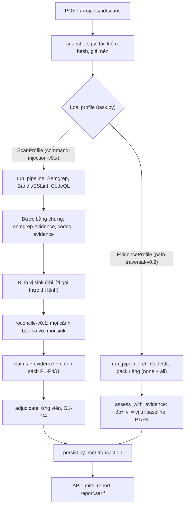
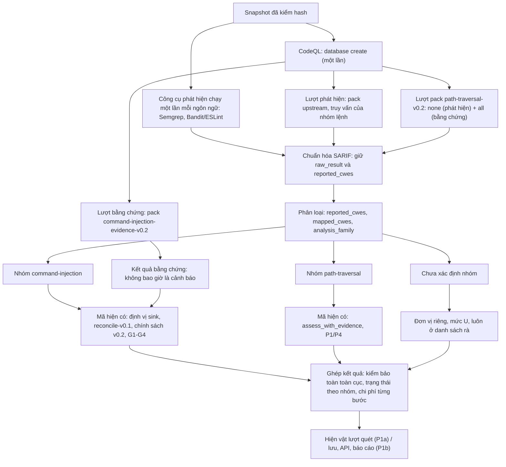

# Kiến trúc đa CWE — thiết kế P0 và kế hoạch P1

Tài liệu thiết kế, viết ngày 2026-11-15 trên nhánh `feat/cwe22-triage`. Đây là **kế hoạch**, chưa có
dòng mã ứng dụng nào được sửa. Trạng thái ứng dụng như đã cài đặt vẫn nằm ở
[architecture.md](../architecture.md); trạng thái nghiên cứu ở [research.md](../research.md).

- **Mục tiêu dài hạn:** một kiến trúc phân tích tĩnh đa CWE (CWE-22, 78, 89, 79, 918) cho Python và
  JavaScript/TypeScript, thay cho hai đường xử lý chuyên biệt hiện nay.
- **Phạm vi của tài liệu này (P0):** truy vết hiện trạng, chọn kiến trúc, đặc tả các bất biến và chia
  P1 thành đầu việc. Không sửa backend/frontend, không quét dữ liệu mới, không thêm CWE, không sửa
  hiện vật nghiên cứu đã khóa.
- **Bản này là bản đã chỉnh** sau khi chủ đề án rà bản kế hoạch đầu; các điểm thay đổi và lý do nằm ở
  [mục 7](#7-quyết-định-và-lý-do).
- **Cập nhật cùng ngày:** P1a đã được triển khai trên nhánh `feat/multi-cwe-core`; mã, kiểm thử và
  kết quả lượt quét thật nằm ở [mục 16](#16-trạng-thái-p1a-2026-11-15). P1b (tích hợp vào ứng dụng
  web) nằm ở [mục 17](#17-trạng-thái-p1b-2026-11-15). Các mục 1–15 giữ nguyên là bản thiết kế; chỗ
  nào thực tế khác kế hoạch thì được ghi ngay tại chỗ và ở mục 16, 17.

## 1. Kết luận ngắn

1. Kiến trúc được chọn là **lượt quét ghép**: một snapshot, một cơ sở dữ liệu CodeQL cho mỗi ngôn
   ngữ, nhiều **nhóm phân tích** (analysis family). Mỗi cảnh báo được định tuyến tới đúng một nhóm
   hoặc ở trạng thái "chưa xác định nhóm"; mỗi nhóm được xử lý bằng **chính mã và profile đã ghim
   hiện có** của nó.
2. Thứ phải trừu tượng hóa ngay rất ít: mô hình phân loại ba trường, khả năng chạy nhiều lượt
   phân tích CodeQL trên một database, và một lớp ghép kết quả theo nhóm. Mọi thứ khác (bộ gộp,
   bằng chứng, chính sách, bước gạn, đường CWE-22) **giữ nguyên**.
3. Chống gộp nhầm CWE bằng **định tuyến trước khi gộp**, không bằng cách đổi khóa đơn vị. Vì vậy
   `unit_id` của các profile cũ không đổi.
4. Không có quy tắc gạn chung cho mọi CWE. Nhóm mới mặc định **chỉ phát hiện và giữ cảnh báo**.
5. P1 chia hai chặng: **P1a** chỉ thêm mã mới và chứng minh bằng một lượt quét ghép thật trên dữ liệu
   phát triển; **P1b** (profile schema, lưu trữ, API, giao diện, hiệu năng) chỉ mở khi P1a đạt.

## 2. Trạng thái Git khi viết (đã kiểm tra, không thay đổi gì)

| Mục | Kết quả |
|---|---|
| Nhánh, HEAD | `feat/cwe22-triage`, `837c53d700dae0ab0686598c49ad444f61b10c76` |
| Nhánh trên origin (`git ls-remote`, đọc trực tiếp từ remote) | `feat/cwe22-triage` ở `ac014a2` |
| Chênh lệch | Local đi trước **1 commit**, origin không có commit nào local thiếu (`ac014a2` là tổ tiên của HEAD) |
| Commit chưa push | `837c53d docs: align the conclusion and chapter 3 wording with the measured results` (2 file dưới `docs/thesis/`) |
| Working tree | Sạch, trừ PDF đề cương chưa theo dõi (không được stage) |
| Khác | Không có nhánh `main` cục bộ (`origin/main` ở `b35413d`); có một worktree khác ở `.kilo/worktrees/cloud-argon` (HEAD tách rời `9299543`) — không đụng tới |

Hệ quả: mọi tham chiếu "HEAD `837c53d`" trong tài liệu này là **commit chỉ có ở máy cục bộ**. Việc
push là quyết định của chủ đề án; không reset, không ghi đè.

## 3. Hiện trạng đã truy vết

Truy vết trên mã nguồn, không theo README. Đường dẫn tương đối tính từ `backend/app/` trừ khi ghi khác.

### 3.1 Luồng hiện tại

### 3.2 Từng bước và file

| Bước | File và hàm | Phụ thuộc CWE |
|---|---|---|
| Thu nhận nguồn | `workflows/scans/snapshots.py`, `scanners/sources.py`, `scanners/acquisition.py` | Không. Ngôn ngữ theo `SOURCE_EXTENSIONS` (python; javascript gồm cả TS) |
| Chạy công cụ | `scanners/pipeline.py::run_pipeline`; `semgrep.py`, `codeql.py`, `bandit.py`, `eslint.py` | Không: rule và truy vấn đến từ profile. Giới hạn cấu trúc: một pack CodeQL chính (`query_pack_for_language`), **một** bước `codeql-evidence`, **một** file luật `semgrep-evidence` |
| Chuẩn hóa SARIF | `scanners/sarif.py::sarif_findings` | Không. Giữ nguyên `raw_result`; `reported_cwes` lấy bằng regex từ metadata rule |
| Định vị sink | `triage/sinks_python.py`, `triage/sinks_javascript.py`, `scanners/semgrep.py::run_sink_locator`, `experiments/locators/sink-locator-v{0,1}-javascript.yaml` | Chỉ CWE-78 |
| Đối chiếu | `triage/reconcile.py::reconcile_findings` | Lẫn lộn (mục 3.3, 3.5) |
| Phân loại rule | `triage/claims.py::classify_claims`, `triage/assess.py::verified_definitions` | Cơ chế chung, có hai chỗ viết cứng |
| Bằng chứng theo đơn vị | `triage/evidence.py::EvidenceIndex` | Lẫn lộn |
| Chính sách ưu tiên | `triage/policy.py` | Bộ máy chung, bộ vị từ cố định |
| Gạn | `triage/adjudicate.py::adjudicate` | Lẫn lộn |
| Đường CWE-22 | `triage/safety_evidence.py::assess_with_evidence`, `workflows/scans/analysis.py::scan_language_evidence`, `scanners/profile.py::load_evidence_profile` | Riêng CWE-22 |
| Điều phối | `workflows/scans/analysis.py::scan_language`, `workflows/scans/task.py::scan_snapshot` | Rẽ nhánh `isinstance(profile, EvidenceProfile)` |
| Lưu | `workflows/scans/persist.py`, `features/triage/models.py`, `features/findings/models.py` | Chung, có ràng buộc mang từ vựng CWE-78 |
| Báo cáo, API | `workflows/scans/report.py`, `service.py`, `schemas.py` | Chung, không có chiều CWE |
| CLI nghiên cứu | `experiments/run_pilot.py` | Dùng chung `app.scanners` và `app.triage`; gắn với chính sách v0.1 |

### 3.3 Thành phần viết cứng cho CWE-78

| File | Ký hiệu | Nội dung |
|---|---|---|
| `triage/assess.py` | `_CODEQL_RULES`, `codeql_rule_id` | Chỉ biết hai truy vấn `Security/CWE-078/*.ql`; truy vấn khác ném `ValueError` |
| `triage/claims.py` | `classify_claims` | `candidate_status: "cwe78_candidate"` |
| `triage/reconcile.py` | `SHELL_COMMAND_KINDS`, `_JS_PROCESS_KINDS`, `shell_state`, `argument_role`, `_related_shell_location` | Vai trò đối số `shell_command` / `executable` / `argument_list`; liên kết `[shell command](n)` trong thông điệp CodeQL. `argument_role` nằm trong khóa đơn vị |
| `triage/evidence.py` | `_argument_span`, `_literal_proof`, `_safe_command`, `_INTERPRETERS`, `_SUBPROCESS`, `_JS_SPAWN`; trong `_trace` và `EvidenceIndex.build` | Điểm cuối hợp lệ của vết luồng là vai trò lệnh; chứng minh "toàn bộ lệnh là hằng"; vị từ `shell_semantics`; các trường `shell_state`, `command_literal` |
| `triage/policy.py` | `PREDICATES`, `apply_policy` | Đúng mười vị từ, kiểm "exactly ten" |
| `triage/adjudicate.py` | `_BANDIT_LITERAL_TESTS`, `_SHELL_STRING_SINKS`, `_literal_rule` (G2), `_constant_rule` (G4), `_REASONS`; chữ ký `adjudicate` | G2 và G4 là ngữ nghĩa lệnh; ba tham số bằng chứng cố định (`codeql_evidence`, `semgrep_evidence`, `constant_evidence`) |
| `triage/sinks_python.py` | `_SUPPORTED_MODULES`, `_canonical_supported` | `os`, `subprocess`, `asyncio`, `pty` |
| `triage/sinks_javascript.py` | `_CHILD_METHODS`, `_direct_child_aliases`, `_canonical_kind` | `child_process`, `shelljs` |
| `workflows/scans/analysis.py` | `_locate_sinks`, `_codeql_evidence`, `_semgrep_evidence`, `_constant_evidence` | Một khối `adjudication` cho mỗi ngôn ngữ |
| `features/triage/models.py` | `ck_location_unit_argument_role` | CHECK chỉ cho ba vai trò lệnh |
| `workflows/scans/schemas.py` | `ScanCreate.profile`, `UnitDetail.shell_state`, `UnitDetail.blocker_proof` | Danh sách profile là `Literal`; trường chi tiết mang ngữ nghĩa lệnh |
| `frontend/src/features/scans/` | `api/create-scan.ts`, `components/units-table.tsx`, `components/unit-detail-sheet.tsx` | Nhãn profile; cột `argument_role`; khối `shell_state`, `blocker_proof` |
| `experiments/run_pilot.py` | `LOCATOR_RULE`, `POLICY_FILE`, `CLAIMS_FILE` | Gắn với locator v0, chính sách v0.1, rule-claims-v2; chỉ nhận Semgrep và CodeQL |

### 3.4 Thành phần riêng của CWE-22

- `scanners/profile.py`: `EvidenceProfile`, `load_evidence_profile` (bắt buộc `scanners == ["codeql"]`,
  không có luật Semgrep, mọi truy vấn nằm trong pack của profile).
- `workflows/scans/analysis.py::scan_language_evidence`: dùng pack của profile làm pack chính, chỉ đánh
  giá khi lượt quét `completed`.
- `triage/safety_evidence.py::assess_with_evidence`: mỗi vị trí cảnh báo của truy vấn baseline
  (`st/cwe-22/none`) là một đơn vị; khóa đơn vị gồm `baseline_rule`; còn bị truy vấn bằng chứng
  (`st/cwe-22/all`) báo thì P1, không còn thì P4 và `filtered`; rule lạ hoặc cảnh báo bằng chứng nằm
  ngoài baseline ném `ValueError`. Không có bộ định vị sink, không rule-claims, không file chính sách.
- Khác với CWE-78: kết quả của truy vấn bằng chứng **được lưu như cảnh báo** và gắn vào đơn vị;
  ở CWE-78 kết quả bước bằng chứng không bao giờ là cảnh báo.
- Pack [rules/codeql/path-traversal-v0.2/](../../rules/codeql/path-traversal-v0.2/README.md), trùng
  từng byte với bản nghiên cứu đã đóng băng.

### 3.5 Thành phần tái sử dụng được nguyên trạng

- Toàn bộ thu nhận nguồn; `run_pipeline` (chạy song song, lỗi độc lập từng công cụ, trạng thái
  `completed/partial/failed`); `process.invoke`; `provenance`; kiểm hash profile (`_verified`, `_pinned`).
- `sarif_findings`; `assert_finding_conservation`; cơ chế phân loại rule theo hash định nghĩa.
- Kỹ thuật **thu thập và đối chiếu bằng chứng**: `codeql.py::run_codeql_evidence` (chạy truy vấn đã
  ghim trên chính database của lượt quét, có `--rerun`), `adjudicate.py::codeql_evidence_index`,
  `semgrep_evidence_index`, `_trace_lines`.
- Bộ máy chính sách (`matches`, `validate_policy`, `apply_policy`), cách nhóm ứng viên, bộ mã lý do giữ.
- `persist.py`, `report.py`, xuất SARIF hợp nhất.
- Thư viện `SafetyEvidence.qll` của nghiên cứu đã được tham số hóa theo CWE cho Python
  (`experiments/owasp-bp-pilot/ql_v02/gen.py` sinh truy vấn cho 22, 78, 79, 643). Đây là hiện vật đã
  khóa; chỉ là điểm xuất phát cho các nhóm sau này, không dùng trong P1.

### 3.6 Quan sát phụ khi truy vết

Ghi lại để không bị quên; **không** sửa trong P1a.

1. `reported_cwes` không được chuẩn hóa: cùng một CWE có thể xuất hiện là `cwe-78`, `cwe-078` hay
   `CWE-78` tùy công cụ (`backend/tests/scanners/test_sarif.py` khẳng định dạng `cwe-78`). Hiện không
   quyết định nào dùng trường này; nó chỉ được lưu vào `findings.cwe_ids`.
2. `workflows/scans/results.py::LOCATOR_VERSION = "sink-locator-v0"` là giá trị mặc định mà
   `scan_language` không ghi đè, nên lượt quét bằng `command-injection-v0.3` (dùng locator v1) vẫn lưu
   `locator_version = "sink-locator-v0"`.
3. `workflows/scans/task.py::SCANNER_STEPS = 5` đếm Semgrep, Bandit/ESLint, CodeQL create, CodeQL
   analyze và sink locator; hai bước `semgrep-evidence` và `codeql-evidence` không nằm trong ngân sách
   thời gian của Celery.
4. Hai gói bằng chứng CodeQL hiện có khai **cùng tên pack** `security-triage/python-safety-evidence`
   (cùng hash `qlpack.yml`), nên không được giả định là có thể đưa chung vào một lệnh `analyze`.

### 3.7 Ràng buộc khóa đã xác minh

- Bốn manifest `profiles/*/profile.json` và mọi file chúng ghim là tài liệu khóa.
- Các `PREREGISTRATION.json` của `experiments/evaluation/independent*` ghim hash của
  `triage/reconcile.py`, `triage/adjudicate.py`, `scanners/acquisition.py` và
  `workflows/scans/analysis.py`. `FROZEN_CONFIGURATION*.json` của `pairs-v1` ghim thêm toàn bộ
  `triage/*.py` và `scanners/semgrep.py`.
- `experiments/tests/test_evaluation.py::_assert_registered` đọc từng file theo đường dẫn: file phải
  còn ở chỗ cũ, và nếu byte khác thì phải có bản ghi trong
  [PIPELINE_CHANGES.json](../../experiments/evaluation/PIPELINE_CHANGES.json). Hiện có hai bản ghi
  (`adjudicate.py`, `analysis.py`).
- `experiments/run_pilot.py::runner_files_sha256` và `pairs-v1/freeze.py` liệt kê `triage/*.py` bằng
  glob không đệ quy: file mới trong `app/triage/` sẽ làm đổi tập file mà các bản ghi đó mô tả.
- Không file nào trong `scanners/codeql.py`, `scanners/pipeline.py`, `scanners/sarif.py`,
  `scanners/profile.py` bị ghim bởi một bản đăng ký nào.

## 4. Đánh giá lại: trừu tượng hóa gì ngay, giữ nguyên gì

Câu hỏi kiểm tra cho mỗi thành phần: *để một snapshot được quét cho hai nhóm CWE sẵn có và cho kết
quả đúng, có bắt buộc phải sửa nó không?*

| Thành phần | Quyết định | Lý do |
|---|---|---|
| Mô hình phân loại cảnh báo (nhãn gốc, ánh xạ, nhóm xử lý) | **Làm ngay**, module mới | Hiện không có khái niệm "cảnh báo này thuộc nhóm nào"; đây là điều kiện để không gộp nhầm |
| Nhiều lượt phân tích CodeQL trên một database, mỗi lượt có tên riêng | **Làm ngay**, một tham số bổ sung | Hai nhóm dùng hai pack khác nhau; không thì phải trích xuất hai lần |
| Lớp ghép: chạy công cụ một lần, định tuyến, gọi bộ xử lý từng nhóm, kiểm bảo toàn toàn cục | **Làm ngay**, module mới | Thay cho rẽ nhánh theo loại profile, nhưng ở P1a chỉ là đường mới chạy song song |
| Bộ xử lý nhóm CWE-78 và CWE-22 | **Làm ngay**, dạng vỏ mỏng | Gọi lại đúng `_assess_pipeline` và `assess_with_evidence` hiện có |
| `reconcile.py`, `evidence.py`, `policy.py`, `adjudicate.py`, `claims.py`, `assess.py`, `sinks_*.py` | **Giữ nguyên** | Chỉ nhận cảnh báo của nhóm lệnh nên phần viết cứng CWE-78 vẫn đúng chỗ. Tách chúng ra chỉ cần khi có nhóm thứ hai đi qua bộ gộp |
| `safety_evidence.py` | **Giữ nguyên** | Là điều kiện gạn đã đo của CWE-22; viết lại sẽ làm mất liên hệ với kết quả đã đánh giá |
| Khóa đơn vị, khóa ứng viên, `RECONCILIATION_VERSION` | **Giữ nguyên** | Định tuyến trước khi gộp đã đủ ngăn gộp nhầm (mục 5.3); hai nhóm có khóa khác cấu trúc nên không trùng |
| Bộ vị từ chính sách | **Giữ nguyên** | Mỗi nhóm vẫn dùng chính sách riêng đã ghim của nó |
| Loader profile, manifest | **Giữ nguyên ở P1a** | Lượt quét ghép được dựng từ hai profile đã ghim; schema mới để P1b |
| Bảng dữ liệu, API, giao diện | **Giữ nguyên ở P1a** | P1a chứng minh ở mức hiện vật của lượt quét (JSON), không qua cơ sở dữ liệu |
| `run_pilot.py`, mọi thứ dưới `experiments/` | **Giữ nguyên** | Thực nghiệm lịch sử không phụ thuộc đường mới |

Kết quả: P1a sửa đúng **một** file ứng dụng hiện có (`scanners/codeql.py`, thêm một tham số có giá
trị mặc định), còn lại là file mới và kiểm thử.

## 5. Kiến trúc đích

### 5.1 Nguyên tắc tương đương

> Với cùng snapshot và cùng công cụ đã ghim, kết quả của mỗi nhóm trong lượt quét ghép phải bằng kết
> quả của việc quét riêng nhóm đó bằng profile hiện có của nó, trừ các khác biệt được liệt kê tường
> minh.

Nguyên tắc này vừa là tiêu chí nghiệm thu, vừa là lý do dùng lại mã cũ: nhóm lệnh và nhóm đường dẫn
trong lượt quét ghép chạy đúng các hàm mà hai profile hiện tại đang chạy.

Khác biệt được phép (và phải có kiểm thử khẳng định đúng danh sách này):

| Khác biệt | Lý do |
|---|---|
| `raw_id` của cảnh báo từ lượt phân tích pack CWE-22 mang tiền tố tên lượt (`codeql-path-traversal:…` thay cho `codeql:…`), kéo theo `raw_finding_ids`, `mappings[].raw_id`, `refuted_raw_ids` | Hai lượt phân tích CodeQL trong cùng một ngôn ngữ sẽ trùng `codeql:0:n` nếu không tách; `raw_id` phải duy nhất để kiểm bảo toàn |
| Tên bước: lượt pack CWE-22 là `codeql-path-traversal`, dùng chung `codeql-create` | Một database cho cả hai nhóm |
| Tiền tố trong mã rule của Semgrep (`out.run-01.composite.python.subprocess-shell-true`) | Semgrep ghép đường dẫn thư mục chứa file luật đã stage vào mã rule; hai lượt quét ghi ra hai thư mục. Không phải khác biệt của lượt ghép: hai lượt quét riêng bất kỳ cũng khác nhau ở đây. Phát hiện ở lượt quét thật (mục 16) |
| `index` của artifact trong `raw_result` của CodeQL | Là vị trí trong bảng artifact của riêng một lượt chạy; đường dẫn artifact không đổi. Phát hiện ở lượt quét thật (mục 16) |

Cảnh báo của nhóm lệnh đến từ cùng một lời gọi `run_pipeline` như khi quét riêng nên `raw_id` của
chúng không đổi; khóa đơn vị của nhóm đường dẫn không chứa `raw_id`. Vì vậy `unit_id`, khóa ứng viên, mức ưu tiên, `decision_id`, lý do, `disposition`, hash chính sách và phiên
bản (`reconcile-v0.1`, `adjudicate-v0.3`, `safety-evidence-units-v1`) không được khác.

### 5.2 Luồng đa CWE

### 5.3 Mô hình phân loại

Ba trường tách biệt, không trường nào thay thế trường nào:

| Trường | Ý nghĩa | Nguồn | Được sửa bởi hệ thống? |
|---|---|---|---|
| `reported_cwes` | Nhãn nguyên bản công cụ gắn cho rule | SARIF, như `sarif_findings` đọc hôm nay | Không bao giờ; kể cả không chuẩn hóa tại chỗ |
| `mapped_cwes` | Danh sách CWE có căn cứ của rule; một rule **có thể có nhiều** CWE (ví dụ `py/command-line-injection` → CWE-78, CWE-88) | Trường `mapped_cwes` của rule-claims đã ghim, chỉ khi định nghĩa rule khớp hash; với pack CWE-22 là id truy vấn đã ghim trong manifest và README của pack | Không; rỗng nếu không có căn cứ, kèm `mapped_cwes_basis` |
| `analysis_family` | Nhóm ngữ nghĩa dùng để xử lý: `command-injection`, `path-traversal`, hoặc `null` | Quy tắc định tuyến bên dưới | Không; kèm `family_status`, `family_basis`, `unresolved_reason` |

Quy tắc định tuyến, theo thứ tự:

1. **Theo lượt chạy.** Nếu lượt chạy công cụ sinh ra cảnh báo chỉ phục vụ một thành viên (chỉ chạy
   rule/truy vấn đã ghim của profile đó) thì nhóm là nhóm của thành viên đó
   (`family_basis: "pass_provenance"`). Ở P1a mọi lượt chạy đều thuộc loại này.
2. **Theo rule đã ghim.** Nếu một lượt chạy phục vụ nhiều thành viên, nhóm là thành viên duy nhất
   khai rule đó với định nghĩa khớp hash (`family_basis: "pinned_rule_set"`).
3. **Chưa xác định.** Không thành viên nào khai rule (`rule_not_claimed`), định nghĩa không khớp hash
   (`definition_unverified`) hoặc nhiều hơn một thành viên khai (`ambiguous_family`) thì
   `analysis_family = null`, `family_status = "unresolved"`.

Cảnh báo chưa xác định nhóm: giữ nguyên mọi nhãn, thành một đơn vị riêng theo vị trí báo, mức `U`,
`disposition = review`, không quy tắc gạn nào được áp dụng, không gộp với đơn vị của nhóm nào.

Hai trạng thái không được nhập làm một: *chưa xác định nhóm* (ở tầng định tuyến) và
`classification_unresolved` (rule không khớp rule-claims, đã có sẵn trong nhóm lệnh và được chính
sách của nhóm đó đưa về `U`).

Vì sao định tuyến đủ để chống gộp nhầm: bộ gộp `reconcile-v0.1` so mọi cảnh báo nó nhận với mọi sink
lệnh và chọn sink trong cùng chứa vùng báo. Nếu cảnh báo CWE-22 ở đối số `open(p)` nằm trong
`os.system("cat " + open(p).read())` được đưa vào bộ gộp này, nó sẽ bị nhập vào đơn vị của lời gọi
`os.system`. Khi cảnh báo đó không bao giờ tới bộ gộp của nhóm lệnh, lỗi này không thể xảy ra, và
không cần đổi khóa đơn vị.

### 5.4 Bộ xử lý nhóm

Một bộ xử lý là một hàm có cùng chữ ký: nhận cảnh báo đã định tuyến của nhóm, kết quả các lượt chạy
mà nhóm phụ thuộc và profile đã ghim của nhóm; trả về đơn vị, đánh giá, phiên bản và trạng thái.
Đăng ký bằng một `dict`; không có lớp cơ sở, không plugin.

| Nhóm | Thành viên (profile đã ghim) | Bộ xử lý gọi | Chính sách | Điều kiện gạn |
|---|---|---|---|---|
| `command-injection` | `command-injection-v0.3` (hoặc v0.1, v0.2) | `analysis._assess_pipeline` hiện có | `priority-v0.2` đã ghim | G1–G4 như hiện có |
| `path-traversal` | `path-traversal-v0.2` | `safety_evidence.assess_with_evidence` hiện có | P1/P4 của profile | Truy vấn `st/cwe-22/all` không còn báo vị trí baseline |
| (chưa xác định) | — | Đơn vị dự phòng qua `reconcile_findings` với danh sách sink rỗng | `U` cố định | Không có |

Phần ngữ nghĩa CWE-78 trong `reconcile.py`, `evidence.py`, `adjudicate.py` **không** được tách thành
giao diện nhiều hàm ở P1. Hợp đồng chi tiết hơn (định vị sink, vai trò đối số, điểm cuối vết luồng,
vị từ riêng) chỉ được thiết kế khi có nhóm thứ hai cần đi qua bộ gộp; xem [mục 12](#12-chưa-nên-triển-khai).

### 5.5 Quản lý CodeQL

- **Một database cho mỗi ngôn ngữ.** `run_codeql` tạo database như hôm nay; các lượt sau dùng lại nó,
  đúng kỹ thuật mà bước `codeql-evidence` đang dùng.
- **Không ép gộp pack.** Mỗi pack là một lượt `database analyze` riêng, có tên bước, file SARIF, log,
  thời gian và số kết quả riêng. Hai pack tự viết trùng tên pack nên càng không được đưa chung một lệnh.
- **Phân biệt phát hiện với bằng chứng** ở mức kết quả:

  | Lượt | Pack | Vai trò kết quả |
  |---|---|---|
  | `codeql` | `codeql/python-queries` đã ghim | Phát hiện (cảnh báo của nhóm lệnh) |
  | `codeql-path-traversal` | `rules/codeql/path-traversal-v0.2` | `cwe22_none`: phát hiện; `cwe22_all`: bằng chứng, nhưng được lưu như cảnh báo gắn vào đơn vị, đúng hành vi của profile hiện tại |
  | `codeql-evidence` | `rules/codeql/command-injection-evidence-v0.2` | Bằng chứng; không bao giờ là cảnh báo |

- **Ghi chi phí thực tế.** Mỗi bước giữ `seconds` (đã có trong `ProcessRecord`); `run.json` của lượt
  quét ghép ghi thêm bước đó phục vụ nhóm nào và thuộc loại nào. Lượt `codeql-path-traversal` chạy hai
  truy vấn trong một lệnh như profile hiện tại, nên chi phí phát hiện và chi phí bằng chứng của nó
  không tách được nếu không đổi cách chạy pack; tài liệu kết quả phải nói rõ điều này.
- **Điều kiện ghép.** Các thành viên phải cùng phiên bản CodeQL và cùng ngôn ngữ; nếu không, lượt quét
  ghép từ chối chạy thay vì âm thầm chọn một phiên bản.
- **Không tối ưu ở P1a.** Các lượt chạy tuần tự; song song hóa và giới hạn thời gian của Celery thuộc P1b.

### 5.6 Thẩm định và gạn theo nhóm

Lõi chung chỉ cung cấp **kỹ thuật**: chạy truy vấn/luật bằng chứng đã ghim, lập chỉ mục vị trí của
truy vấn đối chứng và truy vấn bằng chứng, đối chiếu vết luồng với các dòng mã. Lõi **không** chứa
điều kiện gạn nào áp dụng cho mọi nhóm. Mỗi điều kiện gạn thuộc về một nhóm, gắn với một gói bằng
chứng cụ thể và với kết quả kiểm chứng của chính nó:

| Điều kiện | Nhóm | Bằng chứng đã có (nguồn: [research.md](../research.md), [thesis/commitments.md](../thesis/commitments.md)) |
|---|---|---|
| G1 — truy vấn bằng chứng CodeQL không còn báo luồng | `command-injection`, Python | OWASP BenchmarkPython (dữ liệu phát triển): gạn 2/7 cảnh báo sai, 0/13 cảnh báo đúng |
| G2 — lệnh là hằng, Bandit xác nhận | `command-injection`, Python | Đợt độc lập 5 (không có nhãn): gạn 19/145 ứng viên; phép kiểm đã đăng ký chấp nhận 17, hai ca còn lại khi đọc lại là lệnh hằng bọc trong lời gọi khác |
| G3 — luồng chỉ qua nhánh không bao giờ chạy | `command-injection`, Python | OWASP (phát triển): 1/7 cảnh báo sai |
| G4 — chuỗi lệnh `exec`/`execSync` là hằng | `command-injection`, JS/TS | 84 package (phát triển): 1/11 cảnh báo sai, 0/122 cảnh báo đúng |
| Pack v0.2 loại mọi luồng tới vị trí baseline | `path-traversal`, Python | Benchmark: 49/53 cảnh báo sai ở nửa kiểm tra; mã thật: 4/43 cảnh báo sai, 0/7 cảnh báo đúng (một người rà, không mù) |

Quy tắc cho nhóm mới: **mặc định không có điều kiện gạn** — phát hiện, gộp nếu có căn cứ, xếp ưu
tiên, giữ mọi ứng viên ở danh sách rà. Một điều kiện gạn chỉ được bật cho một nhóm sau khi có gói
bằng chứng ghim hash, bộ phản ví dụ, và một lượt đo theo giao thức được ghi trước khi quét. Tên G1
hay G3 không tự chuyển sang nhóm khác: cùng kỹ thuật trên nhóm khác là một điều kiện mới, có mã
riêng và phải được đo riêng.

### 5.7 Trạng thái và lỗi công cụ

- Mức độ hoàn tất được tính **theo nhóm**, trên các lượt chạy mà nhóm đó phụ thuộc. Lỗi của lượt chỉ
  phục vụ nhóm B không làm đổi kết quả của nhóm A so với khi quét riêng A.
- Lỗi của bước dùng chung (ví dụ `codeql-create`) ảnh hưởng mọi nhóm phụ thuộc, đúng như khi quét riêng:
  nhóm lệnh vẫn được đánh giá bằng cảnh báo của công cụ sàng lọc nhưng không gạn gì; nhóm đường dẫn
  không xếp hạng gì.
- Một nhóm có bộ xử lý ném lỗi (ví dụ rule lạ trong lượt pack CWE-22) được ghi là thất bại kèm lỗi;
  cảnh báo thô của nó vẫn nằm trong `findings.json`; các nhóm khác tiếp tục.
- Trạng thái lượt quét theo đúng quy tắc hiện có của `task._overall`, áp dụng trên trạng thái các nhóm.

## 6. Đặc tả bất biến

### 6.1 Bảo toàn cảnh báo gốc

| # | Bất biến | Kiểm bằng |
|---|---|---|
| B1 | Mỗi kết quả SARIF của lượt phát hiện xuất hiện đúng một lần trong `findings.json`, với `raw_result` và `reported_cwes` y nguyên | So số kết quả từng file SARIF với số cảnh báo theo lượt |
| B2 | Mỗi cảnh báo thuộc đúng một đơn vị của đúng một nhóm, hoặc đúng một đơn vị "chưa xác định nhóm" | Mở rộng `assert_finding_conservation` trên hợp các nhóm |
| B3 | `raw_id` duy nhất trong một ngôn ngữ của lượt quét | Kiểm khi ghép; trùng là lỗi, không tự đổi tên |
| B4 | Kết quả của bước bằng chứng thuần túy không bao giờ thành cảnh báo hay đơn vị | Như hiện nay (`evidence_findings` tách riêng) |
| B5 | Phân loại là bản ghi bổ sung theo `raw_id`; không ghi đè trường nào của cảnh báo | So `findings.json` trước và sau phân loại |
| B6 | Gạn chỉ đổi `disposition`; đơn vị, cảnh báo, bằng chứng và lý do vẫn còn | Như hiện nay |
| B7 | Nhóm thất bại không làm mất cảnh báo thô của nó | Kiểm thử lỗi công cụ |

### 6.2 Chống gộp nhầm CWE

- Bộ gộp và bộ đánh giá của một nhóm chỉ nhận cảnh báo đã định tuyến cho nhóm đó.
- Không đơn vị nào chứa cảnh báo của hai nhóm; không ứng viên nào chứa đơn vị của hai nhóm.
- Điều kiện gạn của nhóm W chỉ đọc cảnh báo và bằng chứng của W. Cảnh báo của nhóm khác ở cùng vị
  trí không chặn, cũng không kích hoạt việc gạn.
- Cảnh báo chưa xác định nhóm không được dùng làm "xác nhận độc lập" cho nhóm nào.

### 6.3 Thiếu bằng chứng

Nguyên tắc chung giữ nguyên: thiếu bằng chứng thì giữ; **vắng cảnh báo không phải là bằng chứng**.

| Tình huống | Hành động | Mã lý do |
|---|---|---|
| Lượt chạy mà nhóm phụ thuộc bị `partial` hoặc `failed` | Nhóm lệnh: không gạn gì. Nhóm đường dẫn: không xếp hạng gì (như profile hiện tại) | `run_incomplete` (đã có) |
| Bước bằng chứng thất bại | Điều kiện dùng bước đó không gạn | `evidence_step_failed` (đã có) |
| Truy vấn đối chứng không báo đúng cảnh báo này | Giữ | `evidence_baseline_does_not_report_this_alert` (đã có) |
| Công cụ khác khẳng định luồng mà không có vết | Giữ | `flow_claim_without_a_trace_to_check` (đã có) |
| Nhóm không có gói bằng chứng | Giữ mọi ứng viên | `no_refuting_evidence` (đã có) |
| Rule không khớp rule-claims | Mức `U` theo chính sách của nhóm | `classification_unresolved` (đã có) |
| Không định vị được sink | Đơn vị dự phòng, mức `U` | `unmapped` (đã có) |
| Không xác định được nhóm | Đơn vị riêng, mức `U`, luôn ở danh sách rà | `rule_not_claimed`, `definition_unverified`, `ambiguous_family` (mới, chỉ ở đường mới) |
| Truy vấn bằng chứng báo vị trí ngoài baseline | Nhóm thất bại, không xếp hạng | Lỗi của `assess_with_evidence` (đã có) |

### 6.4 Hành vi của bốn profile hiện tại

- Bốn manifest và mọi file chúng ghim không đổi một byte.
- Ở P1a, đường thực thi của bốn profile (`scan_language`, `scan_language_evidence`, `task.scan_snapshot`)
  không bị sửa; thay đổi duy nhất chạm tới mã chúng gọi là tham số bổ sung có giá trị mặc định ở
  `run_codeql_evidence`.
- Kiểm thử hồi quy "golden" ([mục 11](#11-kiểm-thử-bảo-đảm-không-phá-hành-vi-cũ)) phát hiện mọi thay
  đổi ngoài ý muốn ở đơn vị, đánh giá và bản ghi cảnh báo.
- Job CI `scan-parity` (CLI và API cho cùng kết quả trên `curling@0.2.0`) phải tiếp tục qua mà không
  sửa `experiments/run_pilot.py`.

## 7. Quyết định và lý do

| # | Quyết định | Lý do | Phương án bị loại |
|---|---|---|---|
| D1 | Phân loại bằng ba trường `reported_cwes`, `mapped_cwes`, `analysis_family`; có trạng thái chưa xác định nhóm | Một rule có thể mang nhiều CWE; nhãn của công cụ không đủ tin để định tuyến nhưng không được mất | Buộc mỗi rule đúng một CWE; lấy CWE từ `reported_cwes` |
| D2 | Chống gộp nhầm bằng định tuyến trước khi gộp; không đổi khóa đơn vị | Giữ nguyên `unit_id` đã dùng trong các đánh giá; không cần sửa `reconcile.py` (bị ghim) | `reconcile-v0.2` có nhóm trong khóa |
| D3 | Lượt quét ghép dựng từ các **profile đã ghim hiện có** | Mỗi nhóm chạy đúng cấu hình đã được đánh giá; không cần schema mới để chứng minh | Profile schema 2 ngay từ đầu |
| D4 | Bộ xử lý nhóm là vỏ mỏng gọi mã hiện có | Thay đổi ít nhất; nguyên tắc tương đương kiểm được | Giao diện nhiều hàm và di chuyển mã CWE-78 |
| D5 | Không có điều kiện gạn chung; nhóm mới mặc định chỉ phát hiện và giữ | Mỗi điều kiện gạn chỉ có căn cứ trên nhóm và dữ liệu nó đã được đo | G1/G3 thành quy tắc lõi cho mọi CWE |
| D6 | Một database CodeQL, mỗi pack một lượt phân tích có tên; phân biệt phát hiện và bằng chứng; ghi chi phí | Hai pack hiện có trùng tên; chi phí trích xuất là phần dùng chung được | Gộp mọi truy vấn vào một lệnh `analyze` |
| D7 | P1a chỉ thêm mã; không sửa file bị ghim bởi một bản đăng ký | Thực nghiệm lịch sử và bốn profile không bị ảnh hưởng theo cấu trúc, không cần "hợp thức hóa" | Tái cấu trúc `triage/*.py` và ghi vào `PIPELINE_CHANGES.json` |
| D8 | Mã mới đặt ở `app/workflows/scans/`, không ở `app/triage/` | Tập file `triage/*.py` mà `freeze.py` và `run_pilot.py` liệt kê không đổi | Gói con `app/triage/weaknesses/` |

**Thay đổi so với bản kế hoạch đầu** (đã bị rà và không được duyệt nguyên trạng):

| Bản đầu | Bản này | Vì sao |
|---|---|---|
| Mỗi rule khai đúng một `weakness` | Ba trường, nhiều CWE cho một rule, có trạng thái chưa xác định | Yêu cầu 1 của lượt rà |
| G1 và G3 là quy tắc gạn của lõi chung | Lõi chỉ có kỹ thuật thu thập/đối chiếu; điều kiện gạn theo nhóm | Yêu cầu 2 |
| P1 gồm 11 đầu việc liền mạch, có schema, DB, API, UI | P1a (chứng minh) rồi mới P1b (mở rộng) | Yêu cầu 3 |
| Tách ngữ nghĩa CWE-78 thành bộ xử lý nhiều hàm, đổi khóa đơn vị, vị từ mở rộng | Hoãn; bộ xử lý là vỏ mỏng | Đánh giá lại ở mục 4: không cần để chứng minh |
| Sửa `triage/*.py` tại chỗ và ghi `PIPELINE_CHANGES.json` | Không sửa file bị ghim ở P1a; không ghi tự động | Yêu cầu 5 |
| Bước bằng chứng thành danh sách trong `run_pipeline` | Một tham số tên lượt ở `run_codeql_evidence` | Đủ cho hai nhóm; không sửa `pipeline.py` |

## 8. Nghiên cứu đã đóng băng và quản lý phiên bản

1. **P1a không chạm** file nào bị ghim: không sửa `triage/*.py`, `scanners/semgrep.py`,
   `scanners/acquisition.py`, `workflows/scans/analysis.py`, không sửa gì dưới `experiments/`,
   `profiles/`, `rules/`, `tools/`. Do đó `experiments/tests/test_evaluation.py`,
   `test_research_freeze.py`, `test_product_pack.py` và `test_profile.py` phải qua **mà không sửa bất
   kỳ sổ đăng ký nào**; đây là một tiêu chí nghiệm thu của từng đầu việc.
2. **`PIPELINE_CHANGES.json` không được cập nhật tự động.** Sổ này ghi một thay đổi đã xảy ra với lý
   do cụ thể; nó không phải cách làm cho kiểm thử xanh. Nếu một đầu việc về sau (P1b-7) buộc phải sửa
   file bị ghim, trình tự là: (a) nêu file, hash đã đăng ký và lý do trong đề xuất; (b) chủ đề án
   quyết định; (c) kiểm thử golden chứng minh hành vi của các profile đã đăng ký không đổi; (d) bản
   ghi được viết tay trong cùng commit với thay đổi.
3. **Phiên bản.** Đường mới mang định danh riêng trong hiện vật của nó (ví dụ
   `composition_version: "family-composition-v0.1"`); nó không đổi `RECONCILIATION_VERSION`,
   `ADJUDICATION_VERSION`, `EVIDENCE_UNIT_VERSION` hay phiên bản chính sách nào. Một hành vi mới của
   nhóm đã có luôn là phiên bản mới với profile mới, không phải sửa phiên bản cũ.
4. **Tái lập thực nghiệm lịch sử.** Mỗi lượt chạy đã đăng ký ghi commit của nó (`configuration_commit`
   trong `run.json`, `HELD_OUT_GATE.json`); tái lập là checkout đúng commit đó, không phụ thuộc mã ở
   đầu nhánh. `FROZEN_CONFIGURATION_v0.3.json` là bản ghi của một lượt đã xong: không chạy lại
   `freeze.py write`.
5. **Tách nhánh.** Đề xuất triển khai P1a trên một nhánh mới tách từ commit chứa tài liệu này (ví dụ
   `feat/multi-cwe-core`), để `feat/cwe22-triage` tiếp tục là nhánh của hồ sơ đề án và thực nghiệm.
   Trước đó cần quyết định về commit `837c53d` chưa push (mục 2). Việc tạo nhánh và push do chủ đề
   án thực hiện hoặc yêu cầu.
6. **Dữ liệu.** Lượt quét tích hợp của P1a chỉ dùng dữ liệu phát triển đã xem; không quét
   `pairs-v1`, không quét lại nguồn của các đợt kiểm tra độc lập, không dùng nhãn nào. Kết quả của nó
   là kiểm chứng kỹ thuật, không phải số liệu đánh giá.

## 9. Kế hoạch P1a — chứng minh lõi đa CWE

Mỗi đầu việc là một commit qua được hook. Lệnh kiểm tra chung cho backend (từ `backend/`):
`uv run ruff check . && uv run ruff format --check . && uv run mypy && uv run pytest --cov`; cho
thực nghiệm: lệnh `unittest discover` trong [experiments/AGENTS.md](../../experiments/AGENTS.md).

### P1a-1 — Kiểm thử hồi quy golden cho bốn profile

- **Phạm vi:** chỉ kiểm thử. Chạy `scan_snapshot` với pipeline giả cho từng profile và kịch bản, so
  `units.json`, `assessments.json`, `findings.json` và các hàng đã lưu với file golden đã commit.
- **File:** `backend/tests/workflows/scans/test_legacy_golden.py` (mới),
  `backend/tests/golden/<profile>/<kịch bản>.json` (mới), bổ sung nhỏ ở
  `backend/tests/workflows/scans/fakes.py` nếu archive giả chưa tất định.
- **Kịch bản tối thiểu:** v0.1 (Python và JavaScript); v0.2 (Bandit, G1 gạn, G2 gạn, G3 gạn, bước
  bằng chứng lỗi, lượt quét `partial`); v0.3 (G4 gạn, locator v1); `path-traversal-v0.2` (một vị trí
  giữ, một vị trí hạ, lượt `partial` không xếp hạng).
- **Nghiệm thu:** golden sinh từ mã ở commit chưa có thay đổi ứng dụng nào; bộ kiểm thử qua; một
  thay đổi cố ý ở máy cục bộ (ví dụ đổi mức của một quyết định) làm kiểm thử đỏ và được ghi lại là đã
  thử; không file ứng dụng nào thay đổi.

### P1a-2 — Mô hình phân loại

- **Phạm vi:** hàm thuần túy tính bản ghi phân loại cho từng cảnh báo theo mục 5.3.
- **File:** `backend/app/workflows/scans/classification.py` (mới),
  `backend/tests/workflows/scans/test_classification.py` (mới).
- **Kiểm thử:** rule có nhiều CWE giữ đủ danh sách; `reported_cwes` dạng `cwe-078` không bị sửa; lượt
  chạy một thành viên → `pass_provenance`; lượt chạy hai thành viên với rule của đúng một bên →
  `pinned_rule_set`; rule không ai khai, sai hash, hai bên cùng khai → ba lý do chưa xác định; cảnh
  báo đầu vào không bị thay đổi.
- **Nghiệm thu:** các kiểm thử trên qua; golden P1a-1 không đổi.

### P1a-3 — Lượt phân tích CodeQL có tên trên database sẵn có

- **Phạm vi:** `run_codeql_evidence` nhận thêm `name` (mặc định `"codeql-evidence"`) quyết định tên
  bước, tên file SARIF và tiền tố `raw_id`.
- **File:** `backend/app/scanners/codeql.py`, `backend/tests/scanners/test_codeql.py`.
- **Kiểm thử:** lời gọi không truyền `name` cho đúng argv, tên file và `raw_id` như trước (các kiểm thử
  hiện có không sửa); với tên khác, hai lượt trên cùng database không ghi đè nhau và `raw_id` không trùng.
- **Nghiệm thu:** golden không đổi; đây là thay đổi duy nhất ở file ứng dụng hiện có trong P1a.

### P1a-4 — Bộ xử lý nhóm và lớp ghép

- **Phạm vi:** hai bộ xử lý vỏ mỏng (mục 5.4), xử lý cảnh báo chưa xác định nhóm, hàm ghép cho một
  ngôn ngữ: chạy pipeline của thành viên lệnh, chạy lượt pack của thành viên đường dẫn trên cùng
  database, phân loại, định tuyến, đánh giá từng nhóm, kiểm B1–B7, tính trạng thái theo nhóm, ghi hiện vật.
- **File:** `backend/app/workflows/scans/families.py` (mới),
  `backend/tests/workflows/scans/test_families.py` (mới), fixture nguồn tổng hợp trong thư mục kiểm thử.
- **Ghi chú (đã đổi khi triển khai):** bản kế hoạch định gọi tên riêng tư
  `analysis._assess_pipeline`. Cách đã làm đơn giản hơn và không cần tên riêng tư nào: lớp ghép gọi
  thẳng hai hàm công khai `scan_language` và `scan_language_evidence`, và truyền cho mỗi hàm một
  `run_pipeline_fn` phục vụ kết quả từ lần chạy công cụ dùng chung. Mỗi nhóm vì thế chạy đúng
  đường mã của profile đơn, kể cả phần ghi `run.json`, `units.json`, `assessments.json`.
- **Kiểm thử:** toàn bộ ma trận mức A ở [mục 11.2](#112-kiểm-thử-tích-hợp-của-lượt-quét-ghép).
- **Nghiệm thu:** ma trận qua; golden không đổi; kiểm thử thực nghiệm qua mà không sửa sổ đăng ký.

### P1a-5 — Công cụ dòng lệnh phát triển cho lượt quét ghép

- **Phạm vi:** một CLI chạy trong image worker, không dùng cơ sở dữ liệu hay API: nhận một manifest
  nguồn đã ghim, danh sách thành viên và chế độ `composite` hoặc `separate`; ghi hiện vật vào thư mục
  đầu ra; có lệnh so sánh sinh `comparison.json` theo nguyên tắc tương đương.
- **File:** `backend/scripts/scan_families.py` (mới), kiểm thử trong `backend/tests/test_scripts.py`
  hoặc file mới cạnh đó.
- **Nghiệm thu:** chạy được với pipeline giả trong kiểm thử; chế độ `separate` đi qua đúng
  `scan_language` và `scan_language_evidence` hiện có; đầu ra không chứa mã nguồn được quét.

### P1a-6 — Lượt quét tích hợp thật trên dữ liệu phát triển

- **Phạm vi:** ba lượt trên cùng một snapshot Python có cả hai nhóm: riêng nhóm lệnh, riêng nhóm đường
  dẫn, và ghép. Cần chủ đề án đồng ý trước khi chạy.
- **Snapshot đề xuất:** OWASP BenchmarkPython ở commit `f1291485808b66e20ddb6b01b10dc71b3df8c8ba`
  (manifest [owasp-benchmarkpython-cwe78-v01.json](../../experiments/cases/owasp-benchmarkpython-cwe78-v01.json),
  `split: development`; đã được dùng làm dữ liệu phát triển cho cả CWE-78 và CWE-22).
- **Thành viên:** `command-injection-v0.3` (Python) và `path-traversal-v0.2`.
- **Ghi nhận:** `comparison.json`, bảng thời gian từng bước (create, từng lượt analyze, tổng; ghép so
  với tổng hai lượt riêng), lệnh đã chạy và kết quả vào [validation.md](../validation.md).
- **Nghiệm thu:**
  1. mỗi nhóm trong lượt ghép bằng lượt riêng của nó, chỉ khác đúng danh sách ở mục 5.1;
  2. B1–B7 đúng; số đơn vị chứa cảnh báo của hai nhóm bằng 0;
  3. chính sách của mỗi nhóm đúng là chính sách đã ghim của nó (hash khớp);
  4. có số đo chi phí thật, kể cả khi lượt ghép không nhanh hơn;
  5. mọi sai lệch được ghi lại nguyên trạng, không quét lại để "sửa" kết quả.

**Cổng P1a → P1b:** P1a-1 đến P1a-6 đạt và chủ đề án xác nhận. Nếu nguyên tắc tương đương không giữ
được, dừng ở đây và xem lại kiến trúc trước khi đụng tới schema, lưu trữ hay API.

## 10. Kế hoạch P1b — chỉ mở sau khi P1a đạt

Phạm vi và tiêu chí ở mức phác; mỗi đầu việc được viết chi tiết khi mở.

| # | Đầu việc | Phạm vi | Tiêu chí nghiệm thu |
|---|---|---|---|
| P1b-1 | Profile ghép (schema 2) | Manifest mới ghim **manifest của các thành viên** theo hash; loader, `scripts/check_worker.py`, `core/config.py` | Manifest cũ nạp như trước (kiểm thử `test_profile.py` hiện có không sửa); profile ghép sai hash bị từ chối |
| P1b-2 | Lưu trữ | Migration `0008`: cột nhóm ở `location_units`; bản ghi phân loại của cảnh báo; đọc kết quả của lượt quét có nhiều phiên bản đơn vị/chính sách (hiện `service._results` lọc theo một cặp phiên bản của lượt quét) | Lượt quét cũ đọc ra như trước; `alembic check` và vòng downgrade → upgrade qua |
| P1b-3 | Worker | `scan_snapshot` chạy profile ghép; lượt phân tích bổ sung thành `tool_runs`; ngân sách thời gian tính đủ mọi bước (quan sát 3 ở mục 3.6) | Kiểm thử giới hạn thời gian bao mọi profile; golden không đổi |
| P1b-4 | API và báo cáo | Trường và bộ lọc nhóm ở đơn vị; phân loại ở cảnh báo; báo cáo trước–sau theo nhóm; SARIF mang nhóm; `ScanCreate.profile` | `frontend/openapi.json` và kiểu sinh ra đi cùng commit; phản hồi của lượt quét cũ không đổi dạng |
| P1b-5 | Giao diện | Chọn profile ghép; cột và bộ lọc nhóm; khối chi tiết theo nhóm (`shell_state` chỉ cho nhóm lệnh) | `npm run check` qua; kiểm thử E2E với API giả cho lượt quét hai nhóm |
| P1b-6 | Hiệu năng | Chỉ dựa trên số đo của P1a-6: song song các lượt phân tích, giới hạn tài nguyên | Có số đo trước và sau; kết quả từng nhóm không đổi |
| P1b-7 | Hợp nhất đường cũ (tùy chọn) | Cho profile đơn đi qua lớp ghép như lượt ghép một thành viên; bỏ rẽ nhánh ở `task.py`. Chạm `analysis.py` (bị ghim) | Theo trình tự ở mục 8.2; golden không đổi; chỉ làm khi chủ đề án quyết định |
| P1b-8 | Tài liệu sống | `architecture.md`, `backend/AGENTS.md`, `README.md`, `research.md`, `validation.md` | Mô tả đúng trạng thái sau thay đổi |

## 11. Kiểm thử bảo đảm không phá hành vi cũ

### 11.1 Lưới an toàn cho bốn profile

| Lớp | Kiểm thử | Phát hiện |
|---|---|---|
| Golden theo profile | `test_legacy_golden.py` (P1a-1) | Mọi thay đổi ở `unit_id`, khóa ứng viên, mức, `decision_id`, lý do, `disposition`, bản ghi gạn, phiên bản, hàng cảnh báo |
| Kiểm thử hiện có của lõi | `backend/tests/triage/*`, `backend/tests/scanners/*`, `backend/tests/workflows/scans/test_task.py` | Hồi quy ở từng thành phần; không sửa kiểm thử nào để "cho qua" |
| Sổ đăng ký nghiên cứu | `experiments/tests/test_evaluation.py`, `test_research_freeze.py`, `test_product_pack.py`, `test_profile.py` | File bị ghim đổi byte hoặc đổi chỗ |
| CLI nghiên cứu | `experiments/tests/test_runner.py` | Chữ ký và đầu ra của lõi dùng chung |
| Tương đương CLI–API | Job CI `scan-parity` | Lệch giữa hai đường trên công cụ thật |
| Kiến trúc | `backend/tests/test_architecture.py` | Mã mới phá quy tắc phân tầng (`triage` và `scanners` chỉ dùng thư viện chuẩn) |

Quy tắc: nếu một thay đổi làm golden khác đi, thay đổi đó hoặc là lỗi, hoặc phải được giải thích
trong commit và golden được cập nhật **trong cùng commit** với lý do; không cập nhật golden hàng loạt.

### 11.2 Kiểm thử tích hợp của lượt quét ghép

Hai mức. Mức A chạy trong CI với đầu ra công cụ giả; mức B là lượt quét thật của P1a-6.

**Mức A — fixture tổng hợp có hai nhóm** (ghi rõ là dữ liệu kiểm thử tổng hợp):

| # | Tình huống | Khẳng định |
|---|---|---|
| A1 | Nguồn có sink lệnh và sink đường dẫn ở các lời gọi khác nhau | Mỗi nhóm bằng lượt riêng của nó (trừ danh sách ở mục 5.1) |
| A2 | Cảnh báo CWE-22 nằm **bên trong** vùng của một lời gọi lệnh (`os.system("cat " + open(p).read())`) | Cảnh báo CWE-22 ở đơn vị của nhóm đường dẫn; đơn vị của `os.system` chỉ chứa cảnh báo nhóm lệnh |
| A3 | Hai cảnh báo khác nhóm ở đúng cùng một vùng mã | Hai đơn vị, hai ứng viên, hai chính sách |
| A4 | Bảo toàn | B1–B7; tổng cảnh báo theo nhóm cộng "chưa xác định" bằng tổng cảnh báo |
| A5 | Chính sách riêng | Nhóm lệnh mang `decision_id` và hash của `priority-v0.2`; nhóm đường dẫn mang `EV_KEPT_NO_PROOF` / `EV_HIDDEN_BY_EVIDENCE` |
| A6 | Gạn không lan nhóm | Bằng chứng của nhóm đường dẫn không làm đổi `disposition` của ứng viên nhóm lệnh và ngược lại |
| A7 | Lượt pack CWE-22 thất bại | Nhóm đường dẫn không xếp hạng gì; nhóm lệnh giống hệt lượt riêng; trạng thái chung `partial` |
| A8 | `codeql-create` thất bại | Nhóm lệnh chỉ còn cảnh báo sàng lọc, không gạn; nhóm đường dẫn không có đơn vị; cảnh báo thô còn đủ |
| A9 | Bước bằng chứng nhóm lệnh thất bại | `evidence_step_failed` ở nhóm lệnh; nhóm đường dẫn không đổi |
| A10 | Lượt pack CWE-22 trả về rule lạ | Nhóm đường dẫn thất bại kèm lỗi; nhóm lệnh tiếp tục; cảnh báo thô còn trong `findings.json` |
| A11 | Lượt chạy phục vụ hai thành viên, rule không ai khai / hai bên cùng khai / sai hash | Đơn vị "chưa xác định nhóm", mức `U`, `review`, đủ `reported_cwes` và `mapped_cwes`, không gộp với nhóm nào |
| A12 | Các thành viên khác phiên bản CodeQL | Lượt ghép từ chối chạy, nêu rõ lý do |

**Mức B — một snapshot phát triển, công cụ thật:** ba lượt và `comparison.json` như P1a-6.

## 12. Chưa nên triển khai

Mỗi mục kèm điều kiện mở lại, để không bị làm "tiện tay".

| Việc | Vì sao chưa | Điều kiện mở lại |
|---|---|---|
| Thêm CWE-89, CWE-79, CWE-918; CWE-22 cho JS/TS | Ngoài phạm vi; chưa có lõi đã chứng minh | P1a và P1b đạt; mỗi nhóm một giao thức riêng |
| Giao diện bộ xử lý nhiều hàm (định vị sink, vai trò, điểm cuối, vị từ) và tách mã CWE-78 khỏi `reconcile.py`, `evidence.py`, `adjudicate.py` | Chưa có nhóm thứ hai cần bộ gộp; sửa file bị ghim | Nhóm đầu tiên cần gộp cảnh báo của nhiều công cụ theo sink |
| Bỏ `_CODEQL_RULES` và `cwe78_candidate` viết cứng | Chỉ sai khi nhóm khác đi qua `assess.py`/`claims.py` | Như trên |
| Nhóm trong khóa đơn vị (`reconcile-v0.2`) | Định tuyến đã đủ; đổi khóa làm lệch `unit_id` | Khi một bộ gộp phải nhận cảnh báo của nhiều nhóm |
| Vị từ chính sách mở rộng | Mỗi nhóm đang có chính sách riêng | Khi nhóm mới cần vị từ ngoài mười vị từ hiện có |
| Điều kiện gạn cho nhóm mới; G1/G3 dùng chung | Chưa có gói bằng chứng và số đo cho nhóm đó | Gói bằng chứng ghim hash, phản ví dụ, giao thức ghi trước khi quét |
| Rule-claims có trường `analysis_family`; Semgrep chạy luật của nhiều nhóm trong một lượt | P1a không có lượt chạy phục vụ nhiều thành viên | Khi một công cụ phải chạy luật của hai nhóm |
| Gộp truy vấn của nhiều pack vào một lệnh `analyze` | Hai pack trùng tên; chưa có số đo cho thấy cần | Số đo P1a-6 cho thấy chi phí analyze là nút thắt |
| Phân xử nhóm mơ hồ bằng vị trí sink | Thêm suy luận ở chỗ đang cần sự chắc chắn | Có ca thật lặp lại ở trạng thái `ambiguous_family` |
| Chuẩn hóa `reported_cwes` tại chỗ | Trường này là nhãn nguyên bản | Không mở; nếu cần, thêm trường hiển thị riêng |
| Nới CHECK `argument_role`; sửa `LOCATOR_VERSION`; sửa `SCANNER_STEPS` | Không cần cho P1a | P1b-2, P1b-3 hoặc nhóm có vai trò mới |
| Profile schema 2, cột DB, API, giao diện, song song hóa | Thuộc P1b | Cổng P1a → P1b |
| Sửa `experiments/run_pilot.py`, hiện vật, nhãn, giao thức, sổ đăng ký | Đã khóa hoặc là hồ sơ lịch sử | Không mở trong chương trình này |
| Quét dữ liệu mới hoặc held-out | Không có giao thức | Giao thức được commit trước khi quét |

## 13. Rủi ro

1. **Trôi hành vi của profile cũ và của các đánh giá đã đăng ký.** Giảm bằng: P1a chỉ thêm mã; golden
   trước khi sửa; không chạm file bị ghim; `scan-parity`. Rủi ro tăng lại ở P1b-7, vì vậy đầu việc đó
   là tùy chọn và cần quyết định riêng.
2. **Định tuyến sai nhóm hoặc gộp nhầm.** Hôm nay không có lớp nào ngăn một cảnh báo của CWE khác rơi
   vào bộ gộp lệnh. Giảm bằng: định tuyến theo lượt chạy và rule đã ghim, trạng thái chưa xác định,
   kiểm thử A2, A3, A11. Rủi ro còn lại xuất hiện khi một lượt chạy phục vụ nhiều nhóm (chưa có ở P1a).
3. **Kiến trúc mở rộng được nhưng nhóm mới không có giá trị thẩm định.** Trên mã thật pack CWE-22
   mới loại được khoảng 9% cảnh báo sai; JS/TS chưa có gói bằng chứng CodeQL; 89, 79, 918 chưa có bộ
   định vị, chính sách hay bằng chứng nào; tập held-out của CWE-78 đã dùng hết. Mặc định "chỉ phát
   hiện và giữ" là cách nói thật về điều này, nhưng cũng nghĩa là mỗi nhóm mới là một khối lượng
   nghiên cứu riêng.

Rủi ro nhỏ hơn: chi phí thời gian (nhiều lượt analyze; ngân sách Celery hiện đã thiếu hai bước); khác
biệt số luồng khi tạo database giữa lượt ghép và lượt riêng (xem mục 14).

## 14. Điểm chưa xác minh

Máy phát triển này chỉ có Docker; Semgrep, CodeQL và Bandit nằm trong image worker và chưa được chạy
cho tài liệu này.

- Lượt pack `path-traversal-v0.2` trên database do thành viên lệnh tạo (`jobs: 1`) có cho đúng kết quả
  như database do profile CWE-22 tự tạo (`jobs: 2`) hay không. P1a-6 kiểm điều này; nếu khác, đó là
  một phát hiện phải ghi lại, không phải thứ để điều chỉnh cho khớp.
- Hai pack trùng tên có gây xung đột bộ nhớ đệm khi chạy lần lượt trên cùng database hay không.
  `run_codeql_evidence` đã dùng `--rerun` vì lý do này; chưa đo với ba lượt.
- Đường dẫn và hash của các truy vấn upstream cho CWE-22, 89, 79, 918 trong `python-queries` 1.8.11 và
  `javascript-queries` 2.4.6. Không cần cho P1.
- Archive giả trong `backend/tests/workflows/scans/fakes.py` có tất định hay không (header gzip có thể
  mang thời gian). P1a-1 xác định và xử lý trong mã kiểm thử.
- Chưa chạy bộ kiểm thử nào cho tài liệu này vì không sửa mã.

## 15. Đầu việc đầu tiên sẵn sàng triển khai

**P1a-1 — kiểm thử hồi quy golden cho bốn profile hiện tại.** Chỉ thêm file dưới `backend/tests/`,
không phụ thuộc quyết định nào còn mở, không chạm file bị ghim, và là điều kiện để mọi đầu việc sau
có thể khẳng định "không đổi hành vi cũ". Bước nhỏ nhất bên trong nó: một kịch bản golden cho
`path-traversal-v0.2` (một vị trí giữ, một vị trí hạ) dựa trên `fake_evidence_pipeline` đã có.

> Mục 14 và 15 là trạng thái lúc viết thiết kế. Sau khi P1a được triển khai, xem mục 16: câu hỏi
> đầu tiên của mục 14 đã có câu trả lời trên một snapshot, và đầu việc tiếp theo nằm ở mục 16.7.

## 16. Trạng thái P1a (2026-11-15)

P1a-1 đến P1a-6 được làm trên HEAD `837c53d` và commit vào nhánh `feat/multi-cwe-core` (mục 16.6).
**Chưa push.** Không file nào dưới `experiments/`, `profiles/`, `rules/`, `tools/` hay
`frontend/` thay đổi; không sổ đăng ký nào bị sửa.

### 16.1 Mã đã thêm

| File | Nội dung |
|---|---|
| `backend/app/workflows/scans/classification.py` (mới) | Bản ghi phân loại ba trường cho từng cảnh báo; quy tắc định tuyến; ba lý do "chưa xác định" |
| `backend/app/workflows/scans/families.py` (mới) | `compose`, `scan_language_families`, `check_conservation`; cảnh báo chưa xác định nhóm thành đơn vị riêng ở mức `U` |
| `backend/scripts/scan_families.py` (mới) | CLI phát triển: `run --mode composite` hoặc `separate`, và `compare` |
| `backend/app/scanners/codeql.py` | `run_codeql_evidence(name=...)`, mặc định như cũ. Thay đổi duy nhất ở file ứng dụng đã có |
| `backend/tests/workflows/scans/test_legacy_golden.py`, `backend/tests/golden/legacy/*.json` | 15 kịch bản golden cho bốn profile |
| `backend/tests/workflows/scans/test_classification.py`, `test_families.py`, `backend/tests/test_scan_families_script.py`, bổ sung ở `backend/tests/scanners/test_codeql.py` | Kiểm thử của phần mới |

Đúng như mục 4 dự kiến, `reconcile.py`, `evidence.py`, `policy.py`, `adjudicate.py`,
`safety_evidence.py`, `analysis.py`, `task.py`, các loader profile, bảng dữ liệu và API không đổi.

### 16.2 Khác với kế hoạch

1. Bộ xử lý nhóm không gọi `_assess_pipeline`; lớp ghép cấp kết quả công cụ cho chính
   `scan_language` và `scan_language_evidence` (ghi chú ở P1a-4).
2. Bộ so sánh phải gác lại thêm hai chi tiết chỉ ghi nơi công cụ chạy (hai dòng cuối bảng ở mục
   5.1). Lần so sánh đầu tiên của lượt quét thật trả `equivalent: false` vì lý do này; kết quả đó
   được giữ nguyên ở `run-01/comparison.json`. Chỉ bộ so sánh được sửa, mã quét không đổi, và phép
   so sánh lại chạy trên đúng các đầu ra đã lưu (`run-01/comparison-after-fix.json`).
3. Golden có 15 kịch bản thay vì danh sách ở P1a-1: thêm kịch bản "một lời gọi, ba đơn vị, một ứng
   viên" sau khi phép thử đột biến cho thấy bộ golden ban đầu không phát hiện việc đổi thứ tự mức.

### 16.3 Kiểm thử hồi quy và baseline

Chạy trên Windows, Python 3.12 qua `uv`, SQLite trong bộ nhớ; riêng bộ kiểm thử backend được chạy
thêm trong Docker trên PostgreSQL (`docker compose --profile test run --build --rm test`): 542 qua,
độ phủ 95,41%. Chưa chạy hook, chưa chạy CI.

| Kiểm tra | Baseline (HEAD, trước khi sửa) | Sau P1a |
|---|---|---|
| `uv run pytest --cov` (backend) | 484 qua, 2 bỏ qua | 540 qua, 2 bỏ qua; độ phủ 95,28% |
| `uv run ruff check .`, `ruff format`, `uv run mypy` | — | Sạch (137 file) |
| Bản xuất nguyên trạng của HEAD (`git archive HEAD`, ngoài working tree) | 484 qua, 2 bỏ qua | Cả 486 kiểm thử baseline còn nguyên và cùng kết quả sau P1a; 56 kiểm thử mới đều qua |
| Golden, 15 kịch bản | Sinh từ mã chưa sửa; chạy trên bản xuất nguyên trạng của HEAD (chỉ thêm file kiểm thử golden và file golden): 16/16 kiểm thử qua | 16/16 qua, không file golden nào đổi |
| Phép thử đột biến trên golden (không sửa file nào) | — | Đổi mã quyết định: 1 kiểm thử đỏ; đảo thứ tự mức: 1 đỏ; đổi phiên bản gạn: 12 đỏ |
| Kiểm thử thực nghiệm (`unittest discover`) | — | 153 qua, không sửa sổ đăng ký hay file bị ghim |

Ma trận mức A của mục 11.2 nằm trong `test_families.py`: tương đương với quét riêng (A1), cảnh báo
CWE-22 nằm trong lời gọi lệnh (A2), hai nhóm trên cùng vùng mã (A3), bảo toàn (A4), chính sách riêng
(A5), bằng chứng không lan nhóm (A6), lượt pack CWE-22 hỏng hoặc chạy dở (A7), database hỏng (A8),
bước bằng chứng nhóm lệnh hỏng (A9), rule lạ (A10), cảnh báo chưa xác định nhóm (A11), thành viên
không ghép được (A12), và ngôn ngữ chỉ một thành viên có cấu hình.

### 16.4 Lượt quét thật trên dữ liệu phát triển

- **Snapshot:** OWASP BenchmarkPython, commit `f1291485808b66e20ddb6b01b10dc71b3df8c8ba`, archive
  SHA-256 `0defda4cce2ea7675fbeae5b059b4d7cca7d49232529367133feb1adfb529096` (khớp manifest
  `experiments/cases/owasp-benchmarkpython-cwe78-v01.json`, `split: development`). Chỉ quét Python.
- **Thành viên:** `command-injection-v0.3` (manifest `1b3b824a…`) và `path-traversal-v0.2`
  (`65f9c800…`).
- **Môi trường:** image `security-triage-worker:latest` đã dựng sẵn, với `backend/` của working tree
  gắn chỉ-đọc vào `/app`; `scripts.check_worker` báo đúng hash bốn profile và Semgrep 1.178.0, CodeQL
  2.27.1, Bandit 1.9.4, ESLint 10.15.0; `SCANNER_WORKERS` mặc định (2).
- **Ba lượt, mỗi lượt một container mới:** `run-01` quét riêng trước rồi quét ghép; `run-02` đảo
  thứ tự; `run-03` lặp lại thứ tự của `run-01` với công cụ đã đóng băng và tiêu chí ghi trước. Đầu ra
  ở `artifacts/multi-cwe-p1a/` (không theo dõi bởi Git).

| | Nhóm lệnh | Nhóm đường dẫn |
|---|---|---|
| Cảnh báo | 51 (Semgrep 18, Bandit 20, CodeQL 13) | 188 (125 của truy vấn đối chứng, 63 của truy vấn bằng chứng) |
| Đơn vị / ứng viên | 24 / 20 | 125 / 125 |
| Mức | P1 9, P2 4, P3 11 | P1 63, P4 62 |
| Đã gạn | 2 đơn vị (một theo G1; một theo G3 và G1) | 62 (truy vấn bằng chứng không còn báo) |
| Giữ, kèm lý do | 15 `evidence_query_still_reports_flow`, 7 `no_refuting_evidence` | 63 `evidence_query_still_reports_flow` |
| Chính sách | `command-injection-priority` 0.2, hash `58718192…` | `cwe22-safety-evidence` 0.2, hash `8c7a6f77…` |
| Ghép so với riêng, cả hai lượt | Đơn vị và đánh giá bằng nhau | Đơn vị và đánh giá bằng nhau |

Kết quả theo tiêu chí nghiệm thu của P1a-6:

1. **Tương đương:** cả hai lượt, mỗi nhóm của lượt ghép bằng lượt quét riêng của nó. Khác biệt khi so
   từng byte: 18 cảnh báo Semgrep khác tiền tố mã rule; 17 (lượt 1) và 8 (lượt 2) cảnh báo CodeQL
   khác chỉ số artifact; thứ tự kết quả của CodeQL giữa hai lần chạy cũng khác, nên cảnh báo được
   khớp theo nội dung chứ không theo số thứ tự.
   Vì bộ so sánh của dự án đã bị sửa sau khi thấy kết quả đầu, phép tương đương còn được kiểm bằng
   một kịch bản độc lập không dùng mã so sánh đó, liệt kê từng giá trị khác nhau trong đầu ra đã lưu
   của cả hai lượt: `units.json` của nhóm lệnh giống nhau từng byte; `assessments.json` của nhóm lệnh
   khác đúng 18 giá trị, tất cả là mã rule Semgrep cùng tên khác tiền tố thư mục; đơn vị và đánh giá
   của nhóm đường dẫn chỉ khác ở `raw_id` (tiền tố lượt và số thứ tự); `raw_result` chỉ khác ở chỉ
   số artifact của SARIF. Không có khác biệt nào ngoài ba loại này; mức, mã quyết định, `disposition`,
   quy tắc gạn, lý do giữ, hash chính sách và câu lý do giống nhau ở mọi đơn vị.
   **Lượt thứ ba với tiêu chí ghi trước** (`run-03`): hash của bộ so sánh, của mã lượt ghép và tiêu
   chí đạt được ghi vào `artifacts/multi-cwe-p1a/run-03-CRITERIA.json` trước khi container khởi động;
   hash đo trong container khớp bản ghi; bộ so sánh được gọi đúng một lần. Kết luận đầu tiên của nó:
   `equivalent: true`, cả hai nhóm `equal: true`, cùng số liệu như hai lượt trước (51 và 188 cảnh báo,
   24 và 125 đơn vị, 2 và 62 đã gạn), mọi điều kiện bảo toàn đạt, 0 đơn vị bị gạn thiếu bằng chứng.
   Kịch bản độc lập cũng không thấy khác biệt nào ngoài ba loại đã nêu. Thời gian: lượt ghép 184,9 s
   (chạy sau), hai lượt riêng 383,0 s (chạy trước).
2. **Bảo toàn và không gộp nhầm:** 239/239 cảnh báo được phân loại, mỗi cảnh báo nằm trong đúng một
   đơn vị; 0 đơn vị chứa cảnh báo của hai nhóm; 0 kết quả bằng chứng thuần túy thành cảnh báo; nhãn
   `reported_cwes` giữ nguyên dạng công cụ viết (`cwe-078`, `cwe-088`; `CWE-22` cùng `cwe-22`).
3. **Không gạn khi thiếu bằng chứng:** 0 đơn vị đã gạn thiếu tên quy tắc hoặc thiếu bản ghi bằng
   chứng; mọi đơn vị không có bằng chứng bác bỏ đều ở danh sách rà.
4. **Database dùng chung:** lượt pack CWE-22 trên database do thành viên lệnh tạo (`jobs: 1`) cho
   đúng 188 cảnh báo và 125 đơn vị như database riêng (`jobs: 2`) — trên snapshot này.
5. **Chi phí** (mỗi số là một lần đo, cùng một máy):

   | | Lượt ghép | Hai lượt riêng cộng lại | Tạo database |
   |---|---:|---:|---|
   | Chạy trước trong container (bộ đệm nguội) | 265,1 s | 385,5 s | 1 lần 104,5 s so với 2 lần 213,5 s |
   | Chạy sau trong container (bộ đệm ấm) | 184,7 s | 312,1 s | 1 lần 103,1 s so với 2 lần 220,0 s |

   Phần tiết kiệm (khoảng 120–127 giây) gần bằng một lần tạo database. Thứ tự chạy ảnh hưởng mạnh
   tới các bước analyze (ví dụ lượt pack CWE-22: 37,8 s khi chạy trước, 13,4 s khi chạy sau), nên
   không được so lượt ghép của một container với lượt riêng của cùng container đó.

### 16.5 Điều lượt quét thật **không** chứng minh

- **Tình huống gộp nhầm không xuất hiện trong dữ liệu này:** BenchmarkPython không có file nào có
  cảnh báo của cả hai nhóm (0 file chung, 0 cảnh báo CWE-22 nằm trong một lời gọi lệnh). Việc chống
  gộp nhầm vì vậy chỉ được kiểm bằng fixture tổng hợp (A2, A3), nơi cũng có một kiểm thử cho thấy bộ
  gộp lệnh sẽ nuốt cảnh báo CWE-22 nếu nhận nó.
- **Không có cảnh báo chưa xác định nhóm, không có lỗi công cụ** trong lượt thật; các nhánh đó chỉ
  có kiểm thử (A7–A11).
- Đây là dữ liệu phát triển tổng hợp, một snapshot, chỉ Python. Không có nhãn nào được dùng; các số
  trên không phải số liệu đánh giá hiệu quả gạn.
- JavaScript/TypeScript của lượt ghép chỉ có kiểm thử với công cụ giả (thành viên đường dẫn không
  có cấu hình JS).

### 16.6 Quyết định của chủ đề án (2026-11-15)

Sáu đầu việc P1a-1 đến P1a-6 đã xong và đạt tiêu chí nghiệm thu của chúng. Sau khi xem kết quả,
chủ đề án quyết định:

- **Cổng P1a → P1b: xác nhận P1a đạt.** P1b vẫn chưa bắt đầu và chỉ bắt đầu khi được yêu cầu riêng.
- **Commit trên nhánh mới `feat/multi-cwe-core`**, tách từ `837c53d`, mỗi đầu việc một commit và
  một commit tài liệu; **không push**. `feat/cwe22-triage` giữ nguyên là nhánh hồ sơ đề án.

Hook pre-push và CI chưa chạy vì chưa push.

### 16.7 Đầu việc tiếp theo

**P1b-1 — profile ghép (schema 2):** một manifest ghim manifest của các thành viên theo hash, để
lượt quét ghép có định danh và hash riêng như bốn profile hiện tại. P1b đã được làm sau đó; xem
mục 17.

## 17. Trạng thái P1b (2026-11-15)

P1b tích hợp lõi của P1a vào ứng dụng web. Làm trên `e8bf32a` và, theo quyết định của chủ đề án,
commit vào `feat/multi-cwe-core` tách theo đầu việc; **chưa push**. **Chủ đề án chưa kết luận
nghiệm thu P1b.** Lần rà gần nhất (2026-11-15) chủ đề án đánh giá chưa đạt vì chưa có dự án thật
nào có hai nhóm trong cùng một file; lượt quét bổ sung theo yêu cầu đó (mục 17.4, điểm 10) đã có
kết quả và còn chờ chủ đề án xem. Không file nào dưới `experiments/`, `rules/`, `tools/` hay bốn
thư mục profile cũ thay đổi; logic G1–G4 và điều kiện an toàn của pack v0.2 không đổi.

### 17.1 Đã làm theo từng đầu việc

| # | Kết quả | File chính |
|---|---|---|
| P1b-1 | Profile ghép `multi-cwe-v0.1` (`"kind": "composite"`, schema 2) ghim manifest của `command-injection-v0.3` và `path-traversal-v0.2` cùng đặc tả; loader kiểm hash rồi nạp từng thành viên bằng loader của chính nó; worker từ chối khởi động nếu profile ghép khai nhóm mà mã không xử lý | `profiles/multi-cwe-v0.1/`, `backend/app/scanners/profile.py`, `backend/scripts/check_worker.py`, `backend/app/core/config.py` |
| P1b-2 | Migration `0008`: cột `location_units.analysis_family` (cho phép rỗng). Phân loại của cảnh báo lưu ở `findings.evidence.classification`, cạnh nhãn gốc. Đọc kết quả của lượt quét ghép theo `scan_id`, vì mỗi nhóm mang phiên bản riêng | `backend/migrations/versions/0008_unit_analysis_family.py`, `features/triage/models.py`, `workflows/scans/persist.py`, `results.py` |
| P1b-3 | `scan_snapshot` chạy profile ghép; lượt `codeql-path-traversal` thành `tool_run` riêng; giới hạn thời gian tính đủ mọi bước kể cả bước bằng chứng (`worst_case_seconds`), sửa luôn quan sát 3 của mục 3.6 | `workflows/scans/task.py`, `families.py` |
| P1b-4 | API: `families` ở lượt quét; `analysis_family`, `cwe`, `evidence_state`, `kept_because` ở đơn vị; bộ lọc `family`; `mapped_cwes` và nhóm ở từng cảnh báo; báo cáo theo nhóm; SARIF mang nhóm và hai loại nhãn CWE | `workflows/scans/schemas.py`, `service.py`, `report.py`, `router.py`, `frontend/openapi.json` |
| P1b-5 | Giao diện: chọn profile đa CWE; bảng nhóm CWE với trạng thái lượt chạy và bước bằng chứng; lọc theo nhóm qua URL; cột trạng thái bằng chứng; chi tiết đơn vị và báo cáo theo nhóm | `frontend/src/features/scans/`, `frontend/src/app/routes/scans/` |
| P1b-6 | Không tối ưu gì: số đo cho thấy chưa có nút thắt cần xử lý (mục 17.4) | — |
| P1b-7 | **Không làm** (tùy chọn): profile đơn vẫn đi đường cũ, `analysis.py` không đổi | — |
| P1b-8 | `architecture.md`, `README.md` (hướng dẫn sử dụng), hai `AGENTS.md`, `validation.md`, tài liệu này | — |

**Khác với thiết kế ban đầu của P1b:** lớp ghép giờ bảo đảm *mọi* cảnh báo nằm trong đúng một đơn
vị. Ở P1a, cảnh báo của một nhóm chạy dở hoặc thất bại chỉ nằm trong `findings.json` ("unranked").
Trong ứng dụng, như thế chúng sẽ không hiện ở danh sách rà và không vào SARIF. Vì vậy lớp ghép tạo
đơn vị `F10_FAMILY_NOT_RANKED` cho chúng (mức U, luôn ở danh sách rà, không bao giờ gạn). Kết quả
của chính thành viên không đổi, nên nguyên tắc tương đương ở mục 5.1 vẫn giữ. Profile đơn giữ hành
vi cũ: lượt `path-traversal-v0.2` chạy dở vẫn không tạo đơn vị nào.

### 17.2 Ba trạng thái tách biệt

| Thông tin | Trường | Giá trị |
|---|---|---|
| Lượt quét và lượt chạy của từng nhóm | `status` của lượt quét; `families[].runs[].status`; `evidence_steps` | `completed`, `partial`, `failed` |
| Bằng chứng của từng đơn vị | `evidence_state` | `refuted`, `not_refuted`, `insufficient`, `unavailable`, `not_applicable`, `not_assessed` |
| Quyết định gạn | `disposition`, `filter_rule`, `kept_because` | `review`, `filtered` |

Chỉ `refuted` dẫn tới `filtered`. Lượt quét chạy dở, bước bằng chứng lỗi và nhóm chưa xếp hạng cho
`unavailable`; bằng chứng không bác bỏ hoặc mâu thuẫn cho `not_refuted`; cả hai đều giữ cảnh báo.

### 17.3 Kiểm thử

| Kiểm tra | Baseline (`e8bf32a`) | Sau P1b |
|---|---|---|
| Backend cục bộ, `uv run pytest --cov` | 540 đạt, 2 bỏ qua | 584 đạt, 2 bỏ qua; độ phủ 95,54% |
| Backend trong Docker trên PostgreSQL | 542 đạt | 586 đạt; độ phủ 95,67% |
| `ruff check`, `ruff format --check`, `mypy` | Sạch | Sạch (141 file) |
| Golden 15 kịch bản của bốn profile | 16/16 | 16/16, không file golden nào đổi |
| Kiểm thử thực nghiệm | 153 đạt | 153 đạt, không sửa sổ đăng ký nào |
| Frontend `npm run check` | 67 đạt | 76 đạt |
| Playwright với HTTP giả | 2 đạt | 2 đạt (kiểm thử stack thật bị bỏ qua khi không có `FULL_STACK_URL`) |

Kiểm thử mới: `backend/tests/scanners/test_composite_profile.py` (loader, manifest sai),
`tests/workflows/scans/test_composite_members.py` (nhóm lạ, kiểm tra khi worker khởi động),
`tests/workflows/scans/test_composite_scan.py` (worker → cơ sở dữ liệu → API → báo cáo → SARIF; lượt
pack chạy dở; rule lạ; database hỏng; cảnh báo chưa xác định nhóm; profile đơn; hàng lịch sử trước
khi có bước gạn; bảng trạng thái bằng chứng), `tests/test_migration_0008.py`,
`frontend/tests/integration/scans/families.test.tsx`, `frontend/tests/e2e/multi-cwe-full-stack.spec.ts`.

**Lỗi do kiểm thử trên dữ liệu thật tìm ra:** truy vấn đếm theo nhóm chạy được trên SQLite nhưng bị
PostgreSQL từ chối (`GROUP BY` theo biểu thức có tham số). Bộ kiểm thử cục bộ không thấy; phép so
lịch sử ở mục 17.4 thấy ngay ở lượt quét đầu tiên. Đã sửa, và bộ kiểm thử trong Docker trên
PostgreSQL bao phủ đúng truy vấn này.

### 17.4 Kiểm chứng trên stack thật

Stack dựng bằng `docker compose up --build`, cơ sở dữ liệu cục bộ đang chứa dữ liệu lịch sử ở
revision `0007`. Đầu ra ở `artifacts/multi-cwe-p1b/` (không theo dõi bởi Git), gồm bản sao lưu
`pg_dump` chụp trước khi nâng cấp.

1. **Migration trên dữ liệu thật.** `0007 → 0008` chạy trên 366 lượt quét, 5.791 cảnh báo, 3.557
   đơn vị. Số hàng và mã băm nội dung của `location_units`, `unit_assessments`, `findings` trước và
   sau giống nhau; cột mới rỗng ở cả 3.557 hàng; `alembic check` không thấy lệch. Vòng
   `base → head → 0007 → head → base → head` chạy trên một cơ sở dữ liệu tạm.
2. **Dữ liệu lịch sử qua API mới.** Mọi lượt quét được đọc qua API của image cũ rồi của image mới
   (`/scans/{id}`, toàn bộ `/units`, ba chi tiết đơn vị đầu, `/report`, `/report.sarif`): 366 lượt
   quét, 3.557 đơn vị, 599 chi tiết, 5.791 kết quả SARIF. **Không giá trị nào API cũ trả về bị đổi
   hay mất**; API mới chỉ thêm trường. Nhóm suy ra đúng theo profile: 3.525 đơn vị CWE-78, 32 đơn vị
   CWE-22.
3. **Luồng đầu-cuối từ giao diện** (`multi-cwe-full-stack.spec.ts`, Chromium, 3,5 phút): tạo lượt
   quét `multi-cwe-v0.1` cho OWASP BenchmarkPython `f129148` bằng biểu mẫu, chờ worker quét bằng
   công cụ thật, lọc theo CWE qua URL, mở chi tiết đơn vị, tải báo cáo JSON và SARIF.

   | | Nhóm lệnh (CWE-78) | Nhóm đường dẫn (CWE-22) |
   |---|---|---|
   | Cảnh báo | 51 | 188 |
   | Đơn vị | 24 | 125 |
   | Danh sách rà chính / đã gạn | 22 / 2 | 63 / 62 |
   | Trạng thái bằng chứng của đơn vị | 2 bị bác bỏ, 15 không bác bỏ, 7 chưa đủ | 62 bị bác bỏ, 63 không bác bỏ |
   | Khóa đơn vị, mức, quyết định so với lượt ghép của P1a | Giống nhau | Giống nhau |

   239 cảnh báo, mỗi cảnh báo liên kết với đúng một đơn vị; SARIF tải về có 239 kết quả, 51 và 188
   theo nhóm; chỉ kết quả của đơn vị đã gạn có `suppressions`. JavaScript của kho này không có cảnh
   báo nào.
4. **Profile ghép trên nguồn chỉ có JavaScript** (`curling@0.2.0`, quét bằng cả hai profile): lượt
   `multi-cwe-v0.1` cho đúng đơn vị, mức, quyết định, lý do và các bước báo cáo của lượt
   `command-injection-v0.3`; chỉ nhóm lệnh tham gia.
5. **Hai nhóm trong cùng một file, công cụ thật.** Vì dữ liệu ở mục 16 không có file nào chứa cả hai
   nhóm, một nguồn phát triển tổng hợp (một file Flask, không bao giờ được thực thi) được lưu thành
   snapshot và quét qua hàng đợi thật bằng ba profile. Ở dòng 29, lời gọi `open(...)` là đối số của
   `os.system(...)`: cảnh báo CWE-22 (cột 64–85) nằm **bên trong** lời gọi CWE-78 (cột 16–94).

   | | Kết quả của `multi-cwe-v0.1` |
   |---|---|
   | Cảnh báo | 12 (Semgrep 2, Bandit 4, CodeQL 2, lượt pack CWE-22 4), mỗi cảnh báo trong đúng một đơn vị |
   | Đơn vị | 3 thuộc CWE-78, 2 thuộc CWE-22; 0 đơn vị chứa cảnh báo của nhóm khác |
   | Dòng 29 | Hai đơn vị: `os.system` (CWE-78, `D20_STRONG`) và vị trí của `open` (CWE-22, `EV_KEPT_NO_PROOF`) |
   | Gạn | 1 đơn vị CWE-78 (lệnh hằng `ls -l`, G2); SARIF có 12 kết quả, 2 kết quả mang `suppressions` |
   | So với quét riêng | Nhóm lệnh bằng lượt `command-injection-v0.3`; nhóm đường dẫn bằng lượt `path-traversal-v0.2` |

6. **Lượt chạy dở, công cụ thật.** Cùng nguồn đó thêm một file Python 2 không phân tích được. Lượt
   `multi-cwe-v0.1` kết thúc `partial`: bộ định vị lời gọi của nhóm lệnh chạy dở, nên cả 3 đơn vị
   CWE-78 ở lại danh sách rà với `run_incomplete` và trạng thái bằng chứng "không lấy được" — kể cả
   đơn vị lệnh hằng mà lượt hoàn tất đã gạn. Nhóm CWE-22 hoàn tất và cho đúng 2 đơn vị như khi quét
   riêng: lỗi của nhóm này không lan sang nhóm kia. 0 đơn vị bị gạn, 12/12 cảnh báo còn trong SARIF.
7. **Lượt quét thất bại tạo từ biểu mẫu** (`curling@99.99.99`, profile đa CWE): trang lượt quét hiện
   "Scan thất bại" kèm lý do của máy chủ và không hiện bảng đơn vị nào.
8. **Ba ca trên được kiểm lại trong giao diện bằng Chromium:** hai hàng ở `app.py:29` thuộc hai nhóm;
   lọc CWE-22 chỉ còn hàng của nhóm đó; trang lượt chạy dở hiện trạng thái từng nhóm, "Đã gạn: 0" và
   lý do giữ trong chi tiết đơn vị.
9. **Lỗi công cụ tiêm ở ranh giới công cụ.** Một worker thứ hai, cùng image, nghe một hàng đợi riêng
   và có một tệp bọc `codeql` đứng trước trên `PATH`; tệp bọc gọi CodeQL thật trừ đúng một lỗi được
   chọn. Mã ứng dụng, profile và CodeQL không đổi. Nguồn là snapshot tổng hợp ở điểm 5.

   | Lỗi tiêm | Lượt quét | Nhóm lệnh | Nhóm đường dẫn | Cảnh báo |
   |---|---|---|---|---|
   | `database create` thất bại | `partial`, nêu lỗi của cả hai lượt CodeQL | Chạy dở: 3 đơn vị từ công cụ sàng lọc, đều `run_incomplete`, 0 gạn | Thất bại, không có cảnh báo nào để giữ | 6/6 trong SARIF |
   | Lượt pack CWE-22 phân tích xong nhưng thoát mã khác 0 | `partial` | Không đổi so với lượt sạch (1 đơn vị gạn theo G2) | Thất bại; 4 cảnh báo thành **2 đơn vị `F10_FAMILY_NOT_RANKED`**, mức U, danh sách rà, bằng chứng "không lấy được" | 12/12 trong SARIF |
   | Truy vấn bằng chứng của nhóm lệnh thất bại | `completed`, bước `codeql-evidence` ghi `failed` | 2 đơn vị có luồng ở lại với `evidence_step_failed`; đơn vị lệnh hằng vẫn gạn theo G2 vì không cần bước này | Không đổi | 12/12 trong SARIF |

   Ở cả ba lượt: mỗi cảnh báo nằm trong đúng một đơn vị và không đơn vị nào lẫn nhóm.
10. **Dự án có thật, tiêu chí ghi trước.** Trước khi quét, tiêu chí và ứng viên duy nhất được ghi vào
    `artifacts/multi-cwe-p1b/real-project-CRITERIA.json`: `adeyosemanputra/pygoat@2aa4cc1` (dữ liệu
    phát triển; từng bị loại trước khi quét ở đợt kiểm tra độc lập đầu tiên, nên chưa bao giờ thuộc
    một lượt quét đã đăng ký). Kết quả: một lượt quét có cả hai nhóm — 4 đơn vị CWE-78, 3 đơn vị
    CWE-22, 14 cảnh báo mỗi cái trong đúng một đơn vị, 0 đơn vị lẫn nhóm, mỗi nhóm bằng lượt quét
    riêng. **Tiêu chí "có file chứa đơn vị của cả hai nhóm" không đạt:** hai nhóm nằm ở các file khác
    nhau. Theo đúng điều đã ghi trước, không thử thêm kho nào.
    Sau khi xem kết quả này, chủ đề án đánh giá P1b chưa đạt và yêu cầu tìm thêm dự án có thật.
    Ứng viên thứ hai được chọn **bằng cách đọc mã nguồn**, không dựa vào đầu ra công cụ quét, và
    tiêu chí cùng quy tắc dừng được ghi trước ở `real-project-2-CRITERIA.json`: `sgabe/DSVPWA@961f86d`,
    file `dsvpwa/handlers.py` (bốn kho khác bị loại khi đọc vì thiếu một trong hai loại sink).
    **Tiêu chí đạt:** trong lượt `multi-cwe-v0.1`, `dsvpwa/handlers.py` có 1 đơn vị CWE-78 (dòng 205,
    `subprocess.check_output`, `D20_STRONG`) và 2 đơn vị CWE-22 (dòng 134 và 137, `EV_KEPT_NO_PROOF`).
    10 cảnh báo, mỗi cái trong đúng một đơn vị; 0 đơn vị lẫn nhóm; nhóm lệnh (3 đơn vị) và nhóm đường
    dẫn (2 đơn vị) đều bằng lượt quét riêng profile của mình. Ở kho này không có đơn vị CWE-22 nào
    nằm bên trong một lời gọi CWE-78.
11. **Hook pre-push và các bước CI chạy được tại chỗ** (không push): script `.husky/pre-push` đạt
    (frontend 76, backend 585 kiểm thử); `openapi.json` khớp API đang chạy; kiểu sinh ra khớp
    `openapi.json`; `npm run build`, hai cấu hình Compose, `check_worker` và `alembic check` đạt.
    `pip-audit` lúc đó **không đạt** vì ba dependency phát triển (`msgpack`, `filelock`, `certifi`)
    trong `uv.lock` không đổi từ 26/09; theo quyết định của chủ đề án chúng đã được nâng ở commit
    `cce07c1`, và `pip-audit` nay báo không còn lỗ hổng nào.
12. **`scan-parity`:** CLI nghiên cứu (chạy trong image worker thay cho image thực nghiệm của CI) và
    API cho cùng kết quả trên `curling@0.2.0` với profile mặc định v0.1: cùng `unit_id`, mức, số cảnh
    báo theo công cụ và theo đơn vị, hash chính sách, và đúng một đơn vị P1.
13. **Chi phí trong worker** (một lần đo): Python tạo database 12,4 s, phân tích nhóm lệnh 41,5 s,
   bằng chứng nhóm lệnh 31,4 s, lượt pack CWE-22 32,4 s; cả lượt quét hai ngôn ngữ khoảng 3,5 phút.
   Các số này nhỏ hơn nhiều so với mục 16.4 vì ở đó thư mục đầu ra nằm trên ổ gắn từ Windows.

### 17.5 Chưa đạt hoặc chưa kiểm chứng

- **Ca lỗi do công cụ trên stack thật là lỗi được tiêm**, không phải lỗi tự phát: database hỏng,
  lượt pack CWE-22 thoát mã lỗi (đơn vị `F10_FAMILY_NOT_RANKED`) và bước bằng chứng lỗi đều đến từ
  tệp bọc `codeql` (điểm 9). Lỗi tự phát đã gặp chỉ có lượt chạy dở của nhóm lệnh và lượt quét không
  thu nhận được nguồn (điểm 6, 7).
- **Cảnh báo chưa xác định nhóm chỉ có kiểm thử tự động.** Với `multi-cwe-v0.1`, mỗi lượt chạy công
  cụ phục vụ đúng một thành viên nên trạng thái này không thể sinh ra trên stack thật; nó chỉ xuất
  hiện khi một profile sau này cho một lượt chạy phục vụ nhiều nhóm.
- **Hai nhóm trong cùng một file trên dự án có thật chỉ có một ca:** `dsvpwa/handlers.py` (điểm 10).
  Ở pygoat và BenchmarkPython hai nhóm nằm ở các file khác nhau. **Ca lồng nhau** — cảnh báo CWE-22
  nằm bên trong một lời gọi CWE-78, chỗ bộ gộp cũ sẽ gộp nhầm — vẫn chỉ có trên nguồn tổng hợp tự
  viết (điểm 5).
- Commit `dc1db13` không qua `tsc` của frontend khi đứng một mình: một dòng của `get-units.ts` nằm
  ở commit kế tiếp. Đầu nhánh thì sạch; chủ đề án quyết định để nguyên.
- CI trên GitHub chưa chạy vì chưa push; hook pre-commit đã chạy ở từng commit và script pre-push
  đã chạy tại chỗ (điểm 11). Job `reconciliation-integration` của CI (dựng image thực nghiệm) chưa
  chạy tại chỗ. Trang "Cảnh báo" tổng hợp và API liệt kê lượt quét vẫn chưa có, như trước.
- `multi-cwe-v0.1` chưa có số liệu đánh giá riêng; số liệu ở trên là kiểm chứng kỹ thuật trên dữ
  liệu phát triển, không dùng nhãn.
- P1b-7 (cho profile đơn đi qua lớp ghép) không làm; hai đường vẫn song song ở `task.py`.

### 17.6 Đầu việc tiếp theo

Thuộc quyền chủ đề án: kết luận nghiệm thu P1b sau khi rà; quyết định có làm P1b-7 hay không; và nhóm CWE đầu tiên của P2,
với giao thức và gói bằng chứng riêng trước khi nhóm đó được phép gạn.
