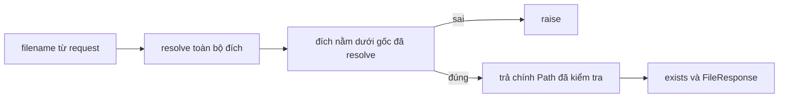
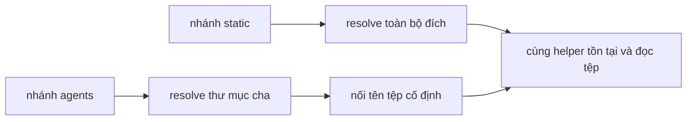

# Hồ sơ rà source bổ sung cho 8 sink

Đây là hậu kiểm đọc mã và thí nghiệm tổng hợp, sau khi đã thấy số lượng bộ lọc.
Không phải reviewer độc lập, lượt rà thứ hai của chủ đề án hoặc một vòng phát triển
quy tắc. Giữ nguyên nhãn đề xuất cũ: **4 FP đề xuất, 4 unknown; 0 nhãn human xác nhận**.
Các trường reviewer/ngày rà vẫn null; `all_reported_flows_reviewed` vẫn false.

Nguồn: [gói scanner gốc](../study-001/RESULTS.md),
[nhãn đề xuất bổ sung](labels.proposed.json), [source audit](source_audit.json),
[quan sát tổng hợp](synthetic_observations.json).

## Bốn nhóm cần rà

| Nhóm | Sink | Đề xuất giữ nguyên | Căn cứ và giới hạn |
|---|---|---|---|
| PC-NORM | pipecat `run.py:215:18` | FP đề xuất | `resolve()` tạo giá trị trước guard; không đọc nội dung tệp. Nó vẫn có thể theo symlink/tra metadata, nên không gọi là không có filesystem I/O. |
| PC-READ | pipecat `run.py:268:16`, `:273:34` | 2 FP đề xuất | Helper resolve cả gốc và đích, kiểm tra containment, trả đúng Path được kiểm tra. Cần phạm vi gốc do server chọn và loại trừ TOCTOU. |
| AA-NORM | atomic `_io.py:110:17` | FP đề xuất | Chuẩn hóa trước `relative_to`; hậu quả đọc/ghi nội dung phải được phân biệt với việc tra metadata. |
| AA-READ | atomic `serve.py:113:16`, `:113:37`, `:141:16`, `:145:23` | 4 unknown | Cùng sink nhận hai dạng đường dẫn: đích được resolve đầy đủ, hoặc thư mục đã resolve rồi nối tên tệp. Dạng sau cần A-SYM cho cả symlink có sẵn. |

Từng unit ID, scope và root cause đề xuất ở `labels.proposed.json`. Không suy số
root cause độc lập từ số sink. Không dùng đề xuất làm mẫu số FP đã duyệt.

## 1. Pipecat: đúng giá trị trả về, cấu hình vẫn có điều kiện

Snapshot `7519c26ac5508573c35fa3a9c4717b013993d129`:

- [`run.py:212–220`](https://github.com/pipecat-ai/pipecat/blob/7519c26ac5508573c35fa3a9c4717b013993d129/src/pipecat/runner/run.py#L212):
  `allowed_base = Path(folder).resolve()`; resolve đường kết hợp, kiểm tra
  `is_relative_to(allowed_base)`, raise nếu sai, trả chính `file_path` nếu đúng.
- [`run.py:260–273`](https://github.com/pipecat-ai/pipecat/blob/7519c26ac5508573c35fa3a9c4717b013993d129/src/pipecat/runner/run.py#L260):
  filename đến từ route; `exists()` và `FileResponse` dùng giá trị helper trả về.
- [`run.py:972,995`](https://github.com/pipecat-ai/pipecat/blob/7519c26ac5508573c35fa3a9c4717b013993d129/src/pipecat/runner/run.py#L972):
  folder được khai báo bằng argparse và đọc từ `parse_args()`.
- [`run.py:301`](https://github.com/pipecat-ai/pipecat/blob/7519c26ac5508573c35fa3a9c4717b013993d129/src/pipecat/runner/run.py#L301):
  `runner_args.cli_args = args` chia sẻ Namespace cho bot callback. Các nhánh khác
  cũng truyền cấu hình này. Không có bằng chứng bất biến toàn chương trình chỉ từ
  việc gốc bắt nguồn từ CLI; mã bot bên ngoài snapshot không được phân giải.



Source test `tests/test_runner_downloads.py` có các kỳ vọng về đường hợp lệ,
parent traversal, đường tuyệt đối và symlink. Chỉ đọc source các test này;
**không chạy chúng và không nhận là chúng đã pass**.

Ba sink bị v0.2 loại vẫn cần chủ đề án rà. Đây không phải phần cải thiện của v0.3.
Không chấp nhận loại nếu gốc thực tế bị request điều khiển hoặc phạm vi không rõ.

## 2. Atomic: hai caller vào cùng sink

Snapshot `ec474f458122c5c0ca718d0df3078c8080338b2c`:

- [`_io.py:96–120`](https://github.com/dep0we/atomic-agents-stack/blob/ec474f458122c5c0ca718d0df3078c8080338b2c/atomic_agents/_io.py#L96):
  `safe_resolve_under` resolve đích/gốc, kiểm tra bằng `relative_to`, raise trước
  return nếu không contained.
- [`serve.py:97–109`](https://github.com/dep0we/atomic-agents-stack/blob/ec474f458122c5c0ca718d0df3078c8080338b2c/atomic_agents/dashboard/serve.py#L97):
  nhánh static-dashboard resolve **toàn bộ đích** rồi truyền giá trị trả về.
- [`serve.py:70–84`](https://github.com/dep0we/atomic-agents-stack/blob/ec474f458122c5c0ca718d0df3078c8080338b2c/atomic_agents/dashboard/serve.py#L70):
  nhánh agents kiểm tra tên, resolve **thư mục cha**, rồi nối `dashboard.html`.
- [`serve.py:111–116,140–145`](https://github.com/dep0we/atomic-agents-stack/blob/ec474f458122c5c0ca718d0df3078c8080338b2c/atomic_agents/dashboard/serve.py#L111):
  helper kiểm tra tồn tại/kiểu tệp rồi đọc; tên `_serve_file_contained` không phải
  một phép kiểm tra containment mới.



Không được truyền kết luận canonical của thư mục cha sang tệp con một cách mặc
định. Tên con cố định/ngắn không loại được symlink có sẵn tại chính tệp con.
A-SYM trong [SPEC.md](../../../v03-interprocedural-guard/SPEC.md) đã bao gồm cả
symlink có sẵn; điều kiện này mạnh hơn chỉ loại trừ race hoặc attacker cục bộ.

### Gốc và phạm vi triển khai

[`dashboard/__main__.py:35–39,60`](https://github.com/dep0we/atomic-agents-stack/blob/ec474f458122c5c0ca718d0df3078c8080338b2c/atomic_agents/dashboard/__main__.py#L35)
chọn gốc từ CLI hoặc `_platform.get_agents_root()`.
[`_platform.py:17–26`](https://github.com/dep0we/atomic-agents-stack/blob/ec474f458122c5c0ca718d0df3078c8080338b2c/atomic_agents/_platform.py#L17)
đọc môi trường/home; [`serve.py:175,188`](https://github.com/dep0we/atomic-agents-stack/blob/ec474f458122c5c0ca718d0df3078c8080338b2c/atomic_agents/dashboard/serve.py#L173)
gán gốc vào handler lúc khởi tạo server. Không đọc lại môi trường ở mỗi GET trong
đường source này. Đó là bằng chứng về vai trò cấu hình, chưa phải chứng nhận triển
khai hoặc quyền giữa người dùng. Host cũng có thể được caller/CLI đổi khỏi mặc định.

Source `tests/test_dashboard_serve_security.py` có các kỳ vọng traversal và đường
hợp lệ, không có ca symlink tại tên tệp con vừa nêu. Đây là nhận xét từ đọc source,
không phải kết quả chạy test hoặc phép thử ứng dụng.

## 3. Quan sát tổng hợp hậu kiểm

Chỉ tạo tệp/marker của thí nghiệm trong workspace. “Ngoài gốc” bên dưới vẫn nằm
trong thư mục thí nghiệm đó; không đọc dữ liệu người dùng ngoài workspace.

| Tình huống | Quan sát |
|---|---|
| Resolve toàn bộ đích là tệp thường | Cho phép, đọc marker trong gốc |
| Resolve toàn bộ đích qua symlink có sẵn ra ngoài | Guard từ chối, không đọc nội dung |
| Resolve cha rồi nối tên con là symlink có sẵn | Guard cha chấp nhận; đường dùng chỉ contained từ vựng, đọc marker ngoài gốc |
| Resolve cha rồi nối tệp con thường | Đích thực trong gốc |
| Thay tệp sau kiểm tra canonical | Có thể đọc marker ngoài gốc; đây là thay đổi sau kiểm tra, thuộc TOCTOU bị loại khỏi mô hình |

Các kết quả **không phải kiểm thử end-to-end**, không chứng minh có khai thác trên
triển khai nào, và không được tính là ca kiểm chứng độc lập của quy tắc v0.3.
Không thêm chúng vào tập phản ví dụ/kỳ vọng đã khóa hoặc sửa QL theo chúng.

## 4. Phạm vi audit và kết quả chấm nhãn đề xuất

- 266 + 829 = 1.095 tệp `.py` từ hai archive được đọc/parse AST; không lỗi parse.
  Từng tệp khớp byte với bản đã giải nén. Hash archive và file được lưu.
- Audit ghi các lần xuất hiện tên/thuộc tính/import, **không phân giải đầy đủ caller
  động**, monkeypatch hay mã bot bên ngoài. Đây không phải CodeQL codeFlows.
- Metadata đã lưu của cả 7 repository: không fork, không có parent/source, không
  trùng định danh loại trừ sau chuẩn hóa. Màn exact-byte trước đó không thấy file
  >=512 byte dùng chung giữa các snapshot mới. Near-duplicate ngữ nghĩa vẫn pending.
- Evaluator nguyên bản nhận `labels.proposed.json`; không có nhãn nào thành final.
  Count/raw suppression không đổi; FP rate đã xác nhận vẫn N/A. Không thay báo cáo
  scanner gốc, nhãn cũ hoặc manifest phương pháp.

## Phần cần chủ đề án thực hiện

Đọc [packet trung lập gốc](../study-001/evaluation/review_packet.json) và điền một
bản nhãn mới theo [REVIEW_GUIDE.md](../study-001/REVIEW_GUIDE.md). Bốn nhóm trên giúp
rà tám sink, không thay thao tác rà của chủ đề án. Không đặt all-flows=true chỉ vì
đã xem sơ đồ nguồn/đích; cả tám SARIF vẫn thiếu codeFlows.

Ưu tiên ba phép loại pipecat. Với atomic, cần phân biệt bằng chứng canonical của
đích với bằng chứng của cha và nêu rõ phạm vi A-SYM. Nếu không đủ bằng chứng thì
giữ unknown. Phần xác nhận hiệu quả v0.3 không thể được tạo bằng cách duyệt đề xuất:
raw incremental suppression đã bằng 0, bất kể nhãn sau này.

## Tái lập các bước bổ sung

Từ gốc repo, dùng thư mục output mới và cache source đã khóa:

```powershell
python experiments/wave-c/results/review-001/tools/collect_review_source.py --output artifacts/wave-c/source-audit-reproduce-001
wsl -d Ubuntu --exec python3 /mnt/d/github/security-triage/experiments/wave-c/results/review-001/tools/observe_review_boundaries.py --workspace /mnt/d/github/security-triage --output artifacts/wave-c/review-boundaries-reproduce-001
python experiments/wave-c/evaluate.py --run experiments/wave-c/results/study-001/evaluation_run.json --labels experiments/wave-c/results/review-001/labels.proposed.json --output artifacts/wave-c/proposed-labels-reproduce-001
```

Thư mục đầu ra phải chưa tồn tại. Không import/chạy source của ứng dụng; không chạy
scanner. `REVIEW_LOCK.sha256` giữ riêng bằng chứng bổ sung, không thay khóa gói gốc.
